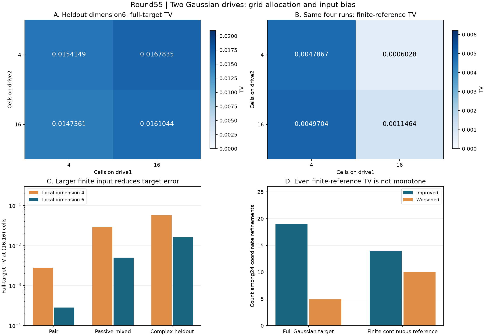

# 第55轮：双Gaussian驱动、一般双模输入与网格分配

日期：2026-11-10。本轮从一个共同噪声变量推进到两个独立Gaussian驱动，并加入被动混合后的双模输入。24项预声明实验包含8项复参数留出，完整核验3456个位移节点和24184个测量树节点。噪声的实相空间秩为2，尚非双模满秩4噪声。

## 1. 单轴细化连有限连续参照也不保证单调改善

对三个输入族、局部维数4和6，分别执行内部格数(4,4)、(16,4)、(4,16)、(16,16)。每轴另含两个尾部边界节点，乘积节点数分别为36、108、108、324。

24次单轴细化对完整Gaussian目标为19改善、5退化；对同一有限存储态的连续积分参照为14改善、10退化。所有判断使用完整概率律的严格区间，不使用抽样估计。

例如未旋转配对输入、局部维数6，从(16,4)改为(16,16)，节点数108增至324，但完整目标TV从0.000273067740增至0.000282531698，有限连续参照TV从0.000282009808增至0.000406977556。保守耦合上界仍下降；上界收紧与实际误差单调下降是不同命题。

逐原子精确记录两轴改动Δ1、Δ2及交互项I，核对Q11=Q00+Δ1+Δ2+I。六组输入均存在异号改动及半L1抵消。复参数留出、维数6时，第一轴细化使联合真空概率增加约0.001368576828，第二轴细化使其减少约0.000678810552，交互向量半L1约0.000003145035。这是实际程序概率变化的抵消证据，没有把纯连续误差拆成两个独立轴贡献。

## 2. 相同节点预算可能选出不同方向

六组108节点对照中，(16,4)对有限连续参照全部优于(4,16)，但对完整Gaussian目标只有四组更好；两个复参数留出恰好相反。维数6留出如下：

| 内部格数 | 节点数 | 完整目标TV | 有限连续参照TV |
|---|---:|---:|---:|
| (4,4) | 36 | 0.01541487889 | 0.004786743261 |
| (16,4) | 108 | 0.01678345572 | 0.0006028494724 |
| (4,16) | 108 | 0.01473606834 | 0.004970371779 |
| (16,16) | 324 | 0.01610443478 | 0.001146427990 |

该有限连续参照距完整目标TV约0.01725086277。资源分配若只优化有限参照，可能牺牲完整目标的接近程度。这里仅控制节点预算，未证明运行成本相同，也未提出普适最优分配规则。

## 3. 增大输入维数的12组配对全部改善

本面板的局部维数4→6配对全部降低完整目标TV。在(16,16)配置下：

| 输入族 | 维数4 TV | 维数6 TV |
|---|---:|---:|
| 配对态 | 0.002731944440 | 0.0002825316981 |
| 被动混合 | 0.02885555569 | 0.004994136970 |
| 复参数留出 | 0.05849356950 | 0.01610443478 |

被动混合矩阵U=[[3/5,4/5],[-4/5,3/5]]的正交性及B→UBUᵀ精确核验。有限输入从完整小Fock盒系数构造，再以普通矩阵SVD保留全部奇异值；实际binary64张量及无限输入误差均认证。这不是Gaussian-SVD/PCO的大规模构造实现，也没有单独识别键截断收益。

## 4. 解析参照、独立核验与证据保存

生产算法对真空振幅的多变量多项式使用Gaussian Wick递推积分；独立算法由占据密度双和建立平方自由根多项式，并使用二元矩显式组合式和256位二分根。逐项核对矩、归一化及完整阈值律，不进行数值积分或位移后光子截断。

旧26项秩1参照全部回归。六个新输入各四个固定节点与原密度双和算法逐根系数相同，共24项直接控制；其后全部3456节点以该独立多项式求值审核。完整程序律包括失败项，本面板失败质量均为零；固定种子公开样本用于回放而非TV估计。

原节点JSON共174,086,828字节，gzip后37,646,706字节，约4.62倍缩减。六组输入首次建立参照，另外18项复用相同输入参照，全部节点仍计算并保存。非隔离阶段计时仅为观测，不作为吞吐排名。

**166,715项核验通过**：完整双驱动审核166054项、回归及密度控制455项、比较206项。全库699项运行、670项通过、0失败、0错误；新增12项通过，既有29项用例和7个类跳过保留。所有本轮科学源码、绘图和封存脚本均在全库测试前完成，源码及快照不变。

## 5. 前沿比较和继续方向

本轮重新核对Frugal、GSVD/PCO、热损耗理论及九章4.0原始来源，详见[先进工具与九章对照](research/iteration55_frontier_comparison.md)。进展是多个噪声变量下的完整认证和资源分配诊断；尚无完整144模TV上界、官方算法匹配质量的速度排名或九章规模模拟结论。

参见[预声明实验](research/iteration55_noise_plan.md)、[推导与复现](research/iteration55_methods.md)、[下一轮多方向计划](research/iteration56_plan.md)。后续继续推进实际144模边缘、全局误差界、更紧的多驱动耦合界及输入预算分配。
