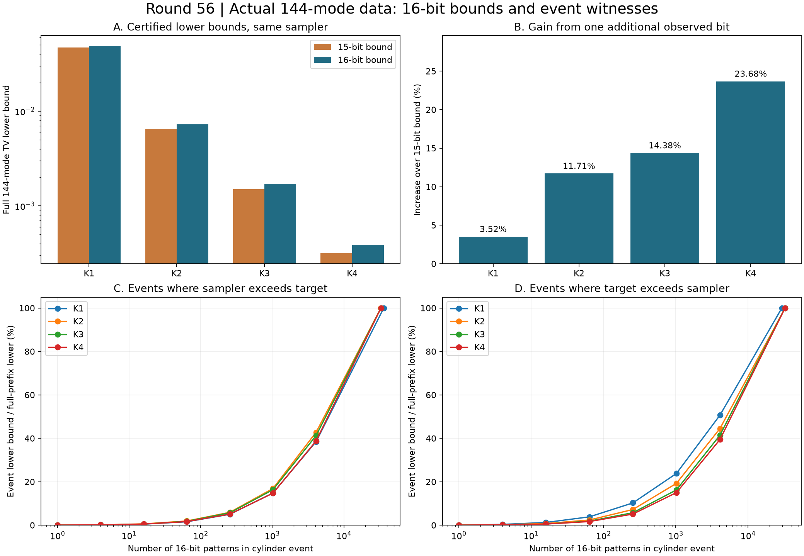

# 第56轮：实际144模十六位边缘与分散误差见证

日期：2026-11-10。本轮将实际144模输入的完整边缘从15位扩到16位，保留同一抽样器、CSV、K1..4、固定种子公开输出与旧前缀路径。新增32768个物理子集证书，并提取稀疏柱事件及逐父分支的误差抵消证据。

## 1. 四个阶数的整体下界全部加强

| 截断阶数 | 旧15位整体TV下界 | 新16位整体TV下界 | 增幅 |
|---|---:|---:|---:|
| K1 | 0.04705842562 | 0.04871692706 | 3.52% |
| K2 | 0.006478410708 | 0.007236779100 | 11.71% |
| K3 | 0.001497444660 | 0.001712764545 | 14.38% |
| K4 | 0.0003151465891 | 0.0003897686993 | 23.68% |

下界表示完整144模程序律与精确物理Gaussian目标之间至少存在的差距，并非新的抽样误差估计值，也不是上界。抽样器未改变，增强的是检测偏差的证据。扣除既有约0.000008507545的整体目标转移界后，对原shifted目标的下界分别为0.04870841952、0.007228271555、0.001704257000、0.0003812611543。

全部65535个非空子集的数学证书重新独立核验。生产整数Mobius变换的524288次区间减法与独立43046721项容斥在全部65536原子上相等；旧15位32768原子也重新容斥并逐项保持原区间。68个公开输出、9792步路径及四棵树的旧32767节点不变。

## 2. 第16位揭示哪些被合并掩盖的偏差

同一个15位父分支下，新增位为0、1的两个概率差记为x、y。观测这一位增加的TV恰为(|x|+|y|−|x+y|)/2：同号时为零，异号时为两者绝对值中的较小值。逐父保存精确区间并独立核验这个分解。

| 阶数 | 认证异号父分支数／32768 | 第16位TV增量（约） |
|---|---:|---:|
| K1 | 5424 | 0.001658501440 |
| K2 | 9303 | 0.0007583683925 |
| K3 | 10216 | 0.0002153198856 |
| K4 | 12638 | 0.00007462211016 |

K4有约38.57%的父分支包含这种抵消，说明旧边缘合并掉了较多偏差信息。该比例不是独立事件频率，也不能直接解释为抽样概率质量。用旧较窄15位区间传播新分支增量，仅另收紧约10⁻²⁸的数值包围；23.68%的下界增幅来自新增信息，非数值精度变化。

## 3. 少量模式难以保留大部分证据

预先固定事件预算1、4、16、64、256、1024、4096及全部正差原子。分别按程序超过目标、目标超过程序的认证单原子差值选取最强模式；每个模式限制前16位，其余128位任意，形成完整144模柱事件。

K4事件下界与完整16位下界之比为：

| 模式数 | 程序超过目标一侧 | 目标超过程序一侧 |
|---|---:|---:|
| 1 | 0.0452% | 0.0410% |
| 16 | 0.5213% | 0.5191% |
| 256 | 5.1119% | 5.1257% |
| 1024 | 14.7411% | 15.0130% |
| 4096 | 38.7492% | 39.4582% |

这是一项不利于“少数模式就能保留大部分误差证据”的结果，完整保留。两侧全部正差模式数分别32988、32548；合计覆盖65536原子。该结论针对本输入和这类单侧模式并集，不能排除其他结构化事件的效率。

事件选择在完整概率律计算后完成，未节省本轮全律构造成本；所谓“最强”仅指逐原子区间给出的加性认证保证。表中是两个下界之比，不是已知完整144模实际误差的占比。

## 4. 成本与验证

新增证书展开JSON共1,627,834,633字节，紧凑JSON为359,368,969字节，无损gzip后119,471,851字节，约13.63倍缩减。逐父分支证据原JSON共429,120,500字节，gzip后91,294,988字节。原生stdout及完整程序律从341,558,595字节压缩到86,385,922字节。所有原字节摘要、源码快照和数学见证均保存。

目标生成观察到约328.29秒，其中新增子集约146.60秒、整数变换约1.73秒、紧凑编码与保存约151.03秒。K4原生程序前缀枚举约8.34秒，整个调用及证据处理约177.91秒；大部分原生准备成本仍在目标构造。生产和审核存在并行活动，不能把这些时间当作隔离或匹配质量吞吐基准。

**1,706,575项核验通过**：主审核1,312,992项，事件与分支独立审核393,396项，比较187项。全库707项运行、678项通过、0失败、0错误；新增8项通过，既有29项用例及7个类跳过保留。所有本轮科学源码、绘图与封存脚本均在全库测试前完成，测试后没有新增源码例外。

## 5. 前沿和继续方向

已重新核查Frugal官方版本、Gaussian-SVD/PCO、热损耗理论与九章4.0，详见[前沿比较](research/iteration56_frontier_comparison.md)。本轮给出144模输入的16位边缘证据，未模拟九章4.0的8176模实验，也没有完整144模TV上界或匹配质量的速度排名。

参见[预声明计划](research/iteration56_prefix_plan.md)、[证明与复现](research/iteration56_methods.md)、[下一轮方向](research/iteration57_plan.md)。继续重点研究完整误差上界、直接事件认证成本、多驱动耦合界和可扩展输入构造。
