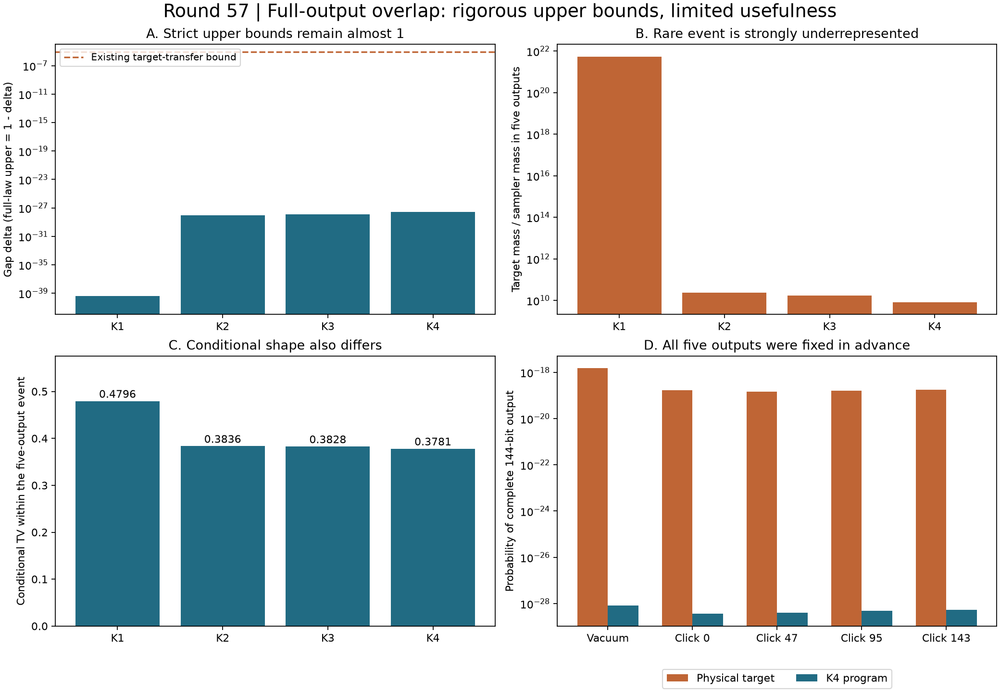

# 第57轮：完整输出上界及其局限，稀有事件偏差

日期：2026-11-10。本轮直接认证少量完整144位输出的共同概率质量，得到严格的完整分布TV上界。但这些上界极接近1，尚不能给出实用精度保证。另对同一组预先选定输出发现明显的相对概率及条件形状偏差。

## 1. 获得完整上界，但实用问题仍未解决

五个输出在计算前固定：全零，以及只在模式0、47、95、143点击的四个输出。每个输出指定全部144位。由TV(P,Q)=1−Σmin(P,Q)，选定输出的认证共同质量δ给出TV≤1−δ。

| 阶数 | 认证δ，约值 | 物理目标完整上界的形式 |
|---|---:|---|
| K1 | 3.978549300×10⁻⁴⁰ | 1−δ |
| K2 | 8.988889092×10⁻²⁹ | 1−δ |
| K3 | 1.272498391×10⁻²⁸ | 1−δ |
| K4 | 2.614124910×10⁻²⁸ | 1−δ |

表中δ显示为近似值，完整上界使用存档的精确有理数。普通双精度会把这些上界显示成1，不能因此丢弃δ或夸大它的约束力。加入既有约8.507545×10⁻⁶的目标转移界后，四个shifted目标上界全部封顶为1。

第56轮K4整体下界约0.0003897686993保持不变，因此目前上下界仍相距极大。这里补齐了完整输出上界的认证方法，没有解决任意精度或实用精度采样问题。

## 2. 稀有输出的相对偏差很大，绝对质量却极小

这五个输出在物理目标中的总概率约2.129064877×10⁻¹⁸。四个程序都低估了其中每一个输出，总质量及条件形状如下：

| 阶数 | 目标总质量／程序总质量，约 | 限定五个输出后的条件TV，约 |
|---|---:|---:|
| K1 | 5.35136×10²¹ | 0.479609 |
| K2 | 2.36855×10¹⁰ | 0.383607 |
| K3 | 1.67314×10¹⁰ | 0.382784 |
| K4 | 8.14446×10⁹ | 0.378134 |

例如全零输出的物理概率约1.484633099×10⁻¹⁸，K4程序概率约8.343830096×10⁻²⁹。提高阶数改善了这组输出的概率与条件形状，但仍存在很大的相对偏差。

这些条件TV只在极罕见事件内部计算，不能作为无条件144模误差。整个五输出事件给出的绝对TV下界仅约2.129×10⁻¹⁸，远弱于已有16位边缘下界。稀有事件相对误差很大与常见统计接近并不矛盾。相对误差诊断在结果出现后追加，但没有重新挑选事件；全部五个预声明输出均分析并保存。

## 3. 直接路径方法及十模完整控制

新适配器保留官方生成器、旧生成钩子、编译器和运行库。完整指定路径函数由原前缀函数有限改写记录行为，概率递推不变。每条144模路径用原函数检查五个深度，并反序重放；公开样本的完整路径也逐步保持旧结果。

十模控制直接追踪全部1024个输出，uint64字模型与连续均匀模型都与旧完整树重建律逐项完全相同。十模K4完整TV约0.000057335347991。合计1044条完整指定路径、13120步新路径、12362步公开路径及1124个原前缀函数检查点。

五个144模物理概率只需全真空及四个143模真空概率；通过单击差分求得，不枚举2^144输出。七份矩阵证书重新独立审核，包括共享核心、噪声及五个局部包围。此捷径依赖零或一次点击，不能外推为任意高点击概率的低成本计算。

## 4. 验证、成本和保留的更正

39,027项科学核验通过：路径及构建37635项，物理目标177项，共同质量比较1131项，稀有事件84项。全库715项运行、686项通过、0失败、0错误；新增8项通过，既有29项用例和7个类跳过保留。所有本轮Python源码及绘图恢复在全库测试前完成；原生适配器通过独立构建与完整路径审核。测试后没有新增源码例外。

新适配器构建约22.60秒，五个物理输出证书共约35.23秒。K4原生目标准备约114.59秒，路径检查约23.42秒，整次运行约164.37秒。路径检查包含旧函数控制、反序重放及公开样本回归，不是纯抽样时间；所有计时为非隔离观察。

原计划把“精确目标下的共同质量恒等式”错误推广为“区间目标的两种上端必相等”。在完整输出聚合前写入[数学更正](research/iteration57_interval_note.md)，原计划保留；新控制比较两种严格包围并取交。首次图表图例遮挡柱顶，原图与拒绝记录保存，恢复图在全库测试前完成。所有正式科学输出均保留且不覆盖。

## 5. 前沿和继续方向

已重新核对官方Frugal、Gaussian-SVD/PCO、热损耗理论和九章4.0，详见[前沿比较](research/iteration57_frontier_comparison.md)。本轮没有九章规模或匹配质量速度结论。完整输出上界虽已形式上成立，实用误差上界仍是主要未解问题。

参见[预声明](research/iteration57_overlap_plan.md)、[证明与复现](research/iteration57_methods.md)、[持续方向](research/iteration58_plan.md)。整体探索继续。
