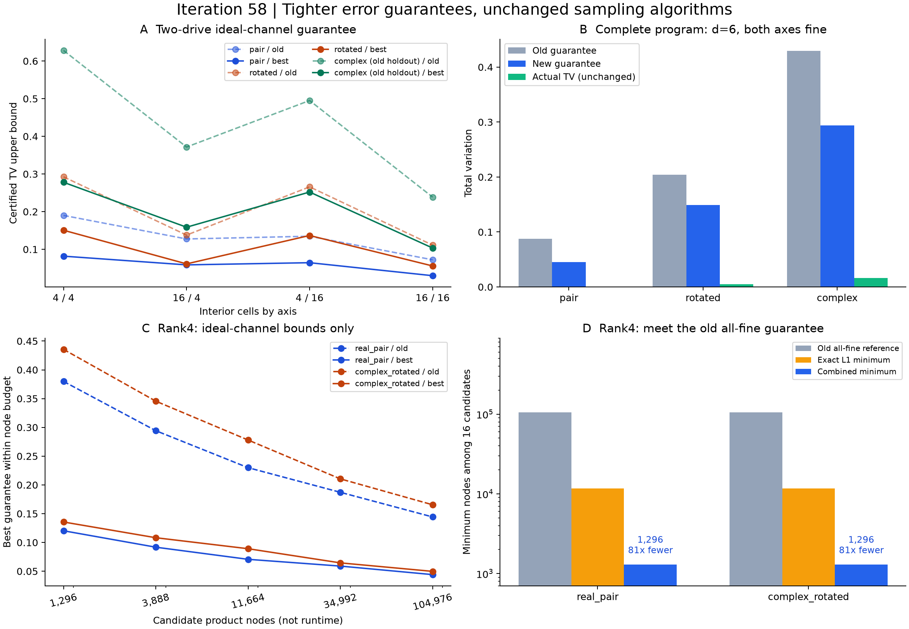

# 第58轮：联合位移误差保证与网格预算

日期：2026-11-10。新增精确量化残差矩及联合纯Gaussian位移耦合界，56项配置的组合上界全部优于旧界。两驱动6组完整程序以108节点达到原324节点的认证目标；两个秩4理论输入以1296节点达到原104976节点的理想噪声认证目标。后者是81倍候选节点数差，不是实测运行提速或同实际误差的加速。

## 理论与实现

对独立中心Gaussian驱动和各轴对称边界量化，残差δ_a独立、零均值。纯Gaussian输入的位移生成元Gram矩阵为Γ，平方重叠为exp(−δᵀΓδ)。由迹距离凸性、测量收缩和Jensen不等式，得到

`TV ≤ √(1−exp(−Σ_a Γ_aa Eδ_a²))`。

同时解析计算精确一阶绝对矩，使用Σ_a√Γ_aa E|δ_a|作为另一上界。最终取新一阶界、联合二阶界、RMS界和旧粗界的最小值。理论条件、保真度约定及公式来源见[方法说明](research/iteration58_methods.md)。它是已有Gaussian重叠公式的应用与认证实现，不声称新保真度定理或最优误差界。

## 第55轮两驱动结果的回顾性比较

全部24项原始程序律、目标分布、输入桥接、选择器和测量算术误差复用并校验原始哈希，仅替换理想噪声的量化耦合项。旧留出不是本轮新留出；局部维数4与6共享同一理想输入和量化耦合值，因此24项中只有12种不同理想耦合配置。

- 组合耦合上界24/24收紧，相对下降48.50%—58.52%；完整程序上界下降17.26%—52.62%。
- 联合二阶界在18/24项胜过精确一阶界，精确一阶界在另外6/24项更好；按不同理想耦合配置计为9/12与3/12。
- 6组均可用108节点达到旧324节点完整程序上界，候选节点数减为三分之一。单独使用精确一阶界也能达到同样节点预算；这部分成本改善不全归因于联合界。
- 等108节点时，新旧界都选择先细化第一轴。实际TV在4/6组支持该选择，复相位族的另外2组仍更偏好第二轴。最小上界不等于最小实际误差。

以下是局部维数6、双轴全细网格的完整程序结果：

| 输入族 | 旧完整程序TV上界 | 新完整程序TV上界 | 实际TV（保持不变） |
|---|---:|---:|---:|
| 实配对 | 0.08782664 | 0.04557648 | 0.000282532 |
| 旋转实配对 | 0.20452370 | 0.14918071 | 0.004994137 |
| 复相位旧留出 | 0.42934759 | 0.29411516 | 0.016104435 |

保证明显收紧，但与实际误差仍有距离；完整程序还受到有限输入近似等误差的限制。

## 两个新秩4理论输入

每个输入只有两个物理模式，四个独立实方向覆盖两模完整实相空间。两输入各16种候选网格，共32种配置；不是32个独立物理输入，也没有执行秩4完整采样程序。所有32项联合二阶界都优于精确一阶界，组合界较旧粗界降低61.01%—69.93%。

| 输入 | 旧全细理想上界 | 新全粗理想上界 | 达到旧目标的节点数：旧/精确一阶/组合 |
|---|---:|---:|---:|
| 实配对λ=1/3 | 0.14431995 | 0.12031728 | 104976 / 11664 / 1296 |
| 复相位旋转λ=2/5 | 0.16548144 | 0.13557121 | 104976 / 11664 / 1296 |

候选集合中，组合保证所需节点是旧全细参考的1/81、精确一阶保证的1/9。较粗网格实际误差仍未计算；这个结果说明旧界保守程度很大，不能称为实际精度提升81倍。

在预声明11664节点预算下，实配对选(4,16,16,4)，上界0.07070112；复相位旋转选(4,4,16,16)，上界0.08913639。新旧界选轴一致，未出现优化方向逆转。完整资源记录见[候选选择](results/iteration58_comparisons/resources.json)。

## 验证与证据边界

8种轴参数的所有格、两条无穷尾和总矩，用独立原始矩展开、正项级数、独立π和有理二分根重新验证；从配对矩阵重新构造纯态协方差并检查两种Γ表达式。独立数学核验1608项、预算与比较核验155项，共1763项全部通过。

全库727项运行、698项通过、0失败、0错误；新增12项通过。保留29个用例跳过及7个类级跳过，所以不称作无跳过的全量通过。所有实验源码纳入测试开始快照，没有测试后新增实验代码。图表已检查，原始输出和源码拒绝覆盖。

生产8.73秒、独立核验246.29秒是本机本次观察，未经隔离重复测试，不作为算法速度比较。节点成本不含建立输入态、误差认证和实际采样开销。

与[Frugal、Gaussian-SVD/PCO、热损耗理论及九章的对照](research/iteration58_frontier_comparison.md)已更新；本轮没有外部工具新运行、实用144模整体TV上界或九章规模同质量速度结论。下一步优先落实秩4完整程序和解析连续参照，同时继续144模事件质量与MPS预算方向，见[持续计划](research/iteration59_plan.md)。

## 证据入口

- [冻结预声明](research/iteration58_coupling_plan.md)
- [生产摘要](results/iteration58_coupling/summary.json)、[24项回顾性结果](results/iteration58_coupling/retrospective_rows.json)、[32项秩4理论配置](results/iteration58_coupling/rank4_rows.json)
- [独立验证](results/iteration58_coupling_validation/validation.json)、[比较摘要](results/iteration58_comparisons/summary.json)、[测试结果](results/iteration58_tests/validation.json)
- [完整产物清单](results/iteration58_manifest.json)、[GitHub发布回执](research_archive/publication/verification_iteration58_2026-11-10.json)
