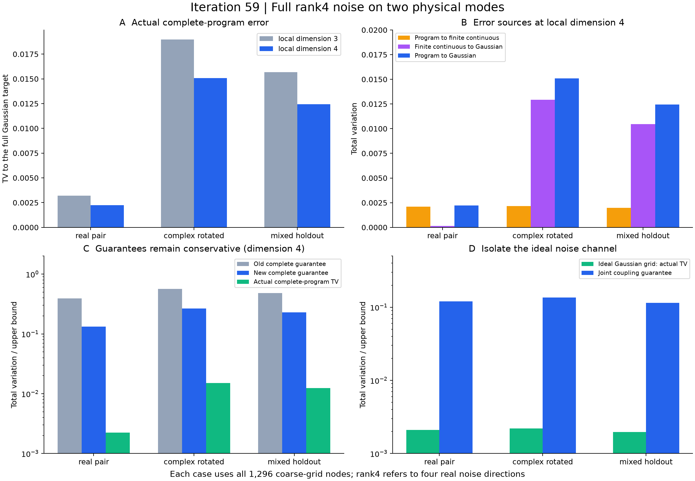

# 第59轮：秩4完整采样程序与连续参照

日期：2026-11-10。已将第58轮的秩4理想误差保证推进到完整两模程序：三个物理输入、各局部维数3和4，共6项实验，完整核验7776个位移节点及42768个测量树节点。三组维数3→4的实际TV均下降，改善因子1.26—1.43。新混合方向输入通过非对角多变量矩验证。

## 实际误差与主要来源

所有实验使用四独立Gaussian驱动，每轴4个中点和2个边界尾节点，共1296节点。秩4是两个物理模式的完整实相空间噪声，不是四模式实验。实配对、复相位旋转来自第58轮；混合方向族是本轮唯一新物理输入留出，其两个局部维数不算两份独立留出。

| 输入 | d3实际TV | d4实际TV | d4程序到有限连续参照TV | d4有限连续参照到Gaussian目标TV |
|---|---:|---:|---:|---:|
| 实配对 | 0.00319105 | 0.00222889 | 0.00210912 | 0.000136684 |
| 复相位旋转 | 0.01898917 | 0.01509116 | 0.00215991 | 0.01293125 |
| 混合方向新留出 | 0.01566597 | 0.01244108 | 0.00197500 | 0.01046608 |

有限输入维数增加后，三组到有限连续参照及到完整Gaussian目标的距离均下降，但前者仅小幅变化。实配对更值得继续细化位移网格；两个复相位族仍由有限输入近似误差主导，更值得先评估更大的局部维数。这个判断针对当前三个输入及网格，不是普遍调参定理。

实配对的两段误差有抵消：三角余量分别约0.000151480和0.000016910，各有两个输出的误差方向认证相反。其余四项未解析出非零余量，区间上端约1.2×10⁻⁵⁷。所有分项来自完整概率律，不来自7个校准样本；不能简单把两段TV之和当作实际TV。

## 理想网格与保证

三个理想Gaussian网格到连续Gaussian目标的TV依次约0.00210879、0.00220969、0.00196089。对应联合耦合保证约0.12031728、0.13557121、0.11447228；虽然严谨，仍较保守。

| d4输入 | 旧粗界完整预算 | 新组合完整预算 | 实际TV |
|---|---:|---:|---:|
| 实配对 | 0.39223574 | 0.13266295 | 0.00222889 |
| 复相位旋转 | 0.56725760 | 0.26723586 | 0.01509116 |
| 混合方向新留出 | 0.48436779 | 0.22974572 | 0.01244108 |

前两输入的完整理想耦合对象、协方差和生成元Gram与第58轮全粗配置完全一致。本轮现在有了粗网格实际误差，但没有运行对应全细程序，因而仍不能把第58轮81倍候选节点差称为同实际精度的实测提速。

## 新增能力与验证

新模块将解析有限态Gaussian积分支持范围扩到最多四驱动，保留旧模块冻结。生产端沿用多项式/Wick递推；独立端用密度矩阵双重求和、多项展开和配对数矩阵公式，不复用Wick递推。完整连续积分无数值求积或输出光子截断。

输入为完整小Fock箱的binary64归一化和常规全SVD，所有d个奇异值保留，不是Gaussian-SVD/PCO。公开采样器的固定7样本回放全部相同；概率律结论限定于独立均匀53位随机字模型，不声称有限种子PRNG全周期精确分布。全部6项失败质量为0。

- 326189项主体核验：输入与物理目标、连续积分、全部节点、完整程序路径及误差预算。
- 625项控制：26项旧秩1、24项旧秩2参照，以及12个预先固定节点的原始直接密度对照。
- 39项比较检查；合计326853项全部通过。
- 全库740项运行、711项通过、0失败、0错误；新增13项通过。既有29个用例和7个类级跳过保留，不称作无跳过的全量通过。

原始节点JSON共336098435字节，无损压缩后71236104字节，约4.72倍缩减。六项生产总计约59.40秒是本机一次观察，包含准备、完整概率计算及存储；不当作采样吞吐或外部工具速度基准。源码均在计算/测试开始时快照冻结，没有测试后新增实验代码。

## 外部对照与继续方向

[Frugal、Gaussian-SVD/PCO、热损耗理论和九章对照](research/iteration59_frontier_comparison.md)已重新核对。当前仍是小系统精确验证，没有九章规模或同质量速度结论；144模整体实用上界仍未解决。

下一步按误差来源比较网格细化和有限输入维数预算，同时保留144模事件质量、MPS与外部构造方向，见[持续计划](research/iteration60_plan.md)。

## 证据入口

- [预声明](research/iteration59_noise_plan.md)、[方法与复现](research/iteration59_methods.md)
- [生产结果](results/iteration59_noise/rows.json)、[主体核验](results/iteration59_noise_validation/validation.json)、[回归控制](results/iteration59_controls/validation.json)
- [维数配对](results/iteration59_comparisons/dimension_pairs.json)、[误差分项](results/iteration59_comparisons/error_decomposition.json)、[全库测试](results/iteration59_tests/validation.json)
- [产物清单](results/iteration59_manifest.json)、[远端发布回执](research_archive/publication/verification_iteration59_2026-11-10.json)
