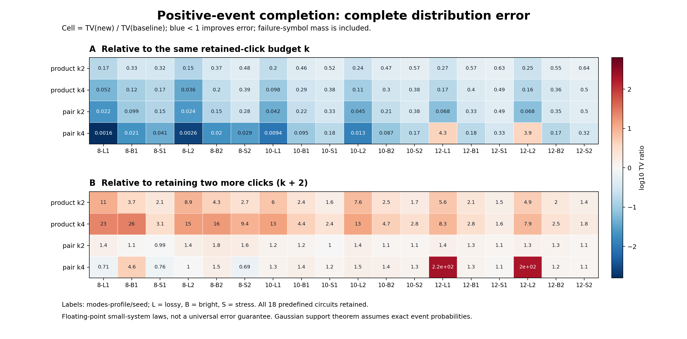

# 第六轮：补回遗漏点击的条件信息

日期：2026-11-04。项目：量子 / deziroGBS。基于第五轮提交 `d0b57b3996c5f87370634aac3fc80db33ad72bd7`。

## 1. 结论与下一步决定

**本轮找到了一条有明确概率含义的改进方向，但当前不相交分块方案没有战胜更强的保留点击基线。** 在预先固定的 18 个小规模输入、126 个完整分布评估中，逐个补回遗漏点击的信息，在相同保留预算 k 下全部降低 TV；两两补全通常改善更多。然而，只要把基线改为直接保留 k+2 个点击，大多数补全方法就失去优势。两个低亮度案例还暴露了浮点消去问题，失败质量已计入主结果。

这不是原地重复第五轮的缓存优化。本轮改变了条件采样概率，推导了适用于精确 Gaussian 阈值概率的支持保持性质，定位了控制全局误差真正需要的相关性残差，并用完整 P/Q 检验具体近似。它仍没有给出任意 GBS 输入的低复杂度、固定全局 TV 算法，也没有建立方法新颖性。

**已决定直接进入第七轮条件依赖树探索。** 原因是：遗漏信息有价值，但只保留互不相交的两两相关性仍不足。下一轮用固定链和固定无条件互信息最大生成树连接遗漏点击，保留相同 k 的分块对照和更强 retained-k+2 基线；不在本轮结果上拟合补偿系数。第六轮的全部结果和失败记录冻结保留。

## 2. 为什么改变研究方向

第五轮实现了不改变候选采样律 Q 的前缀缓存，但大型高亮度输入的质量问题仍存在。同一批数据的事后 Clopper–Pearson 精化，在 256 模式 bright 输入上给出 TV 下界 0.1066718524，超过当时的 0.1 目标。该下界不是完整 TV，也不是新独立数据；它足以说明仅加速旧 Q 不会修复这一案例的偏差。[第五轮报告](RESEARCH_REPORT_ITERATION5.md)

旧规则保留全部历史零结果，却只保留至多 k 个历史点击。这里将“被遗漏的正事件如何影响当前位”写成显式 Bayes 似然，再考察能以多小的局部结构近似它。研究目标从缓存命中率转向了概率近似误差。

文献也要求区分适用条件。噪声 GBS 的高效可模拟充分条件、低纠缠 Gaussian MPS 的键维数依赖、Frugal 的有限阶近似，均不等于所有九章实例的已证明经典成本上限。已有 Bayes/树增强分类模型已经包含本轮使用的乘积及森林因子分解思想。本轮不将公式改写本身称为原创算法。具体原始来源、代入计算与适用边界见[文献审查](research/iteration6_literature.md)。

## 3. 条件补全公式

记当前待采样位为 Y。历史零集合为 Z，精确保留的历史点击为 R，遗漏的历史点击为 F。令

\[
B=\{X_Z=0,X_R=1\},\qquad
p_a=P(Y=a\mid B),\qquad a\in\{0,1\}.
\]

精确下一位概率为

\[
P(Y=a\mid B,X_F=\mathbf1)
=\frac{p_aP(X_F=\mathbf1\mid Y=a,B)}
{\sum_{c=0}^1p_cP(X_F=\mathbf1\mid Y=c,B)}.
\]

把 F 划分为不重叠块 \(\mathcal G\)，每个块的宽度不超过 b，得到本轮近似：

\[
s_a=p_a\prod_{G\in\mathcal G}P(X_G=\mathbf1\mid Y=a,B),
\qquad \widetilde p_a=\frac{s_a}{s_0+s_1}.
\]

`product` 使用单点块；`pair_block` 按测量顺序把遗漏点击两两配对，剩余一个点单独成块。所有遗漏点击均被覆盖，不删除困难事件，不向零概率添加 epsilon。保留集 R 仍由第五轮的 `click_influence` 规则选择，没有为本轮结果改动选择器。

实现直接计算联合事件质量

\[
w_a=P(B,Y=a),\quad u_{a,G}=P(B,Y=a,X_G=\mathbf1),
\]

并在 log 域使用

\[
\log s_a=(1-|\mathcal G|)\log w_a+\sum_G\log u_{a,G},
\]

其中省略了在 a=0、1 间共同抵消的因子。最终只归一化两个分支，不重新归一化一次实验的成功样本。singleton 在 |F|≤1 时精确；pair 在 |F|≤2 时精确。更多块若在给定 (Y,B) 后条件独立，也精确，但一般 Gaussian 输入不满足这一假设。

## 4. 理论上已经确定的边界

### 4.1 支持保持：精确阈值概率有较强性质

对有限、可归一化的零均值 Gaussian 态，先将任意指定零结果投影到真空。剩余指定模式集合 S 同时点击的概率大于零，当且仅当每个选中模式分别不是严格真空。

一个证明从纯 Gaussian 态的 Bargmann 形式开始：

\[
f(z)=c\exp\!\left(\tfrac12z^TAz\right),\qquad \|A\|<1.
\]

S 中所有模式至少含一个光子的振幅不全为零，等价于 \(\partial_S f\) 不是零函数。写 \(\partial_Sf=H_S(z)f(z)\)，其最高齐次项为

\[
\prod_{j\in S}(Az)_j.
\]

若每个对应行非零，多项式整环中该乘积非零，较低次数项不能将其抵消；若某行严格为零，该模式为真空。混态通过 Gaussian 纯化处理；零结果投影继续保持 Gaussian 结构。这里没有将正点击投影后的态误当成 Gaussian。

因此，在全部历史零保留、所有遗漏点击被块覆盖、局部事件概率精确的条件下，补全规则与真实下一位分支具有相同零/非零支持，可归纳得到完整采样律的支持保持。完整论证和限定见[独立理论审查](research/iteration6_theory_audit.md)。

**支持正确不代表权重准确。** 该论证不提供 TV 上界，也不保证浮点包含排除能可靠地区分极小正数和零；它不直接扩展为任意 PNR 截断或非 Gaussian 态的结论。

### 4.2 全局精度缺少的关键量

对正似然定义

\[
C_a=\frac{P(X_F=\mathbf1\mid Y=a,B)}
{\prod_GP(X_G=\mathbf1\mid Y=a,B)}.
\]

则真实与近似条件 logit 的差恰为

\[
\operatorname{logit}p_{\rm true}-\operatorname{logit}\widetilde p
=\log C_1-\log C_0.
\]

两个分支的相关修正相等就足以使后验精确；各块完全独立只是充分条件。如果在第 t 步的所有相关可达前缀上，能够保证该差的绝对值不超过 \(\delta_t\)，则

\[
\mathrm{TV}(\mathrm{Bern}(p_t),\mathrm{Bern}(\widetilde p_t))
\le \tanh(\delta_t/4)=e_t,
\]

逐步最大耦合进一步给出

\[
\mathrm{TV}(P,Q)\le1-\prod_t(1-e_t)\le\sum_t e_t.
\]

本轮**没有得到便宜、普适的 \(\delta_t\) 上界**。相关修正仍包含被省略的高阶联合事件，不能用平均前缀误差或无条件弱相关代替所有前缀上的界。因此，固定 k、b 使一个近似规则可多项式计算，并不说明保持给定全局误差时 k、b 可以固定。

### 4.3 两两分块并非总比逐点补全准确

独立审查构造了一个真实 7 模式 Gaussian 输入，避免使用不属于 Gaussian 阈值分布族的一般离散奇偶反例。其可达前缀为 `111110`，当前位为 6，recent-k2 选择 R=(3,4)、F=(0,1,2)。

| 下一位概率 | 数值 | 相对精确值的绝对误差 |
|---|---:|---:|
| 精确 | 0.14558312733059908 | 0 |
| product | 0.1451529488449504 | 0.0004301784856486912 |
| pair | 0.1437242001201385 | 0.0018589272104605759 |

前缀本身的目标概率为 0.0010823257466514025，完整目标分布无需负数夹断或归一化修正。直接 Gaussian 与完整概率表两个事件接口的四项核对，最大差为 2.50e-16。[反例与复现](results/iteration6_theory_counterexample/README.md)

这是反对“更大块总改善条件误差”的具体反例，不能据此推断该输入的完整 Q 的 TV 排序。它与下面正式面板分开保存。

## 5. 冻结实验与主要结果

### 5.1 面板与计分规则

本地方案清单在首次正式评估前于 **2026-11-04 15:42:44 UTC** 固定；不是外部注册。模式数 8、10、12；两个种子基数 240611、240612；每组线路使用 lossy、bright、stress 三组参数：

| 参数组 | 均匀压缩 r | 透过率 eta |
|---|---:|---:|
| lossy | 0.6 | 0.35 |
| bright | 0.9 | 0.65 |
| stress | 1.2 | 0.85 |

实际线路种子为 `base_seed + 1000*m`；同一模式数与种子下三组参数共用同一个 Haar U。因此这是六个线路、十八个物理输入，不能把全部十八项当成相互独立的总体统计样本。

七个方法为 retained-k2/k4/k6、product-k2/k4、pair-k2/k4。全部采用自然测量顺序、同一选集、缓存上限 8192、数值保护阈值 1e-6。每个输入枚举完整目标 P 和各方法的完整顺序律 Q，不靠有限抽样估算这些小系统 TV。

不能可靠计算的可达前缀，其全部 Q 质量转入显式失败符号 \(\bot\)：

\[
\mathrm{TV}_{\rm extended}(P,Q)=\tfrac12
\left[\sum_x|P(x)-Q(x)|+Q(\bot)\right].
\]

成功部分不重新归一化；不补抽、不跳过失败案例。枚举器自身的正分支下溢属于枚举失败，会直接终止，而不是悄悄丢弃质量或伪造采样器失败。

正式矩阵于 15:44:32–15:54:17 UTC 完成，共 **18 个输入、126 个方法分布**，源码与原生参考二进制散列稳定。24 项 m8 独立表事件交叉核对及 18 项 retained-k4 原生核对全部通过，最大分布差 3.003e-13。[方案](results/iteration6_plan/manifest.json)、[运行元数据](results/iteration6_completion/metadata.json)、[交叉检查](results/iteration6_completion/crosschecks.json)

### 5.2 相同 k 下改善，与 k+2 比较则大多落后

表中比值为 TV(新法)/TV(基线)，小于 1 更好。改善/恶化按绝对 TV 差 1e-10 区分；本表无数值平局。所有值包含失败质量。

| 新法 | 基线 | 改善 / 恶化 | TV 比值中位数 | Python 完整枚举时间比中位数 |
|---|---|---:|---:|---:|
| product-k2 | retained-k2 | 18 / 0 | 0.411378 | 1.348 |
| product-k2 | retained-k4 | 0 / 18 | 2.629453 | 0.954 |
| product-k4 | retained-k4 | 18 / 0 | 0.247355 | 1.290 |
| product-k4 | retained-k6 | 0 / 18 | 6.314222 | 2.218 |
| pair-k2 | retained-k2 | 18 / 0 | 0.183670 | 1.340 |
| pair-k2 | retained-k4 | 1 / 17 | 1.251678 | 0.946 |
| pair-k4 | retained-k4 | 16 / 2 | 0.091212 | 1.279 |
| pair-k4 | retained-k6 | 3 / 15 | 1.259521 | 2.258 |

来源：[从保存 P/Q 重算的全部结果表](results/iteration6_analysis/summary_tables.md)、[机器可读汇总](results/iteration6_analysis/summary.json)。



这个强基线比较有实际意义：pair-k 的局部正事件最多涉及 k+3 个模式，retained-(k+2) 的当前位事件也最多涉及 k+3 个模式。只与 retained-k 比较，会把增加的事件规模误认为免费收益；与此同时，补全还增加事件数量。二者不是等成本算法，面板只保证比较口径明确。

表中的时间是共享机器上 Python 完整指数规模分布枚举的单次描述性记录，包含当前后端的直接事件计算及选集；它不是单样本吞吐率，不能与 C++、Frugal GPU 或九章采样时间对赛。正式主运行总耗时 585.104 秒只说明本次小面板完成成本。

### 5.3 数值失败与事后诊断分别报告

126 项评估中，124 项没有失败质量。两个 m12 lossy 的 pair-k4 发生相对事件保护或 log-score 误差传播保护失败：

| 种子基数 | 主结果完整 TV | 主结果失败质量 | retained-k6 TV |
|---|---:|---:|---:|
| 240611 | 0.001111274851 | 0.001106483532 | 0.000005156586424 |
| 240612 | 0.001089131857 | 0.001083873949 | 0.000005529858796 |

第一个输入保存 371 个失败前缀，第二个保存 389 个。保护阈值没有根据输出放宽，失败前缀与质量均保存在对应方法 JSON 中。

为判断数值求值与结构近似的作用，另行对**全部六个 m12 pair-k4 输入**进行事后诊断：保持原 Gaussian 模型、选择器、R、F 与分块规则，唯独把事件后端替换为已保存完整 P 的非负求和。完整表是指数规模参考，不是可推广的快速算法；诊断没有新输入、新样本，也没有覆盖主结果。

六项表参考均无失败。两个 lossy 的 TV 分别降为 **6.996323974e-6** 与 **7.477590845e-6**；仍高于各自 retained-k6 的 TV。四个 bright/stress 输入的主律和表参考律差异为 0 或约 1.5–1.7e-17。主律与表参考律的扩展 TV 在两个 lossy 中分别等于原失败质量。完整 P 也只是浮点参考，不能据此声称获得严格区间证书。

这些距离分别回答主实现质量、表参考结构近似质量、两者差异，**不是可直接相加的误差分解**。全部诊断输入、绑定、结果与只读检查见[诊断记录](results/iteration6_numerical_diagnostic/summary.json)。该结果说明改进事件求值值得继续，但单独解决数值失败仍不能扭转强基线比较。

## 6. 实现、验证与成本

新增 `src/gbslab/positive_completion.py` 提供正事件补全、Gaussian 直接事件接口及独立 `TableEventOracle`。所有正 score 在 log 域计算；未认证的数值零、不一致的嵌套事件和正分支舍入为 0/1 都显式失败。严格孤立真空可提供解析零证书；一般消去结果不靠阈值臆断为真零。

18 项模块定向测试通过，覆盖解析边界、非平凡顺序、同 Gaussian 选集下表事件对照、支持与失败语义等；另有两项运行器测试检查失败前缀质量守恒及正质量浮点转换下溢。冻结模块与测试由独立审查者读码复核，反例又通过独立接口计算复核。第五轮的 203 项全套测试是第五轮历史结果；本报告不把尚未运行的新全套验证称为已经通过。[模块门禁](results/iteration6_completion_validation/validation.json)、[理论与实现审查](research/iteration6_theory_audit.md)

若另行实现零投影 Schur 更新和小事件内核，宽度 b 的补全单步事件工作量可写为约

\[
O\!\left(|\mathcal G|2^{k+b+1}(k+b+1)^3\right),
\]

再加零投影、选集、结构和缓存成本；一种直接路径估计为

\[
O\!\left(m^3+\frac{m^2}{b}2^{k+b+1}(k+b+1)^3+C_{\rm selection}\right).
\]

本轮 Python 参考仍直接对包括全部历史零的事件做包含排除，未实现上述小内核路径，不从该形式估计宣称已得到实际加速。即使实现，这也只是固定 k、b 的近似计算复杂度，不是固定全局 TV 的成本证明。

冻结标识：

- 配置 SHA-256：`c75645a9e8072acd333cb7fa5a3de346e659fadcd27536eaaf626a52f587062e`。
- 补全模块 SHA-256：`35aa0f227dadb0884ad9d3f93eb77d9962c7be70afbe2071860545b6c87790dc`。
- 模块测试 SHA-256：`c1cb2223a284f57f98ab60c2a118bc2931a6a7bcf44991616b595c6196f0d4c8`。
- 原生参考 SHA-256：`a8d5a830e7167aab20f829bee74bc404736f2551ff42e6e48491caf301d0fc3f`。

复现正式面板需要先获得与本地源码及原生构建绑定的通过门禁。归档门禁不能通过编辑散列迁就重新构建的二进制。已有冻结环境可使用新输出目录：

```bash
OPENBLAS_NUM_THREADS=1 OMP_NUM_THREADS=1 PYTHONPATH=src \
  python experiments/iteration6_completion.py --output results/iteration6_reproduction
python experiments/analyze_iteration6.py \
  --input results/iteration6_reproduction --output results/iteration6_reproduction_analysis
```

诊断脚本为 `experiments/iteration6_numerical_diagnostic.py`，物理反例入口与参数在其专门 README 中；正式配置、源码快照、完整 P/Q、运行日志、交叉核对和事后诊断分别归档。

## 7. 第七轮要验证的具体问题

下一轮使用遗漏集 F 上的树 E：

\[
\widehat L_a=
\prod_{j\in F}\ell_a(j)
\prod_{(j,l)\in E}\frac{\ell_a(j,l)}{\ell_a(j)\ell_a(l)},
\quad \ell_a(S)=P(X_S=\mathbf1\mid Y=a,B).
\]

它补入跨原分块的相关边，仍只需单点和两点局部事件，最大局部宽度仍为 k+3。但树边比不相交配对更多，选择树也有成本；不把相同最大宽度说成相同运行成本。

测量顺序链和固定无条件 Gaussian 两点互信息最大生成树均在新输入上评估，不按生成样本调参。无条件 MI 树并不是每个条件 (Y,B) 下最优的树，也不保证最终顺序 Q 的 TV 降低。本轮没有证明这些更丰富依赖结构一定成功；第七轮的任务正是让完整小系统分布检验它们。

## 原始文献

- Qi 等，*Regimes of Classical Simulability for Noisy Gaussian Boson Sampling*，PRL 124, 100502 (2020)。[作者稿](https://arxiv.org/abs/1905.12075)。
- Liu 等，*Efficient simulation of low-entanglement bosonic Gaussian states in polynomial time*，npj Quantum Information 12, 110 (2026)。[作者稿](https://arxiv.org/html/2512.10643v2)。
- Dodd 等，*A fast and frugal Gaussian boson sampling emulator*，Science Advances 12, eaef8431 (2026)。[最终全文](https://pmc.ncbi.nlm.nih.gov/articles/PMC13665930/)。
- Friedman、Geiger、Goldszmidt，*Bayesian Network Classifiers*，Machine Learning 29, 131–163 (1997)。[作者托管论文](https://dang.cs.technion.ac.il/journal_papers/friedman1997Bayesian.pdf)。
- Gaussian Bargmann 表示、纯化和投影的基础来源列于[理论审查](research/iteration6_theory_audit.md#基础来源与归属)。本报告支持与误差恒等式为本轮推导，不将其归于未做过该推导的来源，也不主张其新颖性。
