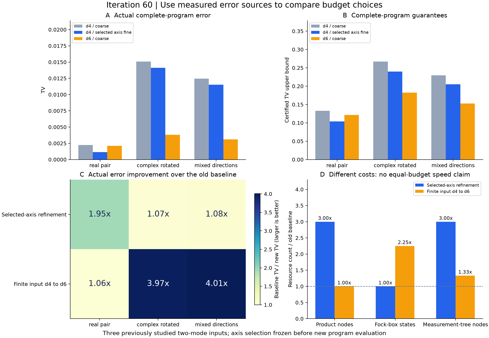

# 第60轮：选轴细化还是增加有限输入预算

日期：2026-11-10。在第59轮三个已研究的两模秩4输入上，比较“d4单轴细化”和“d6全粗网格”。新增6项完整程序、15552个位移节点、101088个测量树节点，另引用3项旧d4粗网格基线。三个输入选择的细化轴均为索引2，选择规则在新程序执行前独立验证。

## 两类投入的实际效果

| 输入 | 旧d4粗网格TV | d4选轴细化TV | d6粗网格TV | 本面板中误差更小的投入 |
|---|---:|---:|---:|---|
| 实配对 | 0.00222889 | 0.00114225 | 0.00211028 | 网格细化 |
| 复相位旋转 | 0.01509116 | 0.01410243 | 0.00380185 | 增大有限输入 |
| 混合方向 | 0.01244108 | 0.01151776 | 0.00310410 | 增大有限输入 |

六项新程序的实际TV均比各自旧基线低。网格细化对实配对带来约1.95倍改善，但对两个复相位输入只有约1.07、1.08倍；增大维数对实配对约1.06倍，对两个复相位输入约3.97、4.01倍。这与第59轮的误差来源诊断一致，但只是三个已分析输入的后续证据，没有新留出或一般最优预算结论。

两个动作的完整认证上界排序也与实际TV排序一致：实配对grid/input分别约0.10411189/0.12168902；复相位旋转约0.23989748/0.18217865；混合方向约0.20534728/0.15267522。上界仍较保守，这次排序一致不能消除此前“小上界未必对应小实际误差”的反例。

## 参照改变时，误差可能反向变化

网格细化保持有限输入及其连续参照不变，三组TV(P,F)均下降，改善因子约2.08、1.84、1.88。这里P为完整程序，F为同一有限输入在连续噪声下的解析参照。

增大维数会改变F。复相位旋转输入的TV(P,F)由0.00215991升到0.00221432，约增加2.52%；与此同时TV(P,G)从0.01509116降到0.00380185，其中G为完整Gaussian目标。原因是TV(F,G)从0.01293125大幅降到0.00158753，超过另一项的上升。因此不能只用单个中间参照的误差判断整体改进。

实配对d6粗网格的实际TV约0.00211028，已接近同一理想Gaussian粗网格误差0.00210879；其有限连续参照到目标TV只有约1.69×10⁻⁶，继续单独提高输入维数的收益已很有限。另两个d6输入的该参照误差仍约0.00158753、0.00114007，后续可以评估联合增加输入与细化网格。

## 选轴规则和资源范围

每个输入先计算四种单轴细化候选的组合耦合上界，取最小值，轴索引打破并列。全部12个候选先完成164项独立检查，再执行6项程序。三个输入都选中第三个驱动，但只运行了所选方向，不能说它在四个方向中实际TV最优。

| 资源 | 旧d4粗网格 | d4单轴细化 | d6粗网格 |
|---|---:|---:|---:|
| 每项乘积节点 | 1296 | 3888 | 1296 |
| Fock箱状态 | 16 | 16 | 36 |
| 张量复数元素 | 32 | 32 | 72 |
| 完整测量树节点 | 7776 | 23328 | 10368 |

两类投入成本不同，不能称等预算竞争或实测速度优势。六项生产总计约215.19秒为本机一次观察，包含准备、完整概率计算及存储，不是采样吞吐。原始节点JSON共779382167字节，无损压缩到171542506字节，约4.54倍缩减。

## 验证与冻结

三项d4输入张量、连续参照和桥接项与旧基线完全一致；另有12个预先固定节点的原直接密度对照，控制检查112项。d6输入重新独立构造；所有新节点的真实测量概率、完整程序路径、Gaussian目标和误差预算逐项核验。主体审计707231项、先行选轴164项、控制112项、最终比较60项，共707567项检查全部通过；主体记录分为15个分片，覆盖全部101088个测量树节点。

全库740项运行、711项通过、0失败、0错误，既有29个用例及7个类级跳过保留。本轮没有修改公共数学库，没有新增只复述实验实现的单元测试；新增科学证据来自独立选轴、全节点核验和概率律比较。所有实验源码已进入测试开始快照。

概率模型仍为每步独立均匀53位随机字，而不是有限种子PRNG全周期分布。每项7个公开样本仅用于接口回放；实际TV来自完整双模输出律。满秩指两物理模式上的四个实噪声方向，不是四物理模式，更不是九章规模。

[先进工具与九章对照](research/iteration60_frontier_comparison.md)已重新核对。本轮没有新增外部工具运行、同质量速度对照或实用144模整体上界。下一轮优先回到实际144模的输入次序与前缀误差，继续小系统联合预算和MPS方向，见[持续计划](research/iteration61_plan.md)。

## 证据入口

- [冻结预算计划](research/iteration60_budget_plan.md)、[方法与复现](research/iteration60_methods.md)
- [选轴候选](results/iteration60_selection/selection.json)、[先行选轴验证](results/iteration60_selection_validation/validation.json)
- [新程序结果](results/iteration60_noise/rows.json)、[控制](results/iteration60_controls/validation.json)、[主体核验](results/iteration60_noise_validation/validation.json)
- [预算比较](results/iteration60_comparisons/panels.json)、[误差分项](results/iteration60_comparisons/error_decomposition.json)、[全库测试](results/iteration60_tests/validation.json)
- [产物清单](results/iteration60_manifest.json)、[远端发布回执](research_archive/publication/verification_iteration60_2026-11-10.json)
