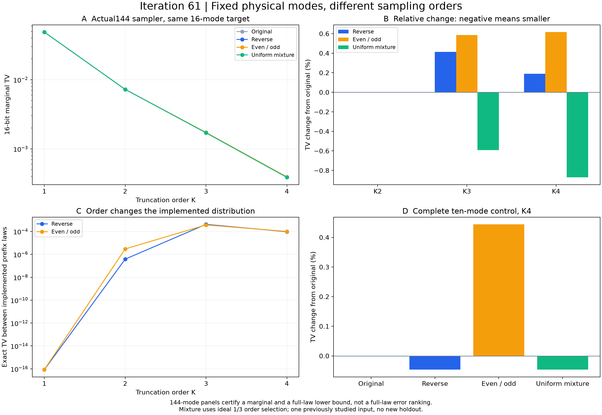

# 第61轮：实际144模固定集合的采样次序

日期：2026-11-10。完成8项新144模排序实验、1项144模原序回放、6项完整十模控制，共15项新执行。固定物理集合0—15及同一目标，比较原序、逆序和偶数标签在前的顺序；其余128模保持原序。全部输入和规则执行前冻结，没有按新结果筛选顺序。

## 次序并不自动改善实际误差

以下为完整16位边缘与原物理目标的TV；不是完整144模TV。实际144模的完整TV至少达到对应下界，但更小的边缘距离不能证明更小的完整距离。

| K | 原序 | 逆序 | 偶数/奇数 | 逆序相对变化 | 偶数/奇数相对变化 |
|---|---:|---:|---:|---:|---:|
| 1 | 0.048716927063 | 0.048716927063 | 0.048716927063 | -1.11022e-14% | +0% |
| 2 | 0.00723677910012 | 0.00723677852289 | 0.0072367642309 | -7.97641e-06% | -0.000205467% |
| 3 | 0.00171276454515 | 0.0017198582323 | 0.00172277958914 | +0.414166% | +0.58473% |
| 4 | 0.000389768699303 | 0.000390506809225 | 0.000392169476627 | +0.189371% | +0.615949% |

K3、K4的两种新顺序均退化，幅度约0.19%—0.62%；K2变化很小。K1在有限浮点和随机字实现中也需区分“数值打印相同”与严格相同。本轮不声称原序在所有排列中最优，也不把所有差异都归因于有限阶截断：原生预处理、阈值除法等浮点步骤同样可能随排序变化。

## 混合与完整十模控制

两种新顺序单独都在K3/K4退化，但预声明的等权混合反而优于三者中最好的原序：

| K | 原序TV | 三顺序均匀混合TV | 相对原序下降 |
|---|---:|---:|---:|
| 2 | 0.00723677910012 | 0.00723677373029 | 0.0000742% |
| 3 | 0.00171276454515 | 0.00170262477194 | **0.5920%** |
| 4 | 0.000389768699303 | 0.000386372692755 | **0.8713%** |

混合产生真实误差抵消：K3、K4混合TV分别比三个分量TV的平均值低约1.58427×10⁻⁵、4.44230×10⁻⁶，均有严格区间证据。混合权重固定为1/3，没有按结果优化。这里认证的是理想选择顺序后的边缘分布，尚未新增有限随机字混合采样器，也没有整体144模误差改善结论。

K1映回物理标签后的新旧程序TV约8.47×10⁻¹⁷、8.64×10⁻¹⁷，并非严格相同。不能把这种浮点量级差异包装成有实际收益的优化。

三项原序控制的公开输出、路径和全部前缀记录与旧结果逐项相同。十模K4原序TV约5.73353×10⁻⁵，逆序约5.73087×10⁻⁵，偶数/奇数约5.75899×10⁻⁵；逆序在这个完整十模模型略改善，但在144模的16位面板退化。两者输入和观测范围不同，不能相互替代。

## 核验与资源

**2579260项检查全部通过**，记录分为52个分片。覆盖595953个新前缀节点，并重查四个旧基线；总计858093个前缀节点、32844个公开路径步骤。全部144模协方差、q/p双块排列、CSV往返、输出标签与目标映射逐项核验，精确距离由另一套概率律算法重算。

全库740项运行、711通过、0失败、0错误；既有29个用例及7个类级跳过保留。公共库未改动。本轮增加的证据来自预声明实验、另一套精确随机字/概率律重建、矩阵与标签核验，没有新增仅复述实验代码的单元测试。

15项新执行共522.77秒为本机一次生产观察，包含原生预处理、公开样本、全树枚举、精确律及存储，不是吞吐基准。标准输出与精确律原始JSON共773178150字节，无损gzip后194245313字节。相同K的排序输入规模相同，但未做重复计时或同质量速度比较；理想混合也尚无新的有限随机字选择入口。

仍采用每步独立均匀uint64字及已核查的GCC转换模型。公开17个样本仅用于回放，不用于估计TV；固定seed的PRNG全周期律未被认证。物理目标及其证书沿用已独立验证的第56/37轮并核验绑定，本轮未重新执行旧65535个矩阵证书。

## 前沿与后续

[先进工具与九章对照](research/iteration61_frontier_comparison.md)加入图分布的完美匹配构造，并细化固定损耗论文已有的比特复杂度分析。此次实际新增运行仍为固定Frugal实现；没有Gaussian-SVD/PCO、图Markov链或九章规模复现，没有匹配质量的速度优势。

下一步根据混合结果决定是否推进有限随机字实现，并考虑同一物理输入上的独立窗口评估；另推进特殊非负图分布的构造核验、小系统联合噪声预算和官方MPS路线。完整144模实用上界仍未解决，见[持续计划](research/iteration62_plan.md)。

## 证据入口

- [执行前冻结计划](research/iteration61_order_plan.md)、[方法与复现](research/iteration61_methods.md)
- [全部执行记录](results/iteration61_order/rows.json)、[独立审核](results/iteration61_order_validation/validation.json)
- [精确比较与理想混合](results/iteration61_order_validation/comparisons.json)、[全库测试](results/iteration61_tests/validation.json)
- [产物清单](results/iteration61_manifest.json)、[远端发布回执](research_archive/publication/verification_iteration61_2026-11-10.json)
