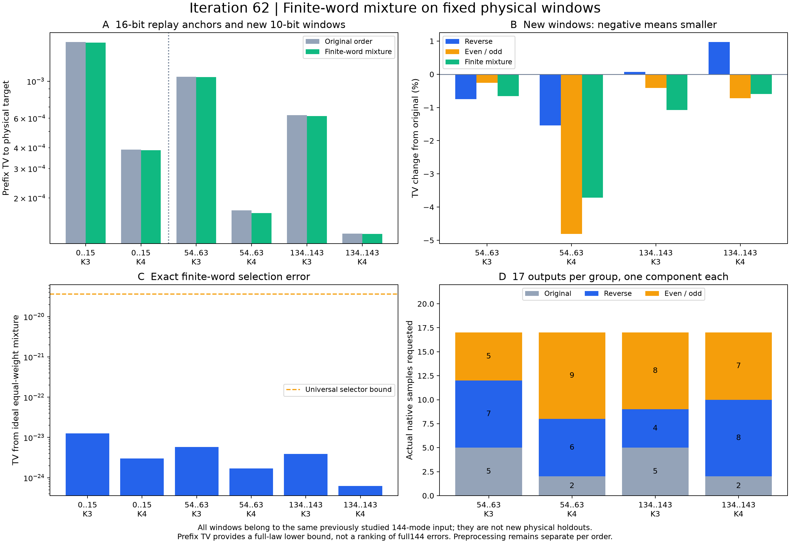

# 第62轮：有限随机字混合与其他物理窗口

日期：2026-11-10。将第61轮理想等权混合落实为有限字选择和实际批处理接口，并在同一144模输入的54—63、134—143窗口各测试K3/K4。新增12项原生144模执行、68个新公开样本；另有两个旧16位锚点回放，合计102个混合输出。窗口和权重执行前冻结，没有按新结果调参。

## 其他窗口的实际效果

| 物理窗口 | K | 原序TV | 有限字混合TV | 相对原序下降 |
|---|---:|---:|---:|---:|
| 54—63 | 3 | 0.00106388103291 | 0.00105687107326 | 0.6589% |
| 54—63 | 4 | 0.000168872059415 | 0.000162590893971 | 3.7195% |
| 134—143 | 3 | 0.000625793698483 | 0.000619086147511 | 1.0718% |
| 134—143 | 4 | 0.000122490874283 | 0.00012176576377 | 0.5920% |

四组新窗口均严格改善。混合在134—143的K3组优于全部三个单一顺序；另外三组均不如该组最好的单一顺序，分别约高0.091%、1.148%、0.132%。因此“优于原序”不等于“混合最优”。

所有距离是完整144模采样器在指定窗口上的边缘TV。不同窗口具有不同目标，不能直接按绝对数值排名；更小边缘TV也不证明更小完整144模TV。两个窗口来自既有同一物理输入，并非新物理态留出。

## 将1/3选择落实到一个64位字

新公共模块使用C=floor(3W/2^64)，W为均匀uint64字，一次选择，无拒绝、无浮点换算。三个分量的整数质量为6148914691236517206、6148914691236517205、6148914691236517205；与精确等权选择的TV为2/(3×2^64)，约3.61×10⁻²⁰。

没有忽略这项偏差。完整有限字混合律逐原子重建，并用独立恒等式Qw−Q̄=(2Q₀−Q₁−Q₂)/(3×2^64)核对。两个旧锚点相对理想混合的实际边缘TV偏差约1.25×10⁻²³、2.99×10⁻²⁴，保留上一轮K3/K4约0.59%/0.87%的改善；其理想混合距离与第61轮完全相同。

批处理先选分量，再按实际需求调用分量生成器，最后恢复样本次序和物理标签。四组新原生请求数分别为(5,7,5)、(2,6,9)、(5,4,8)、(2,8,7)，每组总计17个输出，没有为每个输出生成三个候选。全部新样本来自实际144模输入，未用十模独立模拟器替代。

三个顺序仍各自进行原生预处理。减少不需要的候选样本不等于消除预处理，也不构成同质量速度优势。锚点使用已保存样本回放，不计为新原生运行。

## 审核、测试与复现范围

**1356542项检查全部通过**，分为28个记录分片。重新核验405486个前缀节点，其中12276个来自12项新原生运行，其余为锚点复核；共24480个公开144位路径步骤，并逐个验证102个混合输出的选择字、分量和原标签。完整协方差、CSV往返、选择边界、原子重排、有限混合及严格TV排序均独立核验。

全库752项运行、723项通过、0失败、0错误；新增12项针对性测试全部通过，既有29个用例及7个类级跳过保留。测试涵盖小字穷举、64位边界、选择偏差、完整随机实验、输出双重重排、空请求及非法输入。

概率律使用每步独立均匀随机字模型；固定PRNG种子仅作公开回放，未认证有限种子的全周期分布。物理目标沿用既有第37/56轮证书和审核；此次重新绑定发布字节，并核对新程序的完整前缀律，没有重跑全部旧矩阵证书。

六组生产总计约1008.06秒，其中12项新分量执行及审计约890.76秒，均为本机一次观察，不是吞吐基准。本轮写入的原始标准输出与精确律JSON共411279660字节，无损gzip后111295767字节。所有源码和运行快照保持一致。

## 与先进工具和九章对照

[本轮前沿对照](research/iteration62_frontier_comparison.md)明确：Frugal核心生成器未改动，新增的是选择、分发和标签层；Gaussian-SVD/PCO方向已有第22轮局部参考复现，但完整输入到采样的来源与误差链仍待闭合。本轮没有九章规模完整模拟，也没有匹配质量的速度结论。

下一轮优先推进特殊图分布的双层完美匹配构造验证，并保留混合跨物理输入评估、预处理复用、小系统联合噪声预算和MPS完整链条，见[持续计划](research/iteration63_plan.md)。实用完整144模TV上界仍未解决。

## 证据入口

- [冻结计划](research/iteration62_mixture_plan.md)、[公式与复现](research/iteration62_methods.md)
- [公共混合接口](src/gbslab/finite_order_mixture.py)、[全部分量运行](results/iteration62_mixture/component_rows.json)、[六组结果](results/iteration62_mixture/rows.json)
- [独立核验](results/iteration62_mixture_validation/validation.json)、[精确比较](results/iteration62_mixture_validation/comparisons.json)、[全库测试](results/iteration62_tests/validation.json)
- [产物清单](results/iteration62_manifest.json)、[远端发布回执](research_archive/publication/verification_iteration62_2026-11-10.json)
