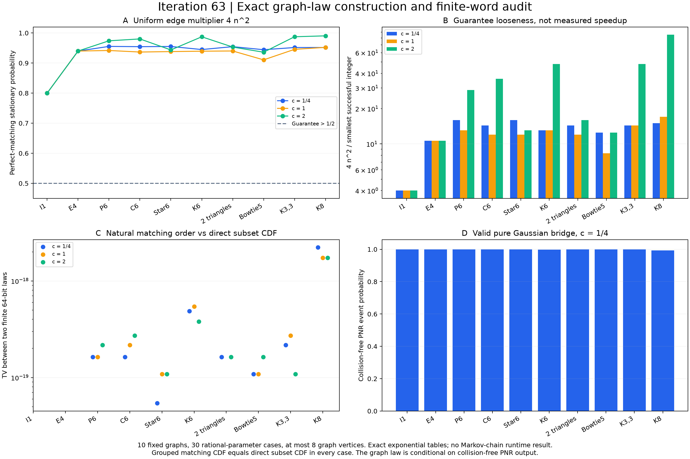

# 第63轮：图匹配构造、有限随机字与Gaussian条件分布

2026-11-10。本轮把特殊图分布路线落实为可独立核验的代码与完整小图结果。执行前固定10个图和c=1/4、1、2，共30组，不按计算结果换图。两套算法对2070个子集概率和18511个完美匹配见证完全一致，118423项检查通过。新增公共模块`graph_matching_gbs.py`；此前Frugal和MPS实现未改动。

## 构造验证

采用[Anand等v3的双层图构造](https://arxiv.org/html/2511.16558v3)：水平边权c²，竖边权1。生产端在双层图上递归计数，独立端从原图所有匹配对重建。给定投影子集S，两层分别有PM(S)个选择，其水平边总数为|S|，所以权重正是c^(2|S|)PM(S)²。

全部匹配的大小分层分配函数包括空匹配。近完美比、对数凹性及4n²重加权后完美匹配质量>1/2逐项通过。另计算达到质量≥1/2的最小正整数α，并检查前一整数确实失败。表中的α为诊断结果，求它需要本轮精确枚举能力；较小α不自动意味着更快混合。

| 原图 | 双层完美匹配数 | 最小α：c=1/4 | c=1 | c=2 | 通用4n² | c=1/4无碰撞PNR质量 |
|---|---:|---:|---:|---:|---:|---:|
| I1 | 1 | 1 | 1 | 1 | 4 | 1 |
| E4 | 1 | 6 | 6 | 6 | 64 | 1 |
| P6 | 13 | 9 | 11 | 5 | 144 | 0.999801642 |
| C6 | 20 | 10 | 12 | 4 | 144 | 0.999725349 |
| Star6 | 6 | 9 | 12 | 11 | 144 | 0.999618530 |
| K6 | 376 | 11 | 11 | 3 | 144 | 0.997735999 |
| 两个三角形 | 16 | 10 | 12 | 9 | 144 | 0.999725117 |
| Bowtie5 | 12 | 8 | 12 | 8 | 100 | 0.999602781 |
| K3,3 | 82 | 10 | 10 | 3 | 144 | 0.999296113 |
| K8 | 17984 | 17 | 15 | 3 | 256 | 0.992860192 |

通用重加权后的质量范围为0.8—0.990423535；4n²与最小整数α之比为4—85.3333。这是目标平稳分布的质量，不是运行中的接受率，更不是实测加速。所有图族及精确分数见[结果](results/iteration63_graph_validation/comparisons.json)。

## 有限字抽样不自动保持理想投影等价

每组预先固定17个64位随机字，分别走直接子集CDF、自然DFS匹配CDF和按子集分组的匹配CDF，共1530个公开输出。三路线在一组内共享同17个字，用于逐路径比较，并非独立统计重复。完整词格质量用有理数计算，未用17样本估计分布。

自然匹配顺序与直接子集CDF有23/30组分布不同，最大TV为2.222614453595284×10⁻¹⁸，出现在K8、c=1/4。按子集连续分组的匹配CDF则30/30与直接子集CDF逐项相同，原因是相邻词格边界可望远镜相消。

分组一致性不是普遍精度优势：自然次序对理想目标的TV有4组更小、16组更大、10组相同。例如K8、c=1/4，直接TV约1.2809050×10⁻¹⁸，自然次序约2.0968159×10⁻¹⁸；C6、c=1/4则自然次序更好。小字长反例及全部小字穷举测试也保留。以上概率以均匀随机字模型为条件，不能解释成有限PRNG种子集合的精确分布保证。

## 物理范围

本轮明确选择B=c²A作为实纯Gaussian配对核。14组满足||B||<1，其中10组c=1/4，加上两种空图在c=1、2的四组。另16组图分布仍合法，但在这个B选择下不对应可归一化纯Gaussian态。一般不能仅靠度数上界判定时，接口返回uncertified。

有效态的无碰撞PNR事件质量为Z_graph sqrt(det(I−B²))，使用有理消元和整数Bareiss两套行列式算法，以及整数平方根和独立二分两套192位根区间核验。表中为区间端点的十进制显示，精确有理区间保留在结果中。这个图分布是无碰撞PNR条件分布，不能与一般阈值探测GBS混同。特别是c=1、2的非空图结果不能被当作物理GBS实验。

## 验证与范围限制

118423/118423项独立检查通过，5个检查分片。全库768项运行、739通过、0失败、0错误；新增16项通过，既有29个用例和7个类跳过保留，所以执行门槛通过，完整无跳过门槛仍未通过。全部科学代码在第一次运行前冻结，并在全库测试时另存完整源码快照。

本轮最大8个原图顶点、16个双层图顶点。递归和完整表均有指数成本，尚未实现JS链、混合时间证书或端到端多项式采样。图构造是已有理论，本轮贡献是独立复建、有限字投影审计和明确的物理条件绑定，不主张理论首创、九章规模模拟或同质量速度优势。

参见[冻结计划](research/iteration63_graph_plan.md)、[方法](research/iteration63_methods.md)、[前沿对照](research/iteration63_frontier_comparison.md)与[下一轮方向](research/iteration64_plan.md)。持续目标保持进行中。
