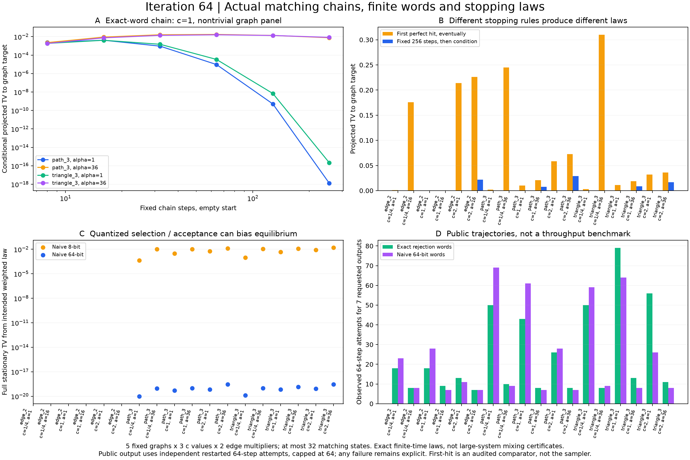

# 第64轮：真实匹配链、有限字平稳律与停止规则

2026-11-10。本轮在第63轮图构造基础上实现真实局部加/删/换边链，区别精确随机字实现、朴素定长实现、有限步条件化和首次命中。固定5种原图、3个c值、2种重加权，共30组；没有根据结果调参。全部90个转移核、810个固定步分布及其平稳/吸收方程通过独立核验，31637/31637项检查通过。

## 实际运行已闭合到完整有限步输出律

公开模块`matching_chain.py`按局部边冲突与有理权重比转移，实际采样不调用状态枚举或预计算分布。I1、E2、K2、P3、K3的双层图最多6个顶点、32个匹配状态；完整状态空间只用于本轮审核。采用[Jerrum–Sinclair原始规则](https://www2.stat.duke.edu/~scs/Courses/Stat376/Papers/ConvergeRates/JerrumSinclair.1996.pdf)的惰性提议，并对一般正有理边权直接验证详细平衡。

正式输出规则为从空匹配运行64步，若完美则接受，否则重新从空态开始；每输出最多64次尝试，失败显式返回。精确与朴素64位路线每组各请求7个输出，420个请求均成功；共1199次尝试、76736步、175465个字全部独立重放。精确路线601次、朴素路线598次，这只是不同公开随机轨迹的运行记录，不能作同质量速度比较。

即使观察到零失败，理论失败概率仍保留：每组为(1−p64)^64，本面板最大约0.000406761375。成功条件下的输出律等于单次64步的完美条件律，而非目标律自动精确。记录包括每次尝试的全部随机字、状态路径、返回值、失败概率及精确条件误差。

## 固定字长取整可以改变平稳分布

精确路线使用均匀字拒绝尾部后取模，实现真正均匀选边与有理Bernoulli接受；拒绝循环没有偏差性截断。所有概率结论假设独立均匀字流，不是有限PRNG种子集合的分布结论。

朴素路线用floor(m·word/2^bits)选边，再用word/2^bits与接受概率比较。8位和64位核各有12/30组平稳律偏离目标；64位最大TV约2.8481053724054243×10⁻¹⁹，8位压力对照最大约0.0163015928813，均在K3、c=2、α=36。8位仅完整核及单元测试审计，公开长轨迹使用64位。

这里有两种偏差来源：非整除的选边词数导致换边提议不再对称，接受概率取整也改变正反比。精确拒绝实现消除这两类平稳量化偏差，但不消除有限步混合误差。所有三核的有限步差还通过t乘最大单行TV差的扰动界检查。

## 首次命中和更高平稳完美质量都不能替代混合

从空态首次到达完美匹配集合的分布由吸收方程精确求解，不是从若干轨迹估计。理想链有16/30组首次命中投影偏离图目标，最大TV约0.3098731653，出现在K3、c=1/4、α=36。这个偏差在等待首次命中直至完成后仍存在。

α=4n²提高平稳完美质量，但在9个非空图/c参数对中，其256步条件TV有8对更大，1对相同。下面完整列出c=1/4的三个非空图；这些图均对应第63轮所述有效纯Gaussian配对核B=c²A。

| 原图 | α=1平稳完美质量 | α=4n²平稳完美质量 | α=1的64步条件TV | α=4n²的64步条件TV | α=4n²首次命中TV |
|---|---:|---:|---:|---:|---:|
| K2 | 0.243140965 | 0.880136986 | 1.73804×10⁻⁹ | 0.000164956 | 0.175596129 |
| P3 | 0.118240147 | 0.915316596 | 4.27632×10⁻⁶ | 0.040967739 | 0.245013934 |
| K3 | 0.115008881 | 0.912221877 | 4.28745×10⁻⁵ | 0.090491512 | 0.309873165 |

例如K3的平稳完美质量从约11.50%升至91.22%，但64步条件TV从约0.00004287升至0.09049；继续到256步时，重加权路线仍约0.000572730。更多成功输出不能掩盖输出质量变化。条件TV本身也可能先升后降；审核中只要求完整状态TV对理想平稳律按Markov收缩不增。

## 证据与限制

生产端按顶点递归枚举状态并用行式整数推进；独立端按边组合枚举状态、集合操作重建提议并用列式整数推进。平稳解与首次命中解通过完整线性方程、非负性、归一化和不可约性/可达性验证，未仅比较两次相同求解器输出。原图目标另从边组合重建。

全库784项运行、755通过、0失败、0错误，新增16项全部通过；既有29个用例、7个类跳过保留，执行门槛通过，完整无跳过门槛仍未通过。源码在首次执行前冻结，完整测试源码快照和原始输出保留。

本轮是小状态空间的有限程序证明，不是最坏起点或大图混合时间证书。30组中18组条件目标具有本轮B选择下的有效Gaussian解释（含重复α及真空图）；其余12组非空图c≥1仅用于合法图概率和链的数学测试，不是物理Gaussian态。重加权不改变完美条件目标。没有新增九章实验输入、Frugal吞吐对照或MPS运行；先进工具和九章范围见[对照](research/iteration64_frontier_comparison.md)。

详见[冻结计划](research/iteration64_chain_plan.md)、[方法](research/iteration64_methods.md)、[精确比较表](results/iteration64_chain_validation/comparisons.json)、[后续方向](research/iteration65_plan.md)。持续目标保持进行中。
