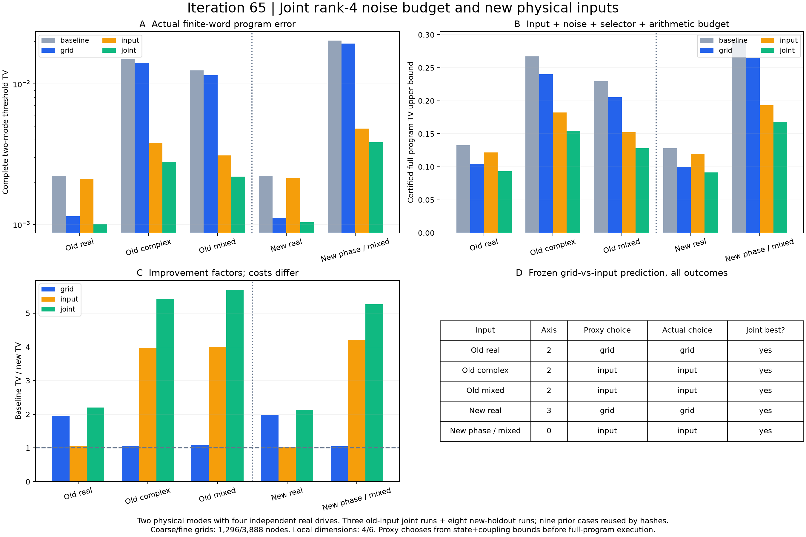

# 第65轮：联合噪声预算与两个新物理输入

11项完整程序和全部比较已经通过独立审计，合计1,558,014项科学检查通过；首次执行源码和完整结果按原字节封存。

2026-11-10。本轮将第60轮的网格和有限输入预算组合起来，并加入两个执行前固定的新物理输入。五组输入的联合方案都优于两个单项方案，较原基线的完整阈值分布TV降低约2.13—5.69倍。执行前的上界代理在两个新输入上均选对较有效的单项投入；五组面板全部一致，但尚不构成普遍资源选择定理。

## 完整四方案比较

三个旧输入各新增联合方案；两个新输入各执行基线、仅细化网格、仅增维、联合方案，共11项新执行。另按哈希复用9项旧程序，组成5组、20项比较。旧mixed_holdout仍计为旧输入，不能再次当作本轮留出。

| 输入 | 基线TV | 仅网格TV | 仅增维TV | 联合TV | 基线/联合 |
|---|---:|---:|---:|---:|---:|
| 旧实配对 | 0.00222889263 | 0.00114224734 | 0.00211027584 | 0.00101402875 | 2.1981 |
| 旧复相位旋转 | 0.01509115695 | 0.01410242574 | 0.00380184919 | 0.00278123197 | 5.4261 |
| 旧混合方向 | 0.01244107802 | 0.01151776161 | 0.00310409887 | 0.00218633675 | 5.6904 |
| 新实输入 | 0.00221419085 | 0.00111601807 | 0.00214214124 | 0.00103818303 | 2.1328 |
| 新复相位混合输入 | 0.02026472030 | 0.01931120964 | 0.00481547602 | 0.00384809804 | 5.2662 |

表中为严格区间的舍入展示，不是从77个公开样本估出的统计距离。完整概率模型包括四种两模阈值输出和程序失败；实际失败质量在本面板为零。概率结论基于各步独立均匀53位字，不是有限PRNG种子集合的分布结论。

联合相对最佳单项的额外改善因子依次为1.1264、1.3670、1.4198、1.0750、1.2514。联合投入消耗更多资源，不能由这些数字推导同成本最优性。所有五组都改善是本次观察结果，未以此删除退化情形或修改预先冻结的选择规则。

## 预先选择与认证上界

每组在执行完整程序之前枚举四种候选轴，仅用认证耦合上界选最小者。三个旧输入选轴2，新实输入选轴3，新复输入选轴0（从0计数）。全部20项候选及粗网格界保留；独立选轴检查258项通过后才执行完整程序。

仅网格和仅增维的预先排序使用“输入迹距离上界＋噪声耦合上界”的代理。它不含当时尚未计算的算术与选择器项，也未匹配两种投入的成本。本轮代理及后验完整上界的排序均与实际误差排序一致：两个实输入选网格，三个复相位/混合输入选增维。只有两组是新物理留出，其余三组是旧输入延伸。

| 输入 | 基线上界 | 仅网格上界 | 仅增维上界 | 联合上界 |
|---|---:|---:|---:|---:|
| 旧实配对 | 0.132663 | 0.104112 | 0.121689 | 0.093138 |
| 旧复相位旋转 | 0.267236 | 0.239897 | 0.182179 | 0.154840 |
| 旧混合方向 | 0.229746 | 0.205347 | 0.152675 | 0.128277 |
| 新实输入 | 0.128240 | 0.100068 | 0.119635 | 0.091463 |
| 新复相位混合输入 | 0.290333 | 0.265015 | 0.193333 | 0.168015 |

上界仍明显宽于实际TV。排序一致提供有限面板的可用性证据，没有证明误差估计紧致，也未验证其选择的轴为实际TV最优；其他三个轴的完整程序未执行。

## 成本、独立验证与复现

基线和仅增维为1296个位移节点，细化网格和联合为3888节点。局部维数从4增至6，有限Fock箱状态从16增至36。11项新执行合计32400个位移节点、238464个完整测量树节点，公开重放77个样本；9项复用程序不计入新节点数。

连续参照使用7组不同输入/方向密度多项式，生产Wick积分与独立显式配对矩交叉验证；额外22个直接密度控制点与3个旧d6输入回归均保留。物理协方差、纯态恒等式、满秩噪声、完整Gaussian目标、有限输入保真度、每个网格节点及每个有限字测量分支都接受独立检查。比较器检查四方案的目标一致、对应有限输入一致和对应网格一致。

运行日志记录完整生产约506.22秒，包含准备、枚举、比较和存储，且有相同输入参照缓存。这是本机一次资源记录，不能作重复采样吞吐或同质量速度结论。原始展开记录约1.789 GB，确定性压缩后约401.39 MB；压缩前后字节数和哈希均保存。

全库784项运行、755通过、0失败、0错误；既有29个用例及7个类跳过保留。公共数学库未修改，新增单元测试为0；本轮新增证据来自冻结的实验和独立全概率核验。执行测试门槛通过，完整无跳过门槛仍未通过。

本轮仍只有两个物理模式、四个实噪声驱动；有限箱使用普通全SVD，不是Gaussian-SVD/PCO。没有新九章输入或大规模采样速度优势。与Gaussian-SVD、计数基准、固定损耗理论、图链及九章的区别见[前沿对照](research/iteration65_frontier_comparison.md)。详见[冻结计划](research/iteration65_noise_plan.md)、[方法](research/iteration65_methods.md)、[完整比较](results/iteration65_comparisons/panels.json)、[持续方向](research/iteration66_plan.md)。持续目标保持进行中。
