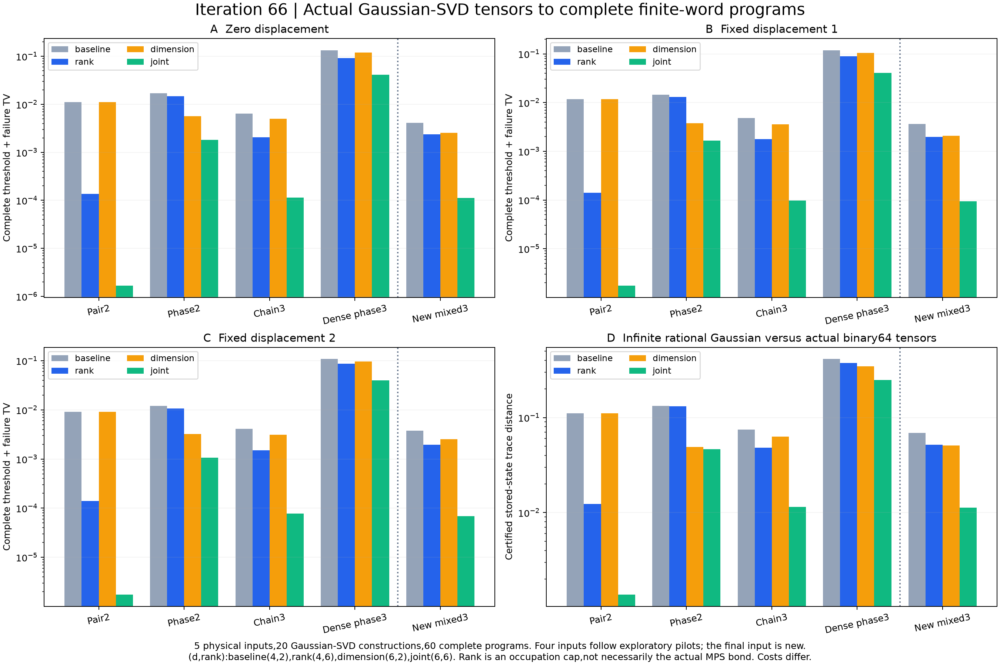

# 第66轮：实际Gaussian-SVD张量的完整程序证书

科学核验、图像复核和恢复后的全库测试均已完成，发布基线为第65轮最终提交。

2026-11-10。本轮把已有Gaussian-SVD构造接入严格输入保真度和完整有限字程序审核。五个有理物理输入、20次实际构造、60项固定位置位移采样均完成，11201项科学检查通过；420个公开样本逐步重放。新增一个三模复输入，其联合方案在三个位移下较基线的输出TV改善约36.66、38.52、54.65倍，仍只是小系统、不同成本的完整证书。

## 从输入到实际有限程序

局部Gaussian核、虚拟占据、标量、递推系数及实际QR后张量全部保存。独立PCO复建局部系数，全局消元核对无截断输入；另对实际存储张量做精确二进制幅度与无限Gaussian态的保真度认证。因此，本轮完整误差上界包含实际构造舍入，不只使用理想投影误差估计。

四个输入已参与本轮前的12项预检，只有mixed_holdout3是新物理留出。所有预算和三个位移在正式执行前固定；没有根据输出误差挑选或删去结果。各输入有基线(d4,rank2)、只增虚拟占据(d4,rank6)、只增局部维数(d6,rank2)、联合(d6,rank6)四方案。rank是占据上限，实际键可能更小。

| 输入 | 基线状态距离 | 只增占据 | 只增维数 | 联合状态距离 |
|---|---:|---:|---:|---:|
| 两模配对 | 0.1111111111 | 0.0123456790 | 0.1111111111 | 0.0013717421 |
| 两模复相位 | 0.1321085694 | 0.1316646521 | 0.0491163739 | 0.0466074407 |
| 三模链 | 0.0744346049 | 0.0483243662 | 0.0630871778 | 0.0114267861 |
| 三模稠密复相位 | 0.4126912480 | 0.3748269481 | 0.3463594956 | 0.2480188379 |
| 新三模复输入 | 0.0686639802 | 0.0516897711 | 0.0507226828 | 0.0112850287 |

两模配对输入在rank固定为2时，仅增局部维数没有改善状态距离。这与已有解析Schmidt限制相符，不能把状态距离自动当成阈值输出误差。强稠密输入联合后的状态距离仍约0.248，当前资源尚不足以获得高精度态近似。

## 新留出的上界排序与实际排序相反

新三模输入只增局部维数的认证状态距离约0.050723，优于只增虚拟占据的0.051690；加入算术项后的完整程序上界保持这一排序。但三个固定位置的实际完整阈值TV都由只增虚拟占据获胜：

| 位移 | 基线TV | 只增占据TV | 只增维数TV | 联合TV | 基线/联合 |
|---|---:|---:|---:|---:|---:|
| 零位移 | 0.00413756522 | 0.00237397946 | 0.00255515068 | 0.000112862801 | 36.6601 |
| 固定位置1 | 0.00361108642 | 0.00197603881 | 0.00207106065 | 0.000093741082 | 38.5219 |
| 固定位置2 | 0.00376802847 | 0.00193879328 | 0.00254498731 | 0.000068947848 | 54.6504 |

这是事后诊断，不是预先宣布的预算预测实验。它说明较小的有效上界不保证较小的真实输出误差；第65轮噪声预算面板的预测命中不能推广为一般规则。上界有效性本身没有被否定，60项实际TV均低于各自认证上界。

五个输入、三个位移的15组面板中，联合方案均优于两个单项。各方案资源成本不同，不能解释为同成本最优；完整数值、严格区间和所有微小有限字差异均在[比较表](results/iteration66_comparisons/panels.json)保留。

## 证据与当前边界

输入构造核验995项、完整程序核验10022项、比较184项，共11201项通过。60项完整程序共1594个测量树节点，所有失败质量为零；420个公开样本仅为接口回放，TV来自完整概率律。概率结论限定独立均匀53位字，不等同于有限PRNG种子集合的分布。

无截断核恢复和PCO数值互证是浮点诊断，实际有限态保真度才是严格区间证书。认证用到小Fock箱的指数规模枚举；最大3个物理模式、实际键不超过6，未获得大规模可扩展精度保证。所有位移均为固定位置，没有本轮连续Gaussian噪声积分。60项完整测量程序计算约6.35秒，不含20次GSVD构造、独立核验和归档，只作本机资源记录，不作端到端采样测速。

公共数学库未修改，本轮新增单元测试为0。最终全库784项运行、755通过、0失败、0错误；既有29个用例和7个类跳过保留，执行门槛通过，完整无跳过门槛未通过。第一次全库执行因稀疏工作树更新后缺少旧归档输入及计算库而出现4个错误；原765项执行日志完整保留。恢复与已发布版本逐字节一致的依赖后，另建tests_recovery记录重新运行全部测试，并以690份源码的当前字节和快照核对通过。科学生产结果和首次源码未改写。

与先进工具及九章的区别见[前沿对照](research/iteration66_frontier_comparison.md)；复现见[方法](research/iteration66_methods.md)和[冻结计划](research/iteration66_gsvd_plan.md)。持续目标保持进行中。
