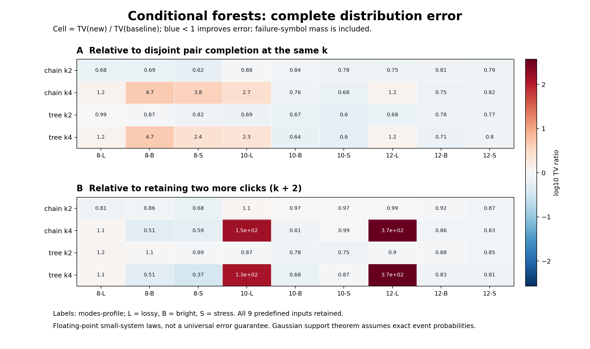

# 第七轮：条件依赖树与下一步计算内核

日期：2026-11-04。项目：量子 / deziroGBS。基础提交：`5cf42049a628dadf79c97b255ca8f191755b790e`（第六轮）。

## 1. 本轮结论与研究决定

**依赖树补全在新的固定小系统面板上开始超过更强的保留点击基线，值得继续研究；当前仍没有形成同时改善质量与实际成本的完整方案。**

本轮已完成 9 个物理输入、8 个方法、72 个完整分布和 27 项交叉核对。链式 k2 相对 retained-k4，8/9 个输入 TV 更低，中位 TV 比值 0.918156，无数值失败；静态互信息树 k2 为 7/9，中位比值 0.880217，同样无失败。但对应 Python 准备加完整枚举的中位成本比为 1.183 和 1.119，不能称为加速。

两种 k4 树都在 6/9 个输入上低于 retained-k6，且所有 bright/stress 输入都胜出；两组低亮度输入却受到数值失败质量影响。树相对同 k 的不相交 pair 也并非始终改善：两个 k4 树都仅 4/9 项胜出。因此，没有证据支持把更复杂的树直接替换成所有输入上的默认方案。

**下一步优先推进共享 Schur 事件内核与数值可靠性，而不是继续堆采样量或单凭均值调参。** 本轮已经推导出按相同保留集共享包含排除计算的具体公式与成本，见第 7 节。它有机会把已经观察到的结构性精度收益转化为可测试的成本收益；尚未实现，不能算作本轮已取得的速度提升。

理论工作同时给出了真实 Gaussian 的相位反例：低阶阈值边缘不能唯一确定更高阶联合事件。这个反例限定了依赖树能够保证什么，不是经典 GBS 的复杂度下界。第六轮的支持定理、这次的局部 KL 性质和实际 TV 测量始终分开解释。

## 2. 连续两轮探索的关系

第六轮把所有被遗漏的历史点击重新加入一个近似条件似然：逐点补全在相同 k 下 18/18 项改善，两两补全 k4 在相同 k 下 16/18 项改善。然而 pair-k4 相对 retained-k6 只有 3/18 项胜出，TV 比值中位数 1.259521。两个 m12 lossy 的表参考诊断即使消除数值失败，仍落后于 retained-k6。[第六轮主报告](RESEARCH_REPORT_ITERATION6.md)

因此没有停在该结果等待新指令，而是转向遗漏点击之间的关联结构。第七轮连接跨原分块的边，使用新线路种子，继续与更强基线比较。它不在第六轮数据上拟合系数，也不将第六轮失败改写为成功。

第五轮保持原 Q 的缓存收益和大模式质量反例仍是独立历史结果。第六、七轮目前都是小模式概率近似研究；没有重新执行大型九章完整任务，也没有新增与官方 Frugal 的等质量原生速度对赛。

## 3. 条件森林的定义及理论边界

### 3.1 从遗漏点击的条件似然出发

当前位记为 Y，全部历史零为 Z，精确保留的历史点击为 R，遗漏点击为 F，令 \(B=\{X_Z=0,X_R=1\}\)。对 F 上的树 E 定义

\[
\ell_a(j)=P(X_j=1\mid Y=a,B),\qquad
\ell_a(j,l)=P(X_j=X_l=1\mid Y=a,B),
\]

\[
\widehat L_a^E=
\prod_{j\in F}\ell_a(j)
\prod_{(j,l)\in E}
\frac{\ell_a(j,l)}{\ell_a(j)\ell_a(l)},
\qquad
q_a=\frac{P(Y=a\mid B)\widehat L_a^E}
{\sum_{c=0}^1P(Y=c\mid B)\widehat L_c^E}.
\]

任取树根，可将上式写成根概率乘父子条件概率，因此是一个正规化树分布的全点击事件概率；不需要未知配分函数。不能任意加入成环边后仍援用这个结论。

本轮 `chain` 按遗漏点击的测量顺序连接相邻节点。`static_mi_tree` 预计算输入 Gaussian 态的无条件两模式互信息，在当前 F 上取确定最大生成树，保留必要的零权边；同分按物理索引裁决。互信息只选择边，不直接进入概率乘积。所有方法继续使用原 `click_influence` 选择器确定 R。

### 3.2 先合并事件幂次再计算

记 \(w_a=P(B,Y=a)\)、\(u_{aj}=P(B,Y=a,X_j=1)\)、\(v_{ajl}=P(B,Y=a,X_j=X_l=1)\)，略去两分支的共同因子后，

\[
\log s_a=(1-|F|+|E|)\log w_a+
\sum_{j\in F}(1-\deg_Ej)\log u_{aj}+
\sum_{(j,l)\in E}\log v_{ajl}.
\]

F 非空时树是连通的，w 的系数为零。F=1 时分数退化成 u；F=2 时退化成 v，所以这两个边界精确。数值实现按合并系数的绝对值传播误差指标，避免把已代数相消的项重复计入；节点解析零先处理，避免负幂和 0/0。原逐事件保护仍保留，未按实验结果放宽阈值。

如果给定 (Y,B) 后 F 的完整分布确实在该树上因子分解，公式也精确。一般 Gaussian 输入不保证这种条件结构。静态无条件 MI 树只对相应无条件近似目标选边，并不优化每个分支的条件 KL，更不直接优化全局采样 TV。

### 3.3 局部 KL 与目标 TV 不能混同

固定 (Y=a,B)，令 p_a 为遗漏变量的完整条件分布，q_a^E 为使用其真实边缘构造的森林分布，则

\[
D_{\rm KL}(p_a\Vert q_a^E)
=\sum_{j\in F}H_{p_a}(X_j)-H_{p_a}(X_F)
-\sum_{(j,l)\in E}I_{p_a}(X_j;X_l).
\]

因此，增加不成环的边不会增大这个条件分布的 KL。chain 包含原相邻 pair 的全部匹配边，因而具有这一局部性质。但这约束的是对所有 F 位串的平均损失，而我们需要的是指定全点击事件在两个 Y 分支间的似然比。罕见事件的相对误差仍可能变大；第六轮物理反例和本轮多个无数值失败的 TV 比较都提醒了这一点。

精确 Gaussian 事件概率下，本轮仍满足第六轮的支持保持引理。全局精度却继续依赖

\[
\operatorname{logit}p_{\rm true}-\operatorname{logit}q
=\log C_1^E-\log C_0^E,\quad
C_a^E=\frac{P(X_F=1\mid Y=a,B)}{\widehat L_a^E}.
\]

只有获得所有相关前缀上的残差界，才能用单步 \(\tanh(\delta_t/4)\) 和顺序耦合给出全局 TV 上界。本轮没有把样本平均、树的 KL 性质或支持保持替换成这种统一界。[独立理论与实现审查](research/iteration7_theory_audit.md)

## 4. 新固定面板与完整主结果

### 4.1 方案及核对

本地方案于 **2026-11-04 16:08:46 UTC** 固定。模式数 8、10、12，各使用种子基数 340701，实际种子为 `340701 + 1000*m`。每条线路各取 lossy (r=0.6,eta=0.35)、bright (0.9,0.65)、stress (1.2,0.85)。因此是三条 Haar 线路、九个物理输入；三个参数组共享线路，不当作九条独立线路推断总体成功率。

八个方法：retained-k4/k6、pair-k2/k4、chain-k2/k4、tree-k2/k4。缓存上限 8192，数值保护阈值 1e-6，自然物理顺序。正式运行于 **16:12:55–16:19:23 UTC** 完成，耗时 388.037 秒，源码和原生参考散列稳定。

每个输入保存完整 P 与各 Q。所有不可可靠求值的可达前缀，其概率质量进入失败符号 \(\bot\)，使用

\[
\mathrm{TV}_{\rm extended}(P,Q)=\tfrac12\left(\sum_x|P(x)-Q(x)|+Q(\bot)\right).
\]

成功子律不重新归一化，不补抽。18 项 m8 表事件核对保持原 Gaussian 选择器和树，另有 9 项独立 C++ retained-k4 核对。**全部 27 项通过**，最大分布差 2.724e-13；72 项方法键集合与全部检查键集合均完整，无遗漏或重复。[方案](results/iteration7_plan/manifest.json)、[元数据](results/iteration7_forest/metadata.json)、[核对](results/iteration7_forest/crosschecks.json)

### 4.2 对强基线的结果

TV 比值为新法/基线，小于 1 表示改善。改善/恶化按 TV 绝对差 1e-10 判定，此表无数值平局。时间包括准备、MI 预计算（适用时）、选择器、建树和完整 Q 枚举。

| 新方法 | 强基线 | TV 改善 / 恶化 | TV 比值中位数 | 最大失败质量 | Python 准备+枚举时间比中位数 |
|---|---|---:|---:|---:|---:|
| chain-k2 | retained-k4 | 8 / 1 | 0.918156 | 0 | 1.183 |
| tree-k2 | retained-k4 | 7 / 2 | 0.880217 | 0 | 1.119 |
| chain-k4 | retained-k6 | 6 / 3 | 0.864679 | 0.001732760472 | 2.450 |
| tree-k4 | retained-k6 | 6 / 3 | 0.826631 | 0.001732760472 | 2.315 |

森林 k 的最大局部事件宽度为 k+3，与 retained-(k+2) 对齐。但它通常计算更多事件，因此对齐最大宽度不代表对齐总成本。上述时间只是共享机器上 Python 完整指数规模分布枚举的描述性测量，不是单样本吞吐率，更不是与 Frugal 或九章的等质量速度比较。

相对同 k 的 pair，两种 k2 树均 9/9 项改善，TV 中位比为 0.775061 和 0.773033；两种 k4 树却都只 4/9 项改善。尤其 m8 bright 中，pair-k4 TV 为 4.8595759e-6，而两个树 k4 均为 2.3071214e-5，三个方法都没有失败质量。这说明不单是数值问题阻止“更多边总更好”的结论。

12 模式的两个高亮度输入更清楚展示当前的机会：

| 输入 | retained-k6 TV | pair-k4 TV | chain-k4 TV | tree-k4 TV |
|---|---:|---:|---:|---:|
| bright | 0.001558019390 | 0.001804521820 | 0.001347185998 | 0.001287906800 |
| stress | 0.005081674789 | 0.005163285950 | 0.004240730862 | 0.004121089716 |

这两项中树补全同时优于 pair-k4 和 retained-k6，但本轮全部强基线比较必须一起看，不能把这两个案例代表整个输入族。



全部 72 个数值及八组比较见[结果表](results/iteration7_analysis/summary_tables.md)与[机器可读汇总](results/iteration7_analysis/summary.json)。分析从保存 P/Q 数组重算 TV，并核对文件散列与总质量。

## 5. 数值失败与独立表参考诊断

主矩阵的 72 项中，66 项没有失败质量。m10、m12 lossy 的 pair-k4、chain-k4、tree-k4 共六项有失败；其原始记录保留。

| 输入 | 方法 | 主 TV | 主失败质量 |
|---|---|---:|---:|
| m10 lossy | pair-k4 | 0.00003693375652 | 0.00003615947298 |
| m10 lossy | chain-k4 | 0.00009804128219 | 0.00009791315576 |
| m10 lossy | tree-k4 | 0.00008326414184 | 0.00008308112448 |
| m12 lossy | pair-k4 | 0.001427065255 | 0.001423906184 |
| m12 lossy | chain-k4 | 0.001732760472 | 0.001732760472 |
| m12 lossy | tree-k4 | 0.001732760472 | 0.001732760472 |

看到这一问题后，单独固定 **m10/m12 × 三参数组 × 上述三方法，共 18 项** 的事后数值诊断。它覆盖全部这个层的输入，不只挑失败项。保持同一 Gaussian 选择器、分块或树与阈值，仅以保存完整 P 的非负求和代替事件求值。完整表是指数规模参考，不能推广为快速采样算法，也没有改写主矩阵。

两个 lossy 输入的表参考给出：

| 输入 | retained-k6 主 TV | pair-k4 表参考 TV | chain-k4 表参考 TV | tree-k4 表参考 TV |
|---|---:|---:|---:|---:|
| m10 lossy | 6.502897770e-7 | 7.742835393e-7 | 5.196822448e-7 | 4.764308887e-7 |
| m12 lossy | 4.684395078e-6 | 5.850880553e-6 | 4.161776031e-6 | 3.720631898e-6 |

固定的 18 项诊断全部完成，全部表参考均无失败。六个 bright 的主律与表参考律逐值相同；六个 stress 的最大扩展 TV 差为 4.625e-17。绑定的 196 个主结果文件及 11 个源码与快照均保持不变。

在两个 lossy 输入中，树补全的结构近似比强基线更接近目标，但主实现尚未可靠实现这一质量，因此这些数值仅支持优先修复事件内核的研究决定。保存的完整 P 也是浮点参考，没有向外舍入的严格区间证书。

诊断分别报告主律对目标、表参考律对目标、两种律之间的扩展 TV，不能将三者当作可以相加的误差分解。[诊断方案与结果](results/iteration7_numerical_diagnostic/summary.json)

## 6. 物理反例：相同低阶边缘仍可能缺失环相位

为了明确理论边界，本轮构造了一个可解析复核的四模式、零均值、无反常关联的 thermal Gaussian 族。其正常关联矩阵 N 的对角元为 n=1，四环各边的模长为 r=2/5，一条边带总环相位 \(\phi\in\{0,\pi\}\)。Gershgorin 给出 \(N\succeq(n-2r)I=0.2I\)，所以两者都是合法 Gaussian 态。

任何不含全四个模式的诱导子图都是森林，边相位可由局部模式相位变换消除；因此这两个态的**所有一、二、三模式阈值边缘相同**。全四模式的真空概率却含有环相位。记 a=1+n，

\[
\det(I+N)=a^4-4a^2r^2+2r^4-2r^4\cos\phi.
\]

以 Y 为第四模式、F 为前面三个已点击模式、B 为空，两个真实后验分别为

\[
P_0(Y=1\mid X_F=1)=\frac{561}{1043},\qquad
P_\pi(Y=1\mid X_F=1)=\frac{1829}{3427}.
\]

它们相差 \(100/23989\approx0.0041685773\)，而这个前缀上 k0 树所使用的全部条件单点与两点边缘相同。固定 chain 给出共同后验 \(88804/165533\)。因此，不增加信息或结构假设，不能由这些低阶条件边缘唯一恢复真实后验。

**这个结论的边界很具体。** 本项目保留所有历史零，所以在其他前缀可以访问涉及全四模式的事件；不能进一步声称两个实例的完整近似 Q 相同。该例中实际两个 Q 不同，脚本明确验证这一点。前三级采样精确，只有最终全点击前缀需要三点遗漏近似，由此能证明至少一个实例的本算法 TV 不低于

\[
\frac{25}{88872}\approx0.000281303448.
\]

这是特定 k0 规则的有限误差下界，不能据此否定 TV≤0.1，也不是当前 k2/k4 的失败证明。两态本身还是可由 classical Gaussian amplitude mixture 采样的 thermal 态，完全不构成经典计算困难性例子。完整协方差包含环相位；“仅看这些低阶事件”是特定近似的信息限制，不是所有读取协方差的经典算法都受此限制。

解析分数、Gaussian 协方差、全部 P/Q、独立数值交叉和复现程序保存在[相位反例记录](results/iteration7_gaussian_phase_witness/record.json)；详细的误差界与所需额外假设见[误差预算说明](research/iteration7_error_budget_note.md)。没有参数搜索、随机样本或硬实例筛选。

## 7. 已推导、尚未实现的共享事件内核

目前 Python 后端对每个节点/边事件重复执行包含排除，且行列式包含全部历史零。下一步可以保持同一个理想森林 Q，重新组织事件计算。

对 \(G\subseteq F\)、\(|G|\le2\)，先在同一个 Z 条件下工作，按保留集 R 的子集 S 展开：

\[
P(B,Y=a,X_G=1)=
\sum_{S\subseteq R}(-1)^{|S|}P(X_{Z\cup S}=0)
P(Y=a,X_G=1\mid X_{Z\cup S}=0).
\]

每个 S 的 Gaussian 条件因子分解可以被当前位、所有单点和树边共同使用；剩余局部事件最多三模式。只计算当前位–节点及树边所需的 Schur 块，避免对每个 G 重复分解同一保留子集。

若 \(r=|R|\le k\)、\(f=|F|\)，流式共享实现的单前缀事件成本可写为

\[
O\!\left(2^r\left[(r+1)^3+(f+1)(r+1)^2\right]\right),
\]

另加全部零条件更新、保留集与树选择。使用顺序零投影，一条路径的形式成本为

\[
O\!\left(m^3+2^k[m(k+1)^3+m^2(k+1)^2]
+C_{\rm selection}+C_{\rm tree}\right).
\]

当前位取 0 和 1 都在同一局部核内计算；同前缀的公共 \(P(X_Z=0)\) 可在两分支一起约去。这样能避免一个可消的极小公共标量造成的下溢，但仍有 Schur 更新、外层交错求和、局部概率及最终分数的数值误差。

这项推导减少重复计算，不消除对 k 的指数依赖，也没有证明达到固定全局 TV 时 k 可以固定。**内核尚未实现或实测；不能将此公式作为已经修复本轮数值失败的证据。** 详细成本、内存、共同尺度和实施验收条件见[共享内核推导](research/iteration7_batched_event_kernel.md)。

## 8. 验证、复现与后续验收

森林模块的 17 项针对性测试通过，覆盖 F≤2 精确边界、条件链/星树、同 R 与同树的 Gaussian/table 全律、非平凡次序、最大树独立穷举、零权边、解析零、log 域、负幂误差传播、失败质量、不补抽和缓存。两位独立审查者核对了源码、测试、门禁、快照与日志。

最终全套回归实际执行 **240 项测试，0 失败、0 错误、0 跳过，31.963 秒**；源码在验证期间稳定，原生集成使用第五轮已验证候选二进制。这个数字包含此前测试，不与第五轮 203 项或本轮 17 项相加。[完整验证记录](results/iteration7_verification/validation.json)

关键冻结标识：

- 配置 SHA-256：`24e5e4b8026d925438261102c13a44cf254155bbe8d3c58e9aeb3a33c8beaa99`。
- 森林模块 SHA-256：`5d11d277a3b4de2318dad50a686d08dc1c5138518db30da5ae5f867ba8122c5f`。
- 模块测试 SHA-256：`961be3e8ac66622e5be56a81f86ead32b6be55f53359fa52715e0cb92e62b268`。
- 专项门禁 SHA-256：`17627d24acdd505a71d4337c9fe7967a63063816a1f49dafb308acf1ed209ae2`。
- 原生参考 SHA-256：`a8d5a830e7167aab20f829bee74bc404736f2551ff42e6e48491caf301d0fc3f`。

保留当前冻结构建的环境可用新输出目录复现；重新构建则必须重新产生与源码和二进制绑定的门禁，不能编辑旧散列绕过检查。

```bash
OPENBLAS_NUM_THREADS=1 OMP_NUM_THREADS=1 PYTHONPATH=src \
  python experiments/iteration7_forest.py --output results/iteration7_reproduction
python experiments/analyze_iteration7.py \
  --input results/iteration7_reproduction --output results/iteration7_reproduction_analysis
OPENBLAS_NUM_THREADS=1 OMP_NUM_THREADS=1 PYTHONPATH=src \
  python experiments/verify_iteration7.py --output results/iteration7_reproduction_validation
```

下一实现首先应在本轮冻结输入上保持相同理想条件规则、核对完整 Q，并说明数值失败律改变的原因；随后用新输入评价稳定性和完整 TV。只有后端可靠且计入准备、选集、建树、失败处理后的原生采样成本有优势，才进入大型模式独立验证。小系统 TV、单步支持与理论形式复杂度都不能替代大型实际任务的质量接受。

## 原始来源与方法归属

- C. K. Chow、C. N. Liu，*Approximating Discrete Probability Distributions with Dependence Trees*，IEEE Transactions on Information Theory 14, 462–467 (1968)。[作者机构记录](https://research.ibm.com/publications/approximating-discrete-probability-distributions-with-dependence-trees)。树近似及信息距离背景。
- N. Friedman、D. Geiger、M. Goldszmidt，*Bayesian Network Classifiers*，Machine Learning 29, 131–163 (1997)。[作者托管全文](https://dang.cs.technion.ac.il/journal_papers/friedman1997Bayesian.pdf)。naive Bayes、TAN 及条件互信息归属；本轮静态树不宣称条件最优。
- T. C. John、K. R. Parthasarathy，*A Common Parametrization for Finite Mode Gaussian States, their Symmetries and associated Contractions with some Applications*，JMP 62, 022102 (2021)。[作者稿](https://arxiv.org/abs/1911.06555)。Gaussian 表示背景。
- C. Weedbrook 等，*Gaussian Quantum Information*，RMP 84, 621 (2012)。[作者稿](https://arxiv.org/abs/1110.3234)。Gaussian 态、测量、投影及纯化背景。

本轮具体相位反例、公式推导与实现实验均可独立复核；没有完成全面查新，不主张理论或算法原创性。近期 GBS 方法和九章任务范围的核对继续见[第六轮文献审查](research/iteration6_literature.md)。
