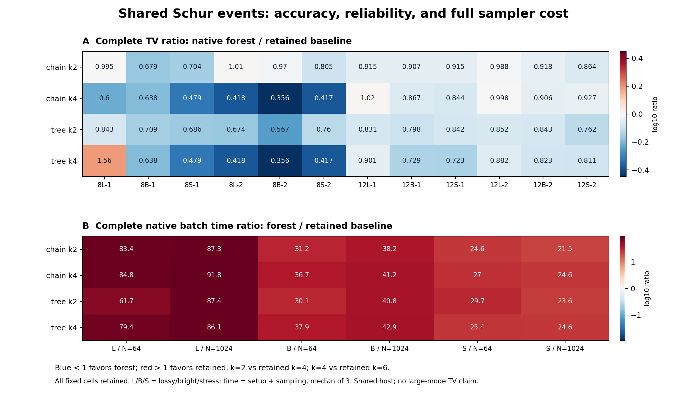

# 第八轮：共享 Schur 事件内核——质量与数值可靠性提高，原生速度目标失败

日期：2026-11-05（北京时间）。项目：量子 / deziroGBS。

## 1. 结论与研究决策

本轮把第七轮的共享事件推导实现为完整 C++ 采样器，并进行了固定的新输入比较。**数值后端与小系统质量有实质进展，但这版实现没有建立成本优势。** 四种候选相对各自较强 retained 基线的完整原生成本中位比为 34.73–40.43，24 个配对计时单元全部更慢。当前实现的定位是数值研究后端；项目的下一探索转向有损态的纯态核心分解、全局截断预算和压缩表示。

这不是对“所有经典算法上限”的判断。结果只覆盖这里声明的零均值 Gaussian 阈值测量模型、12 个小系统输入和当前主机。它不比较完整九章任务，不覆盖 PNR 输出、所有噪声模型或未知经典算法，也没有建立方法原创性。

### 完成规模

| 项目 | 实际完成 |
|---|---:|
| 完整回归门禁 | 268 项，0 失败、0 错误、0 跳过 |
| 新质量输入 | 12 个，来自 4 个不同 Haar 干涉仪 |
| 原生完整扩展律 | 72 个 |
| 原生/Python 完整律核对 | 72 项 |
| 独立表事件、固定原生 R/E 的核对 | 24 项，覆盖 6,120 个前缀 |
| 历史数值回归 | 12 个完整律和 12 项表参考核对 |
| 完整原生冷批次计时 | 108 次，全部完成 |

新面板的 72 个分布和历史回归的 12 个分布均无失败质量。新面板 Python 核对的最大完整律 TV 差为 `9.334700208382985e-13`；独立表事件核对最大差为 `2.5378989842222348e-14`。Python 和原生 forest 调用同一事件 C ABI，因此前者检验编排/选择/状态的一致性；独立表事件才提供不同事件算术路径的核对。两种证据不能混称为两个独立概率内核。

## 2. 固定设计与误差指标

质量配置为 `configs/iteration8_batched_forest.json`，正式运行前冻结 SHA256：

`40dfe24ba2516244faa86784ee2d403609e9b5ffbbcc207700e34280ebc534a4`

模式数为 8、12；每个模式数使用 seed base 440801、440802，实际 Haar seed 为 base + 1000m。同一干涉仪的三种配置为：lossy `(r=0.6, eta=0.35)`、bright `(0.9,0.65)`、stress `(1.2,0.85)`。这给出 12 个输入，但只有 4 个独立干涉仪，三个亮度配置并不是新的独立随机电路。

方法为 retained-k4/k6，以及 chain/tree 的 k2/k4。所有方法采用自然模式顺序和既有 click-influence 选点规则。原生前缀概率缓存关闭。静态 MI 树的权重来自输入态无条件阈值互信息，保留零权重的生成树边；这不是针对当前条件分布或全局 TV 的最优树。

完整 TV 使用成功子概率和失败符号：

\[
\operatorname{TV}(P,Q_\bot)
=\frac12\left(\sum_x|Q(x)-P(x)|+Q(\bot)\right).
\]

数值失败所在前缀的全部质量进入失败符号。没有补抽、删失败或把成功叶子重归一化。穷举自身的下溢会终止枚举，不能伪装成采样器失败。目标 P 来自浮点的小系统完整 Gaussian 阈值参考，保留其修正诊断；该参考不是区间算术证书。

计时固定为第一个新 m12 干涉仪的三种配置，N=64/1024，六种方法，各重复三次，共 108 次。任务顺序由 seed 440899 预先打乱。主统计量为每个单元三次 `setup + sampling` 的中位数，再总结六个 profile-by-N 配对比值的中位数。没有根据结果更换统计量或选择计时输入。

## 3. 实际实现与理论边界

记 Z 为历史零结果，R 为保留点击，F 为遗漏点击，i 为当前模式，E 为 F 上的树边。对空集、单点或树边 G：

\[
\overline M_{a,G}
=\frac{P(Z=0,R=1,X_i=a,X_G=1)}{P(Z=0)}
=\sum_{S\subseteq R}(-1)^{|S|}\beta_S h_{a,G,S}.
\]

这里先在 Q=(V+I)/2 中条件化 Z；每个 S 的因子为
\(\beta_S=\det(Q^Z_{SS})^{-1/2}\)。分解一次 Q^Z_SS，并共享求解
\(H=L^{-1}Q^Z_{S,D}\)，D={i}∪F。只生成对角块、i-j 块和树边块，局部真空行列式最大为 6×6。a=0 的当前真空条件始终在同一局部事件中计算，未丢失其概率因子。

森林分数为

\[
s_a=w_a^{1-f+e}\prod_{j\in F}u_{a,j}^{1-d_j}
\prod_{(j,l)\in E}v_{a,jl}.
\]

全部指数之和为 1，所以共同除去 P(Z=0) 不改变两分数的归一化比值。实现先合并相同事件的指数，再传播其对数误差指标。f=0、1、2 的边界分别退化为单个 w、u、v 事件。

事件核的前缀成本为

\[
O\!\left(2^r[(r+1)^3+(f+1)(r+1)^2]\right),\quad r\le k.
\]

2^k 并未消失，选择器、建树、状态重建和数值保护也不包含在这个局部表达式中。正常的规范 rank-two 零状态追加在一条路径上为 O(m³)。如果低精度状态更新反复失败并失效，随后反复从原输入重建，保守最坏零状态成本仍可达 O(m⁴)；完整路径应保留额外 C_rebuild 项。不能无条件把正常路径的 m³ 当作所有数值路径的保证。

对于已充分缓存的直接真空概率实现，唯一行列式数量可能与本核分解数量相同。复用收益应从分解维度、求解和零状态复用判断，不能通过与未缓存调用次数对比制造速度结论。详见 [理论与协议审查](research/iteration8_theory_and_protocol_audit.md)。

## 4. 数值策略与可验证成果

原始输入是 binary64 协方差。long double 和 GNU __float128 各自从该输入形成 Q 和零状态，quad 不接收低精度 Schur 状态的强制类型转换。当前环境 long double 为 64 位有效尾数，quad 为 113 位。每个标量操作传播固定 `mu=8*epsilon_format` 的误差指标，阈值固定为 1e-6；这些指标是保守设计的浮点启发式，不是向外舍入的区间证明。

AUTO 在一个前缀中最多尝试一次 LD 批次和一次整批 quad 精化，R/E 固定，成功后才消费 uniform。参数、内存和程序错误不进入精化分支。最终两个严格正分支若舍入到 binary64 的 0/1 端点仍然失败。解析零只来自原始协方差严格隔离的真空模式，不能由数值抵消或近似真空推断。

独立解析热态 `V=(1+2^-8)I` 的条件概率为 1/513。门禁确实观察到 LD 失败、quad/AUTO 成功，并检查 R/E 只选择一次；`V=(1+2^-40)I` 超出当前精度预算时继续失败。108 次不同查询历史、缓存容量和非自然测量顺序的条件记录逐值一致；原生 CLI 目前只提供自然顺序。新 Python 规范选择器使用既有 float64 rank-two 公式，并不把整个选择器升级为 quad。

**正式质量、历史回归和计时面板都没有触发 quad 精化。** 三组原生 forest 条件请求分别为 104,400、30,708、470,016。解析测试证明 quad 分支可用，历史问题的修复则发生在新的 long-double 共享/缩放事件路径上；不能把两件事混为“历史失败由 quad 修好”。

四个历史失败方法行全部变为零失败质量。最严重的 m12-lossy 历史输入：

| 方法 | 第七轮完整 TV | 第七轮失败质量 | 第八轮完整 TV | 第八轮失败质量 |
|---|---:|---:|---:|---:|
| chain-k4 | 0.001732760472 | 0.001732760472 | 0.000004161776518 | 0 |
| tree-k4 | 0.001732760472 | 0.001732760472 | 0.000003720632392 | 0 |

12 项历史表参考完整律的最大差为 `6.089949390293764e-13`。历史组是回归证据，不并入新面板的改善比例。其表参考沿用规范 Python 选择规则；逐前缀固定原生 R/E 的 6,120 项核对属于新 m8 面板。

## 5. 质量收益与实际成本

| 新法 | 比较基线 | 新输入 TV 改善 | TV 比值中位数 | 原生完整成本比中位数 |
|---|---|---:|---:|---:|
| chain-k2 | retained-k4 | 11/12 | 0.914677 | 34.7283 |
| tree-k2 | retained-k4 | 12/12 | 0.780143 | 35.4714 |
| chain-k4 | retained-k6 | 11/12 | 0.741252 | 38.9141 |
| tree-k4 | retained-k6 | 11/12 | 0.726073 | 40.4270 |

比值小于 1 才有利于新方法。改善采用预定绝对 TV 差阈值 1e-10。tree-k2 在这个固定组上全部改善，不构成普适单调性定理。反例也完整保留：tree-k4 在 m8-lossy-s440801 的 TV 为 6.68933e-8，retained-k6 为 4.29561e-8；chain-k4 在 m12-lossy-s440801 略差于 retained-k6。

24 个配对成本比的范围为约 21.50–91.79，速度改善和“质量不差且更快”的单元均为 0/24。共享核使问题可稳定求解，但当前逐标量数值保护实现的常数成本非常高。本轮没有运行控制消融来分别隔离 long-double 算术、误差指标和共享结构的成本，因此不能把一个具体机制断言为全部慢速原因。

事后只读工作归因保存于 `results/iteration8_analysis/work_audit.json`：森林冷批次总时长 111.562 秒，原始事件查询合计 108.940 秒，占约 97.65%；其中状态维护 27.897 秒、事件部分 80.787 秒。raw-query 计时不包括共享对数评分，计数也不是全部机器指令数。这个归因把后续优化问题定位在常规内核路径，而非实际没有发生的 quad 回退。

计时环境为共享 AMD EPYC 9V74 主机，允许 9 个逻辑 CPU，应用线程设为 1；非独占、未锁频、未控制操作系统页面缓存。编译器为 GCC 13.3，-O3、-march=native、-ffp-contract=off，无 fast-math。包含输入验证/静态 MI、选点、建树、状态、RNG、样本分配和全部失败尝试的原生 setup+sampling 是主指标；wrapper、输入与聚合成本另存。没有使用 Python 枚举时间声称原生采样加速。



## 6. 已排除的捷径与后续方向

完整树在遗漏至多两个点击时有一个精确边界恒等式，可以改为直接条件化全部历史点击。但直接接受旧 double 核的“成功”不满足第八轮支持/误差规则。解析输入 `V=(1+2^-52)I_2` 的点击概率严格正；旧 double 构造 Q 时就可能舍入为 I，返回零且 correction 计数仍为零。这个快捷接受方案已排除，详见 [边界路线审查](research/iteration9_boundary_route_review.md)。

把全部点击交给新受保护核仍是可研究候选，但外层从 2^r 变为 2^c，矩阵维度也增大，不能从恒等式推断速度。本轮未实现或测量该变体。

第九轮已实际转入纯态核心的解析误差预算与资源筛查，见 [第九轮报告](RESEARCH_REPORT_ITERATION9.md)。该分解属于已有研究思想；新增的是项目上的完整推导核对、固定资源面板和错误捷径排除。现有 forest Q 不继承新理论的误差界。

## 7. 文件与复现

核心为 `src/gbslab/batched_forest.py`、`src/gbslab/cpp_forest.py`、`experiments/batched_forest_kernel.cpp/.h` 和 `experiments/batched_forest_sampler.cpp`。构建和测试均为显式操作，测试不自动调用编译器。旧科学模块、旧原生采样器和第一至第七轮数据保持原内容。

```bash
export OPENBLAS_NUM_THREADS=1 OMP_NUM_THREADS=1 MKL_NUM_THREADS=1 PYTHONPATH=src
python experiments/build_click_sampler.py --build-dir .cache/repro-retained --native
python experiments/build_batched_forest.py --build-dir .cache/repro-batched --native
python experiments/build_batched_forest_sampler.py --build-dir .cache/repro-forest --native
GBS8_BINARIES=(--retained .cache/repro-retained/click_sampler --library .cache/repro-batched/libbatched_forest.so --forest .cache/repro-forest/batched_forest_sampler)
python experiments/verify_iteration8.py "${GBS8_BINARIES[@]}" --output results/repro8_validation
python experiments/iteration8_experiment.py quality "${GBS8_BINARIES[@]}" --validation results/repro8_validation/validation.json --output results/repro8_quality
python experiments/iteration8_experiment.py regression "${GBS8_BINARIES[@]}" --validation results/repro8_validation/validation.json --output results/repro8_regression
python experiments/iteration8_experiment.py timing "${GBS8_BINARIES[@]}" --validation results/repro8_validation/validation.json --quality results/repro8_quality --output results/repro8_timing
python experiments/iteration8_analyze.py --quality results/repro8_quality --regression results/repro8_regression --timing results/repro8_timing --output results/repro8_analysis
```

需要 C++20、libquadmath、Eigen 和项目 Python 依赖。新编译须建立新的绑定门禁；不要修改旧 SHA 来绕过检查。所有复跑使用新目录。完整日志、P/Q、失败记录、R/E 轨迹、源快照、配置与构建绑定均保存在对应 results 目录。

独立审计：[数值与状态审查](research/iteration8_numerical_audit.md)、[理论与协议审查](research/iteration8_theory_and_protocol_audit.md)、[最终产物审计](research/iteration8_final_audit.md)。

## 附录：全部固定结果

# 第八轮完整分布与原生总成本

TV包含失败符号；质量判定绝对差容差1e-10；每个计时单元取预定3次完整冷批次的中位数。

| 新法 | 基线 | TV改善/恶化/数值相等 | TV比值中位数 | 完整成本比中位数 | 更快单元 | 质量不差且更快 |
|---|---|---:|---:|---:|---:|---:|
| chain_k2 | retained_k4 | 11/1/0 | 0.914677 | 34.7283 | 0/6 | 0/6 |
| chain_k4 | retained_k6 | 11/1/0 | 0.741252 | 38.9141 | 0/6 | 0/6 |
| tree_k2 | retained_k4 | 12/0/0 | 0.780143 | 35.4714 | 0/6 | 0/6 |
| tree_k4 | retained_k6 | 11/1/0 | 0.726073 | 40.427 | 0/6 | 0/6 |

## 全部新输入的完整TV

| 输入 | retained_k4 | retained_k6 | chain_k2 | chain_k4 | tree_k2 | tree_k4 |
|---|---:|---:|---:|---:|---:|---:|
| m8_lossy_s440801 | 2.15419546e-05 | 4.29560527e-08 | 2.14438747e-05 | 2.57914885e-08 | 1.8169008e-05 | 6.68932594e-08 |
| m8_bright_s440801 | 0.00198552994 | 2.16394816e-05 | 0.00134751746 | 1.38077845e-05 | 0.00140869931 | 1.38077845e-05 |
| m8_stress_s440801 | 0.00530017181 | 0.000190780735 | 0.00373261012 | 9.13232321e-05 | 0.00363689631 | 9.13232321e-05 |
| m8_lossy_s440802 | 2.36257173e-05 | 2.53424214e-08 | 2.3882261e-05 | 1.05943337e-08 | 1.59159396e-05 | 1.05943337e-08 |
| m8_bright_s440802 | 0.00172347095 | 1.62044277e-05 | 0.00167170155 | 5.77129355e-06 | 0.000976961783 | 5.77129355e-06 |
| m8_stress_s440802 | 0.00409086546 | 7.09565018e-05 | 0.00329226147 | 2.9610136e-05 | 0.00310888685 | 2.9610136e-05 |
| m12_lossy_s440801 | 0.000245780361 | 4.70212548e-06 | 0.000224808677 | 4.78599982e-06 | 0.000204201684 | 4.23810376e-06 |
| m12_bright_s440801 | 0.0109779183 | 0.00160785815 | 0.00995267907 | 0.00139480269 | 0.00875930632 | 0.00117183899 |
| m12_stress_s440801 | 0.0166303472 | 0.00510870344 | 0.0152114682 | 0.00431389383 | 0.0140065323 | 0.00369525472 |
| m12_lossy_s440802 | 0.000235394956 | 4.59553727e-06 | 0.000232646815 | 4.58495635e-06 | 0.000200672434 | 4.05186901e-06 |
| m12_bright_s440802 | 0.010579817 | 0.00147005467 | 0.00971754422 | 0.00133226899 | 0.0089167711 | 0.00121007846 |
| m12_stress_s440802 | 0.0165710484 | 0.00439170715 | 0.0143208427 | 0.00407126088 | 0.0126334907 | 0.00356185196 |

## 原生完整批次成本（秒，中位数）

| 输入 | 样本数 | retained_k4 | retained_k6 | chain_k2 | chain_k4 | tree_k2 | tree_k4 |
|---|---:|---:|---:|---:|---:|---:|---:|
| m12_lossy_s440801 | 64 | 0.001059749 | 0.000812376 | 0.088385573 | 0.068866429 | 0.065424201 | 0.064515112 |
| m12_lossy_s440801 | 1024 | 0.011426584 | 0.011823663 | 0.99796386 | 1.0853116 | 0.99836167 | 1.0183792 |
| m12_bright_s440801 | 64 | 0.003723871 | 0.005199278 | 0.11628781 | 0.19058127 | 0.11206299 | 0.19719913 |
| m12_bright_s440801 | 1024 | 0.048262537 | 0.073353656 | 1.8450263 | 3.0201775 | 1.9715063 | 3.1487651 |
| m12_stress_s440801 | 64 | 0.007070429 | 0.020445926 | 0.17372785 | 0.55136171 | 0.21013537 | 0.51893647 |
| m12_stress_s440801 | 1024 | 0.13697655 | 0.30286456 | 2.9446488 | 7.4362365 | 3.2277227 | 7.4405987 |

## 历史数值回归（不混入新质量面板）

| 历史输入 | 方法 | 原TV | 新TV | 原失败质量 | 新失败质量 | 与表参考的TV差 |
|---|---|---:|---:|---:|---:|---:|
| m10_lossy_s340701 | chain_k4 | 9.80412822e-05 | 5.19682395e-07 | 9.79131558e-05 | 0 | 1.655e-13 |
| m10_lossy_s340701 | tree_k4 | 8.32641418e-05 | 4.76431038e-07 | 8.30811245e-05 | 0 | 1.651e-13 |
| m10_bright_s340701 | chain_k4 | 0.000236216575 | 0.000236216575 | 0 | 0 | 5.474e-14 |
| m10_bright_s340701 | tree_k4 | 0.000198907598 | 0.000198907598 | 0 | 0 | 5.45e-14 |
| m10_stress_s340701 | chain_k4 | 0.00102661914 | 0.00102661914 | 0 | 0 | 1.172e-14 |
| m10_stress_s340701 | tree_k4 | 0.000902187219 | 0.000902187219 | 0 | 0 | 1.141e-14 |
| m12_lossy_s340701 | chain_k4 | 0.00173276047 | 4.16177652e-06 | 0.00173276047 | 0 | 6.09e-13 |
| m12_lossy_s340701 | tree_k4 | 0.00173276047 | 3.72063239e-06 | 0.00173276047 | 0 | 6.061e-13 |
| m12_bright_s340701 | chain_k4 | 0.001347186 | 0.001347186 | 0 | 0 | 1.958e-13 |
| m12_bright_s340701 | tree_k4 | 0.0012879068 | 0.0012879068 | 0 | 0 | 1.942e-13 |
| m12_stress_s340701 | chain_k4 | 0.00424073086 | 0.00424073086 | 0 | 0 | 2.582e-14 |
| m12_stress_s340701 | tree_k4 | 0.00412108972 | 0.00412108972 | 0 | 0 | 2.532e-14 |
