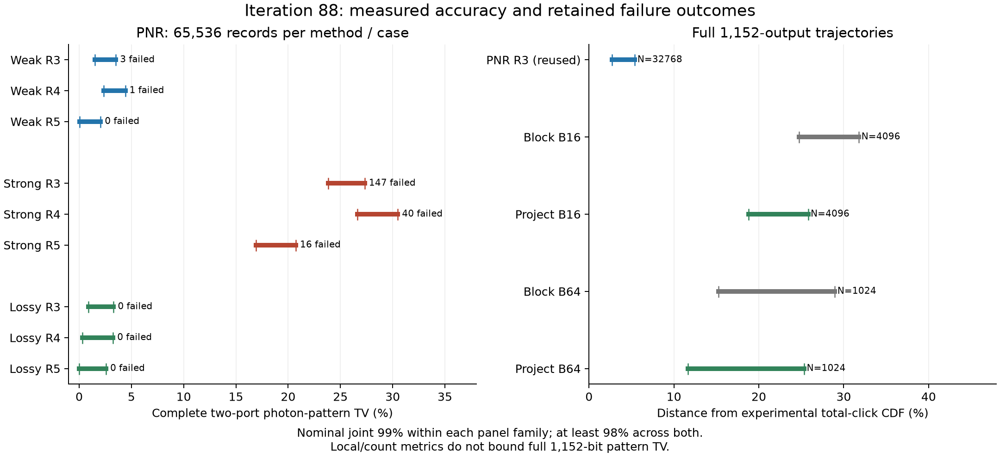

# 第88轮：完整PNR精度、单点击矩投影与物理合法性反例

本轮两条路线都推进了完整质量检验：PNR新增12组、每组65536条两端口记录；
直接点击新增四组共10240条完整1152格双谱记录。PNR强双模态保留5因子相对3因子
确认了有限范围的精度改善，但误差仍大；直接点击的经验改善尚未形成预定置信
保证，而且新投影暴露了不满足物理约束的失败状态。
**两项候选闭合均不升级为可靠通用基线；没有达成任意输入优势或九章吞吐。**
第83轮随机流与第86轮旧CPU舍入勘误继续有效，旧保证不恢复。

## 1. 完整两端口PNR分布，而非仅点击统计

四个输入、保留3/4/5个光子作用因子，共786432条新记录。参考由独立90位正概率
公式计算，每端口0–64外有解析尾界，失败是独立目标零概率结果。所有207条失败
都计入分母，没有删行或补抽。以下区间属于预定24事件名义联合99%族；最后一列
是点击经验TV，不是另一个紧置信上界。

| 输入 | 保留因子 | 失败/65536 | 完整两端口PNR TV区间 | 点击经验TV |
|---|---:|---:|---:|---:|
| 纯双模 r=0.6 | 3 | 3 | 1.4960%–3.5135% | 0.0472% |
| 纯双模 r=0.6 | 4 | 1 | 2.3411%–4.4136% | 0.0596% |
| 纯双模 r=0.6 | 5 | 0 | 0.0353%–2.0524% | 0.3372% |
| 纯双模 r=0.85 | 3 | 147 | 23.8227%–27.3287% | 0.4013% |
| 纯双模 r=0.85 | 4 | 40 | 26.6202%–30.4936% | 0.1499% |
| 纯双模 r=0.85 | 5 | 16 | 16.9276%–20.7342% | 0.3369% |
| 损耗双模 r=0.85, η=0.8 | 3 | 0 | 0.8699%–3.2977% | 0.1555% |
| 损耗双模 r=0.85, η=0.8 | 4 | 0 | 0.3248%–3.2452% | 0.2504% |
| 损耗双模 r=0.85, η=0.8 | 5 | 0 | 0.0000%–2.5725% | 0.2259% |
| 独立热态 n=1,2 | 3 | 0 | 0.0000%–1.6783% | 0.1048% |
| 独立热态 n=1,2 | 4 | 0 | 0.0000%–1.8328% | 0.1287% |
| 独立热态 n=1,2 | 5 | 0 | 0.0000%–1.8089% | 0.2330% |

强纯双模案例R5上界20.7342%低于R3下界23.8227%，同族口径下该完整PNR误差
至少小**1.1490倍**。这不是已接近精确：R5仍有至少16.9276%的TV误差。
R4的经验TV为29.7230%，高于R3的26.5581%；两者置信区间重叠，不宣称已保证
R4实际误差更大。预算不能仅凭这些观察被假定单调有效。

纯双模目标仅支持n₁=n₂；强案例R3/R4/R5样本偏离该支持的比例分别为
23.5382%/29.6310%/17.7353%（描述统计，含原失败行，非新增置信事件）。
对应点击经验TV却只有0.4013%/0.1499%/0.3369%，说明点击统计可掩盖光子数失真。
损耗后R5上界为2.5725%，R3为3.2977%，区间重叠，不能用两个上界之比宣称
实际误差改善。热态对照全部无失败。

强/弱纯态失败均报“Polynomial survival outside [0,1]; no clipping”。本轮没有
改动冻结PNR内核来隐藏该问题。输入重构残差与数值参考的不确定性见
[方法说明](research/iteration88_methods.md)；原始数据见
[小系统质量](results/iteration88_small_pnr_quality_v1/summary.json)。

## 2. 直接点击：匹配整个条件矩，再保留最近点击

先尝试只闭合最老点击的滑动窗口，32条探索记录的平均点击数达811–846，
与目标Gaussian均值103.8958严重不符；这一路线否决，代码和数据原样保留。

第二个候选先计算整个条件二阶矩T，反解Gaussian基底Y，使保留最近一个点击
后的二阶矩等于T。12个独立80位逆映射检查、三种8格完整律、完整模型数值/guard
路径及线程/分批检查通过。实现为C++，Python承担调度及独立参考。
它保持的是二阶矩，而不是整个分布或Gaussian基底的物理合法性。

真实完整模型前8格、两谱OR后的数值枚举TV如下：

| 预算 | 旧闭合 | 单点击投影 |
|---|---:|---:|
| 16 | 4.8806106e-9 | 3.8679302e-9 |
| 64 | 1.3857106e-13 | 9.2263710e-14 |

这里没有用guard区间中心相乘。如此小的局部误差也不能代表后续1144格的质量。
原始枚举、数值路径及区间检查见[完整模型门槛检查](results/iteration88_project_gates_v1/summary.json)。

## 3. 四组完整1152格新样本的共同质量

样本量和47事件失败预算在采样前冻结，四个方法使用独立实验域。PNR复用
第86轮32768条记录，不冒充新增样本。以下误差区间和完整Gaussian TV下界属于
同一名义联合99%族；它与上节PNR小系统族合起来至少98%，不是联合99%。
实验CDF指标比较1492642条真实实验记录；Gaussian TV见证比较固定输入模型，
两种目标分开，不能相互替代。

| 方法 | N | 失败 | 实验总点击CDF误差区间 | 完整Gaussian点击TV下界 |
|---|---:|---:|---:|---:|
| PNR R3（复用） | 32768 | 0 | 2.6909%–5.4040% | 0.0000% |
| 旧闭合 B16 | 4096 | 0 | 24.7556%–31.7893% | 13.7287% |
| 单点击投影 B16 | 4096 | 1 | 18.7742%–25.8079% | 9.6950% |
| 旧闭合 B64 | 1024 | 0 | 15.2431%–28.9604% | 7.5657% |
| 单点击投影 B64 | 1024 | 0 | 11.6288%–25.3460% | 3.6595% |

B16旧误差下界/新误差上界=0.9592，
B64=0.6014，均未超过1。
因此观察到CDF经验误差下降，但不能声称预定置信口径下已保证改善；不根据结果
临时增样。下界变小也不能证明真实完整TV变小，尤其不能把PNR下界0解释成零偏差。

PNR在该实验CDF指标上，相对旧B16、新B16、旧B64、新B64的误差至少分别小
4.5810/
3.4741/
2.8207/
2.1519倍。
这不等于完整1152格模式TV的排序。三组局部TV及光学端口PNR/CDF界见
[共同质量分析](results/iteration88_joint_quality_v1/summary.json)。

## 4. 已定位的新失败：矩残差小，基底仍不物理

单点击B16在4096条中有1条失败，位于第二谱记录685、探测格632（零基索引）。
完整记录作为失败结果计入上表；B64的1024条无失败不保证其他输入也可靠。

原始guard重放逐字段相同，未使用guard的数值路径也在同一位置失败。对实际
long-double Gram导出42位十进制，以100位独立行列式子集和得到概率
**−0.0004418019249383645473**，与原生概率差约2.02e-20。基底的不确定关系
矩阵最小特征值约**−0.277526**。它不是单纯提高最终求和精度就能修复的误差。

当前拟合只检查I+Y正定与矩残差，未检查完整量子不确定关系。这个反例明确指出
下一步应加入物理约束；不能裁剪负概率、删除这条样本或把预定拟合回退当作修复。
数值状态诊断不是原始目标态的区间证明。见[原始失败诊断](results/iteration88_failure_diagnostic_v1/summary.json)。

## 5. 同输入、同线程的正式串行成本

直接点击16线程，固定相同控制记录，三次轮换中位；计入模型创建、随机数生成、
采样、双谱OR及销毁，不计损耗输入准备、首次DLL加载及归档。没有重计算任务重叠。

| 方法 | 4条/秒 | 64条/秒 | 64条折合每条/秒 | 相对九章3.0原始单条耗时 |
|---|---:|---:|---:|---:|
| 旧闭合 B16 | 0.796481 | 2.754766 | 0.043043 | 33892.29× |
| 单点击投影 B16 | 0.947950 | 3.370114 | 0.052658 | 41463.02× |
| 旧闭合 B64 | 3.272316 | 10.180563 | 0.159071 | 125252.99× |
| 单点击投影 B64 | 3.321883 | 10.222752 | 0.159730 | 125772.04× |

B16投影成本为旧闭合的1.2234倍，B64为
1.0041倍。更复杂的近似没有无成本地消除偏差。

完整1152格双谱PNR，块16、16线程、64条、三次串行中位：

| 保留因子 | 64条/秒 | 相对R3成本 | 相对九章3.0折合单条耗时 |
|---|---:|---:|---:|
| 3 | 2.837458 | 1.0000× | 34909.67× |
| 4 | 4.009273 | 1.4130× | 49326.68× |
| 5 | 8.289777 | 2.9216× | 101990.37× |

PNR计时包含模型/树创建、输出分配、采样、双谱求和和销毁，不计输入读取、
初次DLL加载与归档。本轮R3/R5都使用该相同计时边界；小系统精度改善不能被
套用于尚未新增质量样本的完整1152格R5。重复计时输出逐值相同，不增加独立N。
见[直接点击计时](results/iteration88_direct_timing_v1/summary.json)和
[PNR计时](results/iteration88_pnr_timing_v1/summary.json)。

## 6. Frugal与九章的具体口径

2026-11-14复核[Frugal官方HEAD](https://github.com/tomdodd4598/FrugalGBS)仍为
fa8b796f2afebd4845a2e335e457735952617ef8。独立8格任务的前8格K2/K3/K5数值TV
分别为4.6953067e-4/2.8893158e-5/9.0915542e-8；新B16对应完整模型前8格数值TV
为3.8679302e-9，数值误差比约23.50。该局部优势与上表全局明显偏差同时存在；
没有完整Frugal1152格分布误差保证可据此合并成等精度速度结论。

末8格Frugal独立任务K5的TV为3.8955214%，复用PNR完整轨迹的对应边缘上界为
2.5618%，限定该指标误差至少小
1.5206倍；仍不能当作Frugal完整轨迹末端边缘的比较。

Frugal完整1152格K2历史四条耗时5394.1328257秒，单worker、4路SIMD、约16.3GB
工作区；本轮16线程新B16四条0.947950秒，原始时间比
5690.31。这是不同资源与未匹配完整质量的历史比值，
不是同资源、同完整分布误差下的加速证明。

[九章3.0原论文](https://arxiv.org/abs/2304.12240v3)报告1.27微秒/条；本轮最快
直接点击B16折合每条仍慢33892.29倍，并有显著误差。
九章3.0通过144物理端口×8时间格阈值探测获得伪光子数分辨能力，不是无上限
理想PNR。它不是“先在软件生成光子数再阈值化”或Frugal的算法路线；这里比较
的是对齐后的格点击任务和原始硬件吞吐。

## 7. 复核、失败保留与下一轮

全库1024项运行，995成功、0失败、
0错误；新增5项原生投影测试通过。29个历史
可选案例和7个类级后端检查跳过，逐项原因存档。
独立最终核验**9955项**通过，重算原始合并、Philox决策、域范围、
失败符号、两族置信界、120位失败概率及串行中位；大量检查是哈希/地址断言，
不是独立科学实验。20480个新直接点击流、3145728个小系统PNR流与复用PNR域
不重叠；域分离不证明数学iid，全部统计界仍为名义口径。

首版投影因类型名编译失败，修订v2只修正类型；原版源文件与错误输出保留。
滑动窗口反例、PNR失败及新投影失败均保留，不覆盖已执行科学源文件。
数据、二进制、源快照、哈希、报告一起公开。下一轮重点是带物理约束的闭合与
保持光子对相关的PNR近似，详见[第89轮计划](research/iteration89_plan.md)。
