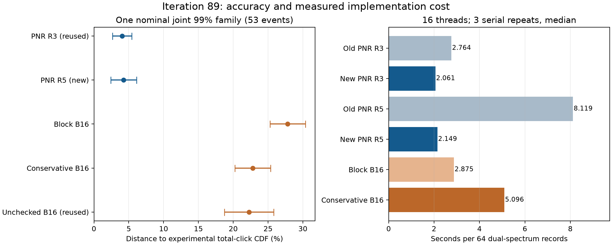

# 第89轮：纯态PNR端口选择加速与保守物理约束

本轮实现了可逐值重放的C++ PNR纯态阶段加速：保留3/5因子的正式耗时分别缩短
**1.3412/3.7775倍**，786432条小系统记录和4096条完整双谱记录
与旧输出一致。新PNR R5另生成16384条独立域质量记录。直接点击两组各8192条
均无失败，但新增物理约束仍未给出预定置信口径下的精度改善保证。
**总体目标尚未完成：没有任意输入优势，也没有达到九章原始吞吐。**

第83轮随机流重叠已在第84轮修正、重采并重新计算误差界；旧保证保持撤回。
第86轮旧CPU舍入环境勘误也继续有效。修正实现不等于旧偏差消失；详见
[随机流勘误](RESEARCH_ERRATUM_ITERATION83_RNG.md)。

## 1. 先生成光子数：保留同一采样路径，降低端口选择成本

新C++内核将条件二阶矩Gram树用于初始纯态阶段，分支靠近阈值或矩阵检查失败
时回退到冻结的正范数选择器。等待时间、闭合、输出和随机地址规则不变。
36个纯态/位移/因子数案例共1620个边界选择检查通过。全部786432条旧小系统
记录及首4096条旧完整双谱记录的光子数、错误、有效性、原16个统计量逐值相同。
树调用计数按设计改变；重放不增加独立N，原207条小系统失败全部保留。

正式计时64条、16线程，三次串行轮换中位，包含模型/树构建、采样与双谱求和；
不含输入读取、首次DLL加载和存档。计时期间没有其他重计算任务。

| 保留因子 | 旧耗时（秒/64条） | 新耗时（秒/64条） | 旧/新时间比 | 新方法相对九章3.0每条耗时 |
|---|---:|---:|---:|---:|
| R3 | 2.764418 | 2.061154 | 1.3412× | 25358.69× |
| R5 | 8.118812 | 2.149261 | 3.7775× | 26442.68× |

这是已检验记录上的实现加速，不是改变闭合后获得了更精确的分布。
[逐值重放](results/iteration89_pnr_replay_v1/summary.json)、
[串行计时](results/iteration89_pnr_timing_v1/summary.json)。

## 2. 新真实输入质量：预算更大不自动意味着更准

采样前冻结53事件族：PNR R3复用32768条、R5新16384条，旧直接B16与保守投影
B16各新8192条，无约束投影复用4096条。PNR R5和两组新直接点击均零失败。
实验参考1492642条；所有错误均映射到目标零概率结果，不删行、不补抽。
以下同属所声明iid模型下的名义联合99%族，且依赖已列出的数值参考。

| 方法 | N | 失败 | 对实验总点击CDF误差区间 | 对Gaussian完整点击TV下界 |
|---|---:|---:|---:|---:|
| PNR R3（复用） | 32768 | 0 | 2.6820%–5.4129% | 0.0000% |
| PNR R5（新） | 16384 | 0 | 2.3994%–6.1155% | 0.0000% |
| 旧闭合 B16 | 8192 | 0 | 25.2662%–30.3755% | 14.8738% |
| 保守约束投影 B16 | 8192 | 0 | 20.2443%–25.3536% | 10.4562% |
| 无约束投影 B16（复用） | 4096 | 1 | 18.7512%–25.8309% | 9.6731% |

PNR R3/R5的实验CDF区间重叠，不能据本轮声称R5更准。保守投影与旧直接B16的
经验CDF误差从27.8208%降到22.7990%，但旧下界/新上界仅
**0.996550**，仍小于1，
因此未保证改善，也不在观察结果后临时增样。保守投影完整Gaussian点击TV仍
至少10.4562%，
零失败并不等于近似无偏。TV下界变小不能用于实际TV排序。

限定实验总点击CDF指标，PNR R3相对旧B16、保守投影B16和无约束B16的误差
至少分别小4.6678、
3.7400和
3.4642倍。
这是计数CDF的结论，不能扩大成完整1152位模式TV排序。

| 方法 | 两组光学端口联合PNR TV上界 | 全区间/末128格光子数CDF误差上界 |
|---|---:|---:|
| PNR R3（复用） | 2.2391% / 2.1811% | 1.8589% / 1.5126% |
| PNR R5（新） | 3.2308% / 3.2099% | 2.1477% / 2.3688% |

端口对为(0,143)、(142,143)，每端口0–64外含解析尾项。R5较宽的上界受不同N
和经验差异影响，不能用两个上界之比声称R3或R5实际误差更小。上述局部上界
均不覆盖完整1152输出模式。完整统计见[共同质量](results/iteration89_joint_quality_v1/summary.json)
和[冻结计划](research/iteration89_quality_plan.json)。

## 3. 直接点击：保守约束消除已知失败路径，但条件仍过严

在第88轮逆矩拟合后，新检查规范潜变量Gaussian基底的不确定关系严格内部条件。
检查失败按预定规则回退为整个条件矩的Gaussian闭合。原失败地址第二谱记录685
现可完成；本轮拟合尝试187918次，接受186034次，拒绝
1884次，其中新增不确定关系原因1163次。
这些是回退次数，不是被删除的样本；完整原始计数均存档。

**这项检查只是剩余输出合法性的充分条件，不是必要条件。** 解析例子显示，
测掉部分光学输出后，内部潜变量的规范不确定矩阵可以有−.11583324特征值，
而真正剩余输出态最小值为+.00619650。18组100位解析核对通过；纯态边界也会
被本轮严格内部条件拒绝。因此不能将拒绝率解释成“不物理状态”的比例。

同步校正第88轮的解释：−.277526属于原始潜变量规范矩阵，而不是实际剩余
输出态。对该真实失败重新选取保留点击及未测的522行光学映射后，实际不确定
矩阵最小值仍为**−.03322222846**，80位Rayleigh见证确认负值。
原条件概率**−.0004418019**的独立证据仍成立；纠正坐标口径没有撤销这个失败。
详见[潜变量解析例子](results/iteration89_latent_physicality_v1/summary.json)、
[实际剩余输出诊断](results/iteration89_remaining_state_v1/summary.json)。

| 直接点击方法 | 4条耗时（秒） | 64条耗时（秒） | 折合单条相对九章3.0耗时 |
|---|---:|---:|---:|
| 旧闭合 B16 | 0.768709 | 2.875191 | 35373.91× |
| 无约束投影 B16（复用） | 0.873537 | 3.324812 | 40905.66× |
| 保守约束投影 B16 | 1.357469 | 5.096180 | 62699.07× |
| 旧闭合 B64 | 3.165810 | 9.478727 | 116618.20× |
| 保守约束投影 B64 | 3.845887 | 10.966701 | 134924.97× |

B16保守投影成本为旧闭合的1.7725倍。
B64仅有门槛检查和正式计时，本轮没有新B64完整质量样本，不能套用B16误差界。
计时含模型构建、随机数、双谱采样/OR及销毁，排除输入准备和归档；
[全部计时](results/iteration89_direct_timing_v1/summary.json)。

## 4. PNR失败分离为端点舍入与结构偏差

对第88轮五种出现失败的配置，各重放第一条失败。所有这五例均发生在零后续
光子的端点。独立100位特征系计算仍为负；进一步直接从保存的二进制double
协方差求逆、不用原生特征分解，端点约−3.7e−18到−8.7e−16，实际保存状态的
不确定矩阵也有约1e−17到1e−16量级负值。只提高最后的求和精度不足以消除
已形成状态的边界误差。没有裁剪端点，且这五例不冒充对全部207条的穷尽诊断。

这与强双模闭合丢失成对支持约束导致的大偏差不同。已冻结小系统R3完整PNR TV
区间23.8227%–27.3287%，R5为16.9276%–20.7342%；本轮逐值重放保持这些记录。
它们来自另一个24事件99%族，与本轮53事件族合起来只称至少98%。端点修复
即使成功，也不能把约20%的分布失真解释掉。
[原始流诊断](results/iteration89_pnr_diagnostic_v1/summary.json)、
[独立矩阵诊断](results/iteration89_pnr_state_audit_v1/summary.json)。

## 5. Frugal、九章与剩余差距

2026-11-14复核[Frugal官方HEAD](https://github.com/tomdodd4598/FrugalGBS)仍为
fa8b796f2afebd4845a2e335e457735952617ef8。独立末8格任务K5数值TV为3.8955214%，
PNR R3完整轨迹对应边缘上界为2.5699%，
限定所列局部任务误差至少小1.5158倍。新R5上界为
4.2486%，没有形成同样的优势保证。
独立八格Frugal任务不是其完整1152轨迹的后段边缘。

Frugal完整1152格K2历史四条5394.1328257秒，单worker、4路SIMD、约16.3GB
工作区；本轮16线程保守B16四条1.357469秒，原始时间比
3973.67。资源和完整精度未匹配，不称等精度加速。

[九章3.0论文](https://arxiv.org/abs/2304.12240v3)报告1.27微秒/条；本轮新PNR
R3每条32.2055毫秒，仍慢25358.69倍。
九章3.0是144物理端口×8时间格阈值读出，能给有限伪光子数分辨信息，不是
无限理想PNR；它也不是经典软件“先PNR再阈值化”或Frugal采样算法。
对齐格点击任务后，硬件吞吐与经典近似误差仍分别报告。
固定损耗、非负图匹配和MPS路线的适用范围见[前沿对照](research/iteration89_frontier_comparison.md)。

## 6. 验证与继续推进

全库1031项运行，1002成功，0失败、
0错误；新增7项原生测试通过。历史可选案例跳过29项、
类级跳过7项，原因存档。最终独立核验9517项通过，
覆盖哈希、域地址、原始合并、逐值重放、质量界、计时中位和物理性见证。
检查数量包含大量机械断言，不等于独立科学实验数量。

163840个新用途流与旧/探索域分离；不将PRNG地址不重复当作真iid证明。
原始数据、二进制、源快照、全部失败和方法范围一起公开。下一轮着重实际
剩余光学子空间的物理约束、保持光子对相关的PNR闭合和端点稳定表示，
详见[方法](research/iteration89_methods.md)、[第90轮计划](research/iteration90_plan.md)。
