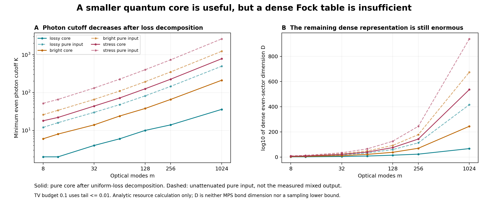

# 第九轮：纯态核心分解、全局截断误差预算与表示规模筛查

日期：2026-11-05（北京时间）。项目：量子 / deziroGBS。

## 1. 本轮方向与完成状态

第八轮的新原生事件核改善了数值可靠性，却在完整采样成本上失败。本轮随即转入基础理论路线：先构造一个能与目标态建立全局距离关系的近似态，再评估其表示和采样成本。

**已完成的是解析推导、已知工作核查、一个可复现的预算计算程序，以及固定参数的资源筛查。新的压缩态采样器尚未实现。** 结果表明，损耗后的纯态核心确实能显著降低所需光子截断，但直接建立稠密 Fock 大表仍不适合大模式数。当前选定的后续方向是保留相干性的压缩表示，并分别预算状态压缩和测量采样误差。

这里的 Gaussian 纯态核心加经典位移分解属于已知方法。Oh 等的作者稿 §III.1、Eq.(4)–(5) 已给出相同单模分解，§III.2 将其与 MPS、随机局部位移和测量结合；本轮不宣称重新发明了它。参见 [Classical algorithm for simulating experimental Gaussian boson sampling](https://arxiv.org/html/2306.03709v2)。更近期的 [低纠缠 Gaussian 态到 MPS 的转换工作](https://arxiv.org/html/2512.10643v2) 也提供可参考的构造路线，但其适用条件、表示维数和完整采样成本仍须分别检查。

## 2. 分解的明确条件

本轮固定零均值、hbar=2、xxpp 顺序，m 个相同实压缩参数 r≥0 的输入，统一透射率 eta∈[0,1]，以及无源线性干涉仪。均匀损耗可与该无源变换交换。设其实正交辛矩阵为 O，定义

\[
a=1-\eta+\eta e^{-2r},\qquad
b=1-\eta+\eta e^{2r},\qquad
s=-\frac12\log a.
\]

目标协方差与纯态核心为

\[
V=O\operatorname{diag}(aI,bI)O^T,
\quad V_p=O\operatorname{diag}(aI,a^{-1}I)O^T,
\quad C=V-V_p.
\]

因为

\[
ab=1+4\eta(1-\eta)\sinh^2r\ge1,
\]

所以 C≥0，Vp 满足纯 Gaussian 态条件。令实际 quadrature 位移 d∼N(0,C)，对应复幅度 alpha_j=(d_qj+i d_pj)/2，则

\[
\rho_V=\mathbb E_d\left[D(d)|\psi_p\rangle\langle\psi_p|D(d)^\dagger\right].
\]

C 可以奇异，Gaussian 随机向量应通过半正定协方差的推前分布定义，无须假定其有全维密度。输出位移一般跨模式相关，不能擅自改成互相独立的模式噪声。非均匀损耗或一般实验协方差需要另行寻找合法 Vp；本轮闭式表达式没有覆盖那些情形。

## 3. 可用于新构造的全局误差预算

令 Π_K 投影到核心的总光子数 N≤K，并定义

\[
\tau_K=\langle\psi_p|(I-\Pi_K)|\psi_p\rangle,
\qquad
|\psi_K\rangle=\frac{\Pi_K|\psi_p\rangle}{\sqrt{1-\tau_K}}.
\]

只要 τ_K<1，两纯态的 trace distance（采用二分之一迹范数约定）恰为

\[
\frac12\bigl\||\psi_p\rangle\langle\psi_p|-|\psi_K\rangle\langle\psi_K|\bigr\|_1
=\sqrt{\tau_K}.
\]

施加同一个随机位移通道，再施加阈值测量，距离收缩。因此，由**这个具体归一化相干截断态**产生的分布 P_K 满足

\[
\operatorname{TV}(P,P_K)\le\sqrt{\tau_K}.
\]

若目标预算为 epsilon，充分条件是 τ_K≤epsilon²。不能误用 τ_K≤epsilon。这个结论从整态到完整输出分布传递误差，不依赖仅匹配低阶边缘。

它也不能直接用于旧 retained、product、pair 或 forest 采样律：那些 Q 没有被证明等于本节的 P_K。若后续压缩表示引入 trace-distance 误差 delta_state，实际采样引入 TV 误差 delta_sample，则要独立证明并合计

\[
\operatorname{TV}(P,Q_{\rm implemented})
\le\sqrt{\tau_K}+\delta_{\rm state}+\delta_{\rm sample}.
\]

若位移或测量也作额外近似，它们必须进入相应预算。计算一个光子尾概率并没有自动完成这些证明。

## 4. 截断尾的计算

无源 O 保持总光子数，所以核心总光子尾可在输入压缩态基底计算。单模的总光子数是偶数。令 lambda=tanh²s，J=N_core/2，则 m 个相同压缩核心的概率生成函数为

\[
\mathbb E[z^J]=\left(\frac{1-\lambda}{1-\lambda z}\right)^{m/2},
\qquad
J\sim\operatorname{NB}\left(\frac m2,\operatorname{sech}^2s\right).
\]

采用 NB 的失败次数约定。程序选择满足 Pr(J>K/2)≤epsilon² 的最小非负偶数 K，同时保存 K−2 的尾概率以核验最小性。

核心平均光子数为

\[
\overline N_{\rm core}=m\sinh^2s
=\frac{m(1-a)^2}{4a}
=\frac{m\eta^2(1-e^{-2r})^2}{4(1-\eta+\eta e^{-2r})}.
\]

弱透射极限下它按 m eta² 缩放，解释了为何它能显著小于实际输出平均光子数。但固定非零 eta、r 时，核心平均光子数仍随 m 线性增长，不能把 K 自动当作与系统规模无关的常数。

上面的距离恒等式与分解是精确算术陈述。本轮尾概率使用 SciPy survival function 和独立 long-double 正项递推核对，尚未实施向外舍入认证；报告中的浮点 K 是经交叉核对的预算估计。

## 5. 必须保留的相干性：一个明确反例

Π_K|ψ_p〉保留不同总光子数扇区间的相干性。被动干涉仪保持 N，但位移不保持 N。先随机选择一个 N，再独立模拟该扇区，会把纯态改成退相干混合态；“量子计数加经典计数”也没有这里的态构造依据。

例如，取单模核心 tanh s=1/2，投影 N≤2 并归一化后

\[
|\psi_K\rangle=\frac{2\sqrt2}{3}|0\rangle-\frac13|2\rangle.
\]

对实位移 alpha=1，保持相干性的真空概率为 1/(2e)，先随机选 N 后的概率为 17/(18e)，差值为 4/(9e)。这个差并非一个很小的浮点效应。它是位移后测量可见的量子干涉。

相同问题也能出现在合法的 Gaussian 位移平均中：取原输入 r=log3、eta=3/4，得到 a=1/3、b=7，残余 p-quadrature 位移方差为 4。写 alpha=iY、Y∼N(0,1)，相干与退相干截断态的平均真空概率之差为 4/(27√3)>0。这个解析见证用于排除错误实现，不是新增采样性能实验。

偶数性只限制纯态核心的**总**光子数。经过干涉仪后单模式光子数可以为奇数；经过位移后总光子数也可以为奇数，且输出光子数支持无界。核心 K 不等于最终探测光子数上限。

## 6. 固定资源面板与结果

配置为 `configs/iteration9_core_budget.json`；在预算计算前单独冻结。模式数 8、12、32、64、128、256、1024，三组既有 r/eta 配置，TV 预算 0.1、0.01，共 42 行比较、84 个核心/未损纯输入主截断计算。它没有读取第八轮的目标 P、Q 或样本，也没有拟合新参数。

检查包括：协方差分解、纯态恒等式、C 的半正定性、eta=0/1 与真空边界、m=2 的几何尾、最小 K 与前一偶数 K，以及 log 维数与小整数精确求和。20 项检查通过。168 个尾概率与前一截断尾的独立递推核对，最大绝对差为 1.21431e-16。

稠密偶数 Fock 基底的维数为

\[
D_{\rm even}(m,K)=\sum_{\substack{0\le n\le K\\n\ \rm even}}\binom{m+n-1}{n}.
\]

以下为 TV 预算 0.1 的代表值；完整两个预算、全部 42 行见后附表。

| 配置 | m | 核心平均光子数 | K | log10 D_even |
|---|---:|---:|---:|---:|
| lossy | 256 | 5.06806 | 14 | 22.928 |
| bright | 256 | 41.1842 | 66 | 69.590 |
| stress | 256 | 168.337 | 226 | 143.085 |
| lossy | 1024 | 20.2722 | 36 | 67.065 |
| bright | 1024 | 164.737 | 212 | 244.414 |
| stress | 1024 | 673.346 | 786 | 536.169 |

在最轻的 m1024 算例，核心 K=36，相同预算下未损纯输入需要 K=498；这是很大的截断降低。但一个稠密 complex128 核心向量仍需约 10^68.269 字节，尚未包括任何工作区和测量成本。**稠密 Fock 大表路线因此被排除。**

这一 D 是选择的表示空间规模，不是 Gaussian 态的独立参数数目，不是 MPS 的键维数，更不是所有经典算法的下界。压缩表示能否避开它，需要另做算法与误差分析。

存在适合验证构造的小窗口：lossy、epsilon=0.1 下，m8/m12 均为 K=2，D=37/79；m32 为 K=4，D≈5.29万。m64 即升至 K=6、D≈1.21亿。小窗口可用于核验完整态构造和位移测量，不能据此宣布大系统可扩展。

比较中的“未损纯输入”使用原始 r 的纯压缩态光子尾，**不是有损混态实际被测光子数的分布**。也不能把预算计算程序耗时当作采样器运行时间。



## 7. 本轮后的主方向与验收条件

当前研究主方向转为：**纯态核心 + 保留相干性的压缩表示 + 分项误差预算**。第八轮的受保护事件核继续用于小系统数值核对；更大问题需要考察压缩结构的真实规模，而非仅增加局部记忆 k 或降低平均核心光子数。

下一实现应先在本轮小窗口核对完整目标分布和相干位移测量，再报告压缩维数、核心状态误差、位移/测量误差和实际完整采样成本。核心平均光子数、某个局部张量的构造速度或少量统计量都不能替代这几项证据。

全局投影尾为理论提供可审查预算，实际压缩态生成与采样尚待实现。因此本轮没有给出现有 forest 的全局 TV 证书，没有发现通用低复杂度精确 GBS 算法，也没有建立九章规模的完整分布模拟结果。

## 8. 复现、来源与完整数据

```bash
export OPENBLAS_NUM_THREADS=1 OMP_NUM_THREADS=1 MKL_NUM_THREADS=1 PYTHONPATH=src
python experiments/iteration9_core_budget.py freeze --output results/repro9_core_budget
python experiments/iteration9_core_budget.py run --output results/repro9_core_budget
```

预声明配置 SHA256：`b2f159fa8a947df67fb0b3e71c93d803c8dcd2406c3e9072b82c073f07bdff6c`。
预算程序 SHA256：`55024644840713bda71d834946818d09aa4e47b3888f4102c23f4639e260da0b`。
结果、输入 U/协方差检查、source snapshot、validation 和 manifest 均在 `results/iteration9_core_budget/`；图形是读取冻结行后的独立展示，保存在 `results/iteration9_visualization/`。

完整理论及先前工作审查见 [iteration9_core_budget_theory.md](research/iteration9_core_budget_theory.md)。边界快捷核被排除的独立审查见 [iteration9_boundary_route_review.md](research/iteration9_boundary_route_review.md)。

## 附录：全部固定资源行

| 配置 | m | TV预算 | 核心K | 核心log10D | 核心尾概率 | 未损纯输入K | 未损纯输入log10D |
|---|---:|---:|---:|---:|---:|---:|---:|
| lossy | 8 | 0.1 | 2 | 1.568202 | 0.0036243674 | 12 | 4.894061 |
| lossy | 8 | 0.01 | 6 | 3.318689 | 4.7428643e-06 | 22 | 6.527540 |
| lossy | 12 | 0.1 | 2 | 1.897627 | 0.00741656 | 16 | 7.285321 |
| lossy | 12 | 0.01 | 6 | 4.140508 | 1.65493e-05 | 26 | 9.205289 |
| lossy | 32 | 0.1 | 4 | 4.723365 | 0.0047982466 | 30 | 17.481864 |
| lossy | 32 | 0.01 | 8 | 7.805511 | 3.3496038e-05 | 44 | 21.231724 |
| lossy | 64 | 0.1 | 6 | 8.081513 | 0.0046003217 | 48 | 31.942762 |
| lossy | 64 | 0.01 | 10 | 11.800775 | 7.4173249e-05 | 66 | 37.792720 |
| lossy | 128 | 0.1 | 10 | 14.663474 | 0.0022571633 | 82 | 59.617977 |
| lossy | 128 | 0.01 | 14 | 18.862984 | 7.2247507e-05 | 104 | 67.858854 |
| lossy | 256 | 0.1 | 14 | 22.927782 | 0.005071133 | 146 | 112.875663 |
| lossy | 256 | 0.01 | 20 | 30.095310 | 8.8578496e-05 | 174 | 124.471728 |
| lossy | 1024 | 0.1 | 36 | 67.064910 | 0.0088281746 | 498 | 416.083029 |
| lossy | 1024 | 0.01 | 48 | 83.872517 | 7.098681e-05 | 550 | 440.532626 |
| bright | 8 | 0.1 | 6 | 3.318689 | 0.0090916113 | 26 | 7.011610 |
| bright | 8 | 0.01 | 12 | 4.894061 | 8.0000842e-05 | 44 | 8.609941 |
| bright | 12 | 0.1 | 8 | 4.951347 | 0.0070084018 | 34 | 10.349130 |
| bright | 12 | 0.01 | 14 | 6.795991 | 9.0961013e-05 | 54 | 12.432285 |
| bright | 32 | 0.1 | 14 | 11.263388 | 0.0095525707 | 66 | 25.594355 |
| bright | 32 | 0.01 | 24 | 15.483144 | 3.3393493e-05 | 90 | 29.162227 |
| bright | 64 | 0.1 | 24 | 21.266831 | 0.0053672896 | 110 | 48.290580 |
| bright | 64 | 0.01 | 34 | 26.270879 | 5.4111065e-05 | 142 | 53.986279 |
| bright | 128 | 0.1 | 38 | 37.559909 | 0.0085803976 | 194 | 92.425234 |
| bright | 128 | 0.01 | 52 | 45.699647 | 5.9046675e-05 | 236 | 100.934708 |
| bright | 256 | 0.1 | 66 | 69.589501 | 0.0075595304 | 352 | 178.037776 |
| bright | 256 | 0.01 | 82 | 79.941057 | 9.9538574e-05 | 406 | 190.131995 |
| bright | 1024 | 0.1 | 212 | 244.414110 | 0.0089718731 | 1238 | 674.563951 |
| bright | 1024 | 0.01 | 244 | 268.061940 | 7.0409055e-05 | 1340 | 700.458981 |
| stress | 8 | 0.1 | 18 | 5.964020 | 0.0072746032 | 52 | 9.136699 |
| stress | 8 | 0.01 | 30 | 7.436018 | 9.0049055e-05 | 84 | 10.687033 |
| stress | 12 | 0.1 | 22 | 8.521263 | 0.0098210413 | 66 | 13.371319 |
| stress | 12 | 0.01 | 36 | 10.599442 | 9.4709861e-05 | 102 | 15.464531 |
| stress | 32 | 0.1 | 44 | 21.231724 | 0.007495461 | 132 | 33.791543 |
| stress | 32 | 0.01 | 62 | 24.897933 | 7.6308053e-05 | 178 | 37.542874 |
| stress | 64 | 0.1 | 72 | 39.488089 | 0.0097500534 | 226 | 64.972425 |
| stress | 64 | 0.01 | 96 | 45.369293 | 7.8553061e-05 | 286 | 70.789249 |
| stress | 128 | 0.1 | 126 | 74.982167 | 0.0091810875 | 402 | 125.606298 |
| stress | 128 | 0.01 | 156 | 83.378817 | 8.6828529e-05 | 478 | 134.034934 |
| stress | 256 | 0.1 | 226 | 143.084677 | 0.0096523781 | 736 | 244.228470 |
| stress | 256 | 0.01 | 266 | 155.460085 | 8.8505866e-05 | 838 | 256.704544 |
| stress | 1024 | 0.1 | 786 | 536.169116 | 0.0098093197 | 2630 | 939.257134 |
| stress | 1024 | 0.01 | 858 | 561.457985 | 9.9677818e-05 | 2818 | 965.312622 |
