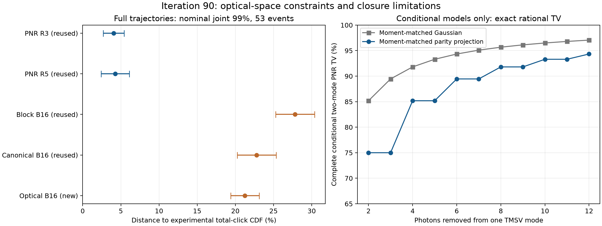

# 第90轮：实际光学空间约束与PNR闭合误差证书

本轮完成两个具体推进：C++直接点击改用实际剩余光学空间，新增16384条完整
双谱记录；PNR推导84个精确有理的条件支持集误差证书，并实现保持二阶矩的
奇偶Gaussian逆映射原型。旧B16误差下界/新上界=1.0932>1，限定该指标误差至少小1.0932倍。
**它尚未建立任意输入优势，也没有达到九章吞吐。奇偶逆映射是构件，不是完整
PNR采样器。** 第83轮随机流及第86轮舍入勘误继续有效，旧保证不恢复。

## 1. 直接点击：约束真正将被探测的光学输出

保留当前点击j后，基底必须适用于行j..1151。新C++实现递归后缀QR缓存，在
实际压缩光学坐标下检查不确定关系，保留第89轮严格内部数值条件。没有截秩、
裁剪特征值、向状态加噪声或删除失败记录。18个解析例子中，原规范潜变量条件
拒绝的合法有噪声剩余态得到接受；旧真实非法状态仍被拒绝，旧失败地址可完成。
严格内部条件仍可能拒绝合法纯态/真空边界，因此也不是必要条件。

缓存90,200,000字节，正式准备耗时1.792006秒，递归QR与原始
后缀Gram的最大相对残差1.53e-18。两个谱共享同一个不可变缓存。
小系统18组完整概率律、完整输入数值/guard、线程和分批门槛通过。
32条探索记录的新旧点击相同，B64曾恢复一次旧约束拒绝的拟合；这不证明质量
改善，探索记录没有加入正式N。

新质量16384条双谱均成功。拟合尝试377235次、接受373980次、
拒绝3255次，其中实际光学不确定关系原因1848次；拒绝只是
预定Gaussian闭合回退，不是样本删除。原始记录见
[完整质量](results/iteration90_quality_optical16_v1/summary.json)。

## 2. 同一53事件族的量化精度

新N在采样前冻结；四组旧记录明确复用。每事件δ=.01/53，实验参考1492642条，
全部失败计入原分母。表中是所声明iid模型及数值参考下的名义联合99%结果。

| 方法 | N | 失败 | 对实验总点击CDF误差区间 | 对Gaussian完整点击TV下界 |
|---|---:|---:|---:|---:|
| PNR R3（复用） | 32768 | 0 | 2.6820%–5.4129% | 0.0000% |
| PNR R5（复用） | 16384 | 0 | 2.3994%–6.1155% | 0.0000% |
| 旧直接闭合 B16（复用） | 8192 | 0 | 25.2662%–30.3755% | 14.8738% |
| 第89轮规范约束 B16（复用） | 8192 | 0 | 20.2443%–25.3536% | 10.4562% |
| 实际光学约束 B16（新） | 16384 | 0 | 19.3953%–23.1114% | 11.4546% |

旧B16误差下界/新上界=1.0932>1，限定该指标误差至少小1.0932倍。 但相对第89轮规范约束，旧下界/新上界仅0.8759，区间仍重叠。
因此不能把相对更老B16的改进单独归因于新光学检查，也不能宣称已比第89轮
约束版本更准。新方法对Gaussian完整点击TV仍至少11.4546%；下界较大或
较小都不能用于真实TV排序，零失败也不意味着零偏差。

限定实验总点击CDF，PNR R3相对新直接点击的误差至少小
3.5832倍。
没有完整1152模式TV上界；局部TV、光子计数CDF、实验CDF分开，详见
[共同分析](results/iteration90_joint_quality_v1/summary.json)和
[冻结计划](research/iteration90_quality_plan.json)。

## 3. PNR：精确算术证明确有结构性失真

TMSV分别湮灭a、b个光子后，剩余态只支持N1−N2=b−a。匹配二阶矩的Gaussian
却把概率放到其他差值上。利用有限有理矩公式及光子数差生成函数，本轮给出
84个256位平方根包围证书，覆盖r=.2/.6/.85、总湮灭数0..6。
它们是精确解析条件模型的证书；与C++舍入协方差另作数值核对。

r=.85的(0,4)分支，Gaussian闭合支持集外质量为**91.808%**，(2,2)分支至少
**51.1861%**；(0,6)为**94.3347%**，(3,3)至少**58.8969%**。
这比第89轮约1e−18至1e−16的负端点大得多，证明这些条件态失真不能由提高
末端浮点精度修复。条件分支的概率权重和后续路径尚需纳入，不能把这些数字
直接当作完整采样器的TV下界。旧强双模整条采样R5的16.9276%–20.7342%区间
仍保持原有范围，未被上述条件数字替代。

[精确证书](results/iteration90_charge_certificate_v1/summary.json)同时核对独立
Fourier系数和C++原闭合矩。独立最终核验另用多项式与Stirling数重算矩，未调用
生产证书的阶乘乘积恒等式。

## 4. 保持矩的奇偶投影：可比较的改善，也有明确局限

新C++构件对零均值Gaussian作正奇偶投影，并反解底层Gaussian，使投影态保持
给定协方差。问题归结为一个标量方程及实对称谱分解。1/2/4/8模的24个旋转、
压缩案例通过独立100位矩核对与逆映射重构；6个热态解析检查通过。
奇数真空、奇数单光子逆映射边界、低于单光子能量及非物理输入明确拒绝。
不通过裁剪或加入噪声让这些案例成功。

在(a,b)=(0,k)条件族，目标等价于双模压缩作用于|k,0>。不同初始占据落在互不
相交的输出光子数差支持集，所以可以计算**完整双端口PNR TV**，无需用局部
见证冒充整个条件分布。单Gaussian误差为1−k^k/(k+1)^(k+1)；保持矩及奇偶的
模型令j=floor(k/2)，误差为1−j^j/(j+1)^(j+1)。以下为精确有理数的十进制显示。

| k | Gaussian闭合完整PNR TV | 保持矩的奇偶模型TV | 旧/新误差比 |
|---|---:|---:|---:|
| 2 | 85.1852% | 75.0000% | 1.1358× |
| 3 | 89.4531% | 75.0000% | 1.1927× |
| 4 | 91.8080% | 85.1852% | 1.0777× |
| 5 | 93.3020% | 85.1852% | 1.0953× |
| 6 | 94.3347% | 89.4531% | 1.0546× |
| 12 | 97.0562% | 94.3347% | 1.0288× |

这里确实比较了相同条件目标下的完整分布精度，但k=4仍有**85.1852%**误差。
一个奇偶标签不足以保住完整光子数差。k=1需要显式单光子极限，当前有限温逆
映射没有实现该边界，不能算作成功。原型尚未接入等待时间、端口选择和混态/
位移轨迹，故没有新PNR整机速度或新完整模型PNR质量声明。
[原型核对与范围更正](results/iteration90_parity_scope_v1/summary.json)、
[公式与适用范围](research/iteration90_methods.md)。

## 5. 正式串行速度、Frugal和九章

16线程、固定控制记录，三次轮换中位；没有与质量、编译或其他重任务重叠。
两种新方法边界都包括模型、随机数、双谱采样/OR和模型销毁；冷缓存额外计入
缓存创建/销毁，热缓存排除一次准备成本。输入准备、初次DLL加载和归档不计。

| 方法 | 4条耗时（秒） | 64条耗时（秒） | 折合单条相对九章3.0耗时 |
|---|---:|---:|---:|
| 第89轮规范约束 | 1.349425 | 4.552073 | 56004.83× |
| 实际光学约束，含缓存构建 | 3.335444 | 6.874720 | 84580.71× |
| 实际光学约束，已有缓存 | 1.460391 | 4.854849 | 59729.94× |

相对第89轮规范约束，实际光学约束64条的冷/热缓存成本分别为
1.5102/1.0665倍。
重复和冷/热输出逐字段相同，不增加质量样本数。
[完整计时](results/iteration90_timing_v1/summary.json)。

[Frugal官方库](https://github.com/tomdodd4598/FrugalGBS)HEAD再次核对仍为
fa8b796f2afebd4845a2e335e457735952617ef8。完整1152格K2历史四条耗时
5394.1328257秒、单worker/4路SIMD；相对本轮冷/热缓存四条，原始时间比分别
1617.22/3693.62。
资源与完整精度未匹配，不能称等精度速度优势。仅4条样本在本轮53事件口径下
的DKW半径为1.0764，已超过1，完整质量保证退化。

Frugal独立末8格K5数值TV为3.8955214%，复用PNR R3对应边缘上界
2.5699%，限定所列局部问题误差至少
小1.5158倍。新直接点击该边缘上界为
6.9683%，不能据此
声称优于Frugal K5。独立八格任务不是Frugal完整轨迹的末端边缘。

[九章3.0原论文](https://arxiv.org/abs/2304.12240v3)报告1.27微秒/条；新直接点击
即使已有缓存，折合每条仍慢59729.94倍。PNR整体沿用
第89轮R3的2.061154秒/64条，仍慢25358.69倍。九章为144端口×8时间格的有限
伪PNR探测；硬件格点击吞吐、理想PNR与经典近似误差不能混为同一个成绩。
其他路线的范围见[前沿对照](research/iteration90_frontier_comparison.md)。

## 6. 验证与下一步

全库1038项运行，1009成功、零失败/错误；新增7项
原生测试通过。历史可选案例跳过29项，类级检查跳过
7项，原因存档。独立最终核验7206项通过，含
32768个新用途流、原始决策、共同误差界、串行中位、有理证书
及奇偶逆矩重构；机械断言数量不是独立科学实验数量。

原始数据、源快照、二进制和全部边界拒绝公开。下一轮继续减小光学缓存与边界
拒绝成本，并研究超出单一奇偶标签的占据结构；若接入采样器，必须先验证完整
概率机制。详见[第91轮计划](research/iteration91_plan.md)。
