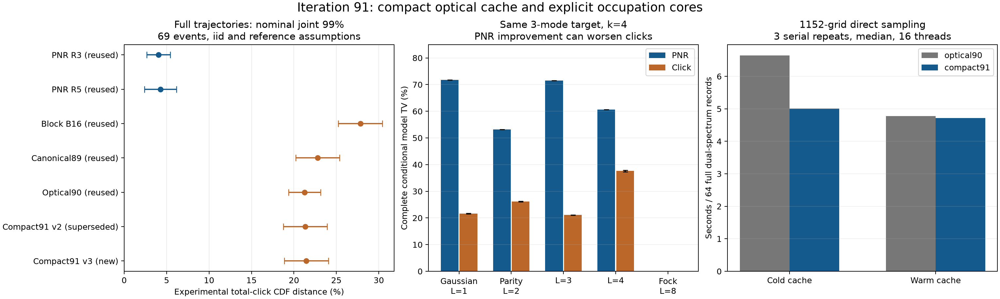

# 第91轮：缓存构建加速与光子占据核心

本轮C++后缀缓存从90.2 MB降至46.3352 MB，减少48.63%；构建中位耗时缩短
22.37倍。完整1152格双谱64条冷启动加速1.3277倍，热缓存速度比为
1.0132，主要收益来自准备成本。新8192条完整质量记录全部成功。

PNR从奇偶标签推进到显式占据核心，完成98组复数光学后的条件分布与20组
PNR／点击精度比较。发现同一条件目标上**PNR更准而点击更差**的明确反例。
显式Fock核心在所列条件族中没有解析闭合误差，但仍有截断尾部和数值误差，
尚不是通用GBS采样器。**任意输入优势与超越九章的总体目标仍未达到。**

## 1. 紧凑QR缓存与完整输入验证

原每个后缀重新作稠密Householder QR，改为上三角矩阵的逐行Givens更新，
QR更新复杂度从O(mn³)降为O(mn²)。缓存只存上三角，不截秩、不裁剪特征值。
1152×50输入的矩阵载荷为46,335,200字节；这不是进程总内存。

实际完整输入1152个后缀及另外28个合法等距输入后缀全部独立重建；最大
binary64导出Gram相对残差4.57e−16。包含秩亏、矩形及全零后缀。固定64条
双谱的新旧点击、条件概率、拟合计数完全相同；18组小系统完整律、数值／
区间决策与线程／分批检查通过。重放不增加质量N。

首份v1实现的旋转伴随符号错误在质量运行前发现并用v2修正；坏库与反例保留。
首份审计的非等距测试输入被模型拒绝，也保留失败记录。v2在完整回归中
又暴露零主元遗漏尾元素的问题；v3显式处理新末行的零主元，新增四组稀疏
回归。v2数据保留，新版本另开随机域重采8192条并重新计时。实际使用的是
[compact91 v3](native/gaussian_click_compact91_v3.cpp)，不是已替代的v1／v2。
[全部后缀证据](results/iteration91_cache_audit_v4/summary.json)。

现有物理筛选仍是严格内部充分条件，某些合法纯态／真空边界仍会被拒绝。
不同QR下的浮点裕度也未被证明处处相同，因此新质量数据独立生成，不能仅凭
一次重放宣称两种采样器的总体分布完全一致。

## 2. 完整轨迹质量：同一69事件族

采样前冻结8192条双谱记录及69事件分配；六组旧记录明确复用，其中v2是已替代版本。每事件
δ=.01/69，实验参考1492642条。以下是声明iid及数值参考假设下的名义联合99%。
新样本实验域0x91004002与旧域及各用途分开；不将地址不重叠当作iid证明。

| 方法 | N | 失败 | 对实验总点击CDF误差 | 对Gaussian完整点击TV下界 |
|---|---:|---:|---:|---:|
| PNR R3（复用） | 32768 | 0 | 2.6627%–5.4322% | 0.0000% |
| PNR R5（复用） | 16384 | 0 | 2.3732%–6.1418% | 0.0000% |
| 旧闭合B16（复用） | 8192 | 0 | 25.2301%–30.4116% | 14.8402% |
| 规范约束89（复用） | 8192 | 0 | 20.2082%–25.3897% | 10.4226% |
| 光学约束90（复用） | 16384 | 0 | 19.3691%–23.1377% | 11.4308% |
| 紧凑缓存91 v2（已替代） | 8192 | 0 | 18.7373%–23.9189% | 10.6464% |
| 紧凑缓存91 v3（新） | 8192 | 0 | 18.8716%–24.0532% | 10.2652% |

新旧光学版本的区间重叠；旧90下界／新91上界=0.8053，没有证明额外
精度提升。相对更老B16，旧下界／新上界=1.0489；这个有限指标的
优势不能单独归因于缓存优化。新方法完整Gaussian点击TV仍至少10.2652%。
拟合尝试188516次，接受186901次、拒绝1615次；拒绝触发
事先规定的Gaussian闭合回退，没有删样或补抽。局部上界不等于完整1152格TV上界。
[共同分析](results/iteration91_joint_quality_v2/summary.json)、
[冻结计划](research/iteration91_quality_plan_v2.json)。第83轮旧保证继续撤回。

## 3. 占据核心：相同二阶矩，不同完整读出精度

目标为U S₂(r)|k,0>，U是一般复数等距列。用a+LJ替代确定占据k，其中
a=k mod L、J为均值floor(k/L)的几何变量。所有L保持均值k，因而保持经过
指定压缩与光学后的二阶矩。L=1对应Gaussian闭合，L=2为奇偶模型，L>k
则显式保留Fock占据，解析模型与目标相同。

两组固定输入：案例0为三模r=.6、总光子截止64；案例1为四模r=.3、截止32。
不是只在保持光子数差的原端口上比较，而是重新计算复杂光学干涉后的所有
保留输出模式。以下区间含**精确有理尾部**，振幅由浮点计算并经独立110位
分配求和核验；它们不是对全部浮点算术作区间包围的证书。
表格保留四位小数；非零区间的端点显示相同只是舍入，完整端点见原始JSON。

| 案例 | k | L | 完整条件PNR TV | 完整条件点击TV |
|---|---:|---:|---:|---:|
| 0 | 4 | 1 | 71.8079%–71.8079% | 21.5144%–21.7022% |
| 0 | 4 | 2 | 53.1583%–53.1583% | 25.9966%–26.2730% |
| 0 | 4 | 3 | 71.5007%–71.5007% | 21.0529%–21.2090% |
| 0 | 4 | 4 | 60.6879%–60.6879% | 37.3451%–37.8685% |
| 0 | 4 | 8 | 0.0000%–0.0000% | 0.0000%–0.0000% |
| 0 | 6 | 1 | 75.1315%–75.1315% | 19.8690%–21.0286% |
| 0 | 6 | 2 | 57.8059%–57.8059% | 22.5324%–23.9197% |
| 0 | 6 | 3 | 79.4988%–79.4988% | 26.1011%–27.8151% |
| 0 | 6 | 4 | 51.9007%–51.9007% | 10.7679%–11.5081% |
| 0 | 6 | 8 | 0.0000%–0.0000% | 0.0000%–0.0000% |
| 1 | 4 | 1 | 82.8085%–82.8085% | 30.4086%–30.6712% |
| 1 | 4 | 2 | 71.1378%–71.1378% | 34.2255%–34.5954% |
| 1 | 4 | 3 | 74.3475%–74.3475% | 34.5909%–34.8093% |
| 1 | 4 | 4 | 71.4783%–71.4783% | 48.1596%–48.8546% |
| 1 | 4 | 8 | 0.0000%–0.0000% | 0.0000%–0.0000% |
| 1 | 6 | 1 | 85.3938%–85.3938% | 28.7191%–30.2884% |
| 1 | 6 | 2 | 74.9361%–74.9361% | 30.1054%–31.9130% |
| 1 | 6 | 3 | 83.9467%–83.9467% | 33.1011%–35.3764% |
| 1 | 6 | 4 | 68.8591%–68.8591% | 20.0959%–21.0787% |
| 1 | 6 | 8 | 0.0000%–0.0000% | 0.0000%–0.0000% |

案例0、k=4：PNR TV从Gaussian的约71.81%降到奇偶模型53.16%，点击TV却从
21.51%–21.70%升到26.00%–26.27%。案例0、k=6的L=3 PNR约79.50%，反而
高于Gaussian约75.13%。因此保留更多标签也不自动保证输出精度单调改善。
不能仅凭二阶矩匹配、输入迹距离缩小或PNR单一指标给点击任务排序。

显式占据L=8的零值指解析条件模型的闭合误差。实际采样器在冻结截止外返回
“未解析尾部”失败，不重归一化、不补抽。其解析尾部概率如下，另有数值舍入误差。

| 模数 | k | 截止 | 解析尾部概率 |
|---|---:|---:|---:|
| 3 | 4 | 64 | 1.660018882e-10 |
| 3 | 6 | 64 | 7.32109864e-09 |
| 4 | 4 | 32 | 5.610212338e-13 |
| 4 | 6 | 32 | 5.240823862e-11 |

C++实现逐层相干振幅递推，保留层内干涉；160个独立高精度振幅、98组质量和
层支持检查通过。四组各65536条条件抽样全部完成；不同k刻意使用共同随机数，
没有合并为独立N。原先奇偶逆映射拒绝的单光子边界，现在以明确Fock态表示并
通过测试。该构件仍未接入1152格PNR的等待／端口选择及一般损耗、位移轨迹。
[条件分布与比较](results/iteration91_fock_quality_v1/summary.json)、
[方法及公式](research/iteration91_methods.md)。

## 4. 正式串行性能与规模成本

完整模型16线程、三次轮换中位；计时期间没有其他重计算。两种方法均包括
模型、均匀数、双谱采样／OR和模型销毁。冷缓存还包括一次共享缓存的创建／
销毁，热缓存单列准备成本，排除初次DLL加载、输入加载与归档。

| 方法 | 4条（秒） | 64条（秒） | 折合单条／九章3.0 |
|---|---:|---:|---:|
| optical90，含缓存构建 | 3.206778 | 6.645655 | 81762.49× |
| optical90，已有缓存 | 1.434501 | 4.779780 | 58806.35× |
| compact91，含缓存构建 | 1.560609 | 5.005256 | 61580.41× |
| compact91，已有缓存 | 1.446019 | 4.717596 | 58041.29× |

单独缓存构建三次中位：第90轮1.807709秒，新版本
0.080814秒，缩短22.37倍。冷64条加速1.3277倍；
热64条时间比旧／新=1.0132。本轮没有把准备成本收益冒充每一步矩阵求解加速。
[完整原始计时](results/iteration91_timing_v2/summary.json)。

以下有限核心计时为单线程，冷路径每次建立完整截断表再抽样，热路径复用表。
包含Python数组分配与C++工作，均匀数预先准备；与完整模型计时边界不同。

| 条件案例 | k | 缓存 | 样本数 | 中位毫秒 |
|---|---:|---|---:|---:|
| 0 | 4 | cold | 1 | 6.447200 |
| 0 | 4 | cold | 65536 | 8.950100 |
| 0 | 4 | warm | 1 | 0.258700 |
| 0 | 4 | warm | 65536 | 3.103200 |
| 0 | 6 | cold | 1 | 6.005400 |
| 0 | 6 | cold | 65536 | 9.356300 |
| 0 | 6 | warm | 1 | 0.256700 |
| 0 | 6 | warm | 65536 | 3.409400 |
| 1 | 4 | cold | 1 | 12.860700 |
| 1 | 4 | cold | 65536 | 15.543400 |
| 1 | 4 | warm | 1 | 0.280800 |
| 1 | 4 | warm | 65536 | 2.884300 |
| 1 | 6 | cold | 1 | 15.809700 |
| 1 | 6 | cold | 65536 | 15.759600 |
| 1 | 6 | warm | 1 | 0.439000 |
| 1 | 6 | warm | 65536 | 3.696600 |

不能用批量热表查询速度宣称战胜九章。固定k=4,r=.3的扩展实验直接量化强模拟
成本；每个总数N的层有binom(N+m−1,m−1)个模式，输出规模增长仍是瓶颈。

| 模数 | 总数截止 | 返回模式数 | C++中位秒 | 解析尾部概率 |
|---|---:|---:|---:|---:|
| 2 | 12 | 45 | 0.000024 | 0.000545311 |
| 2 | 20 | 117 | 0.000021 | 1.97677e-07 |
| 2 | 28 | 221 | 0.000033 | 4.26811e-11 |
| 4 | 12 | 1,025 | 0.000249 | 0.000545311 |
| 4 | 20 | 5,775 | 0.002600 | 1.97677e-07 |
| 4 | 28 | 19,149 | 0.007869 | 4.26811e-11 |
| 6 | 12 | 11,066 | 0.004351 | 0.000545311 |
| 6 | 20 | 129,822 | 0.073234 | 1.97677e-07 |
| 6 | 28 | 736,554 | 0.530091 | 4.26811e-11 |

当前接口限制2–6个输出模，不是任意维度实现。
[条件计时](results/iteration91_fock_timing_v1/summary.json)、
[规模实验](results/iteration91_fock_scaling_v1/summary.json)。

## 5. Frugal、精确经典模拟与九章差距

Frugal固定HEAD的1152格K2历史四条为5394.1328257秒，单worker／4路SIMD；
相对本轮新方法冷／热四条原始耗时比分别为
3456.43/3730.33。
资源和完整精度未匹配，不称等精度加速。四条样本在69事件口径下的DKW半径
1.0916>1，不能提供有用的完整质量界。

Frugal独立末八格K5 TV=3.8955214%；新直接点击对应边缘上界8.8759%，
不能证明更准。PNR R3对应边缘上界2.5873%，所列局部任务误差比至少
1.5056倍；独立八格与完整Frugal轨迹的末端边缘不是同一证据。

新直接点击热缓存每条仍慢于九章3.0的1.27微秒约
58041.29倍；PNR整机沿用第89轮R3结果，仍慢
25358.69倍。有限条件核心不替代这个差距。

本轮还核对新photonic-engines原论文与固定官方HEAD。其H100的12压缩输入约
2.9毫秒／条、41.5输入的一秒边界为校准尾部统计模型；没有将其不同规模、
硬件和精确PNR任务与本轮近似1152格任务直接相除。
来源、版本及比较边界见[前沿对照](research/iteration91_frontier_comparison.md)。

## 6. 验证与后续

全库1051项运行，1022成功、零失败／错误；跳过
29个案例与7个类级检查，原因存档。
新增13项原生测试通过，最终独立核验6978项通过，含
1180个后缀、98组条件分布、
160个高精度振幅及新样本的独立随机数／误差界重算。
检查次数不是独立科学实验次数。原始失败、源码、二进制与数据全部保留。

下一轮把占据核心推进到一般Gaussian背景和完整PNR轨迹，同时研究直接点击
闭合误差与边界筛选成本。详见[第92轮计划](research/iteration92_plan.md)。
