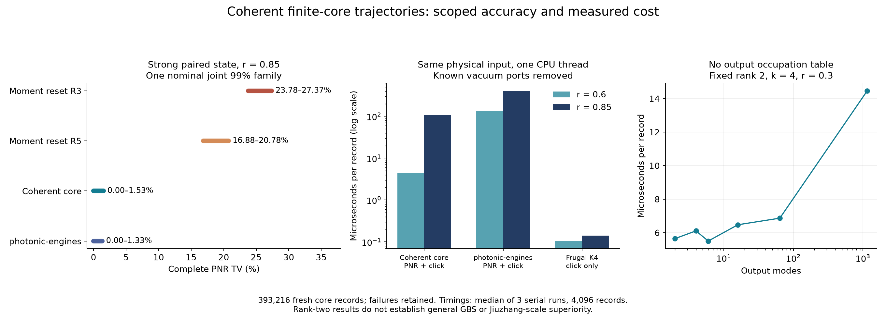

# 第92轮：不枚举输出表的相干有限核心轨迹

本轮将第91轮的完整输出占据表推进为C++相干核心轨迹：保留非Gaussian条件态的相干叠加，在双模压缩背景上直接推进等待和探测。新393216条核心质量样本均成功，强双模态完整PNR TV上界为1.5272%，旧R3/R5下界仍为23.7771%/16.8821%。限定这个同输入任务，误差至少小15.5687/11.0539倍。

总体目标仍未达到：现在支持任意输出端口数的秩二背景及其有限相干核心；尚未实现任意压缩输入数、一般位移和一般Gaussian混态的完整相干轨迹。1152输出条件例不能替代50输入／双谱的九章整机任务。

## 随机流更正继续有效

用户指出的第83轮确定性复用已确认：相邻谱seed与seed+1配上seed+2*row/seed+2*row+1，使等待和探测引擎跨谱、跨记录重叠。4096个消耗引擎只有2049个不同初始化参数。原名义99%保证继续撤回，历史数据没有改写或追认独立。

[第84轮域分离重采](RESEARCH_REPORT_ITERATION84.md)后，旧算法总光子数CDF误差仍为46.8243%–59.0085%，相关核心为0–5.5753%；后者不是完整PNR TV上界。[勘误](RESEARCH_ERRATUM_ITERATION83_RNG.md)明确：撤回保证不等于偏差消失。

本轮新核心使用实验64位key、谱16位／用途16位、记录32位、块64位和块内lane的Philox地址。393216条质量记录实际消耗的**708009个随机流域无重复**。同一流内draw递增；线程和批次重放不改变记录。计时重放不计入独立N。地址域分离修复确定性复用，仍不是软件证明真正iid。

## 算法与范围

状态表示为S₂(r)|C>，C是两个潜在模式上的有限、可复数、相干Fock核心；探测后保留所有系数，不用二阶矩替换为Gaussian或对角混合。均匀无探测衰减η满足

`S₂(ηr)† η^(N/2) S₂(r) = c α^N exp(β a b)`，

其中`c²=(1−r²)/(1−η²r²)`、`α=√η c`、`β=−r(1−η²)/(1−η²r²)`。等待生存概率是变换后有限核心的正范数平方。端口j的跳变为`[U_j0(a+r b†)+U_j1(b+r a†)]/√(1−r²)`，只在选中端口后更新核心。两条核心向量的Gram-Schmidt范数给出非负端口速率，不裁剪负概率。

核心度K时，状态存储O(K²)，一次无探测变换O(K³)，端口率扫描O(m)，无需枚举m模输出occupation。K随已探测光子数增长；该代价优势依赖潜在秩固定为二，不能推广为一般输入数下的多项式GBS算法。

72项独立稀疏矩阵指数核对通过。参考每模Fock截断24时最大向量差6.71e−11，截断36时最大4.97e−16，支持该有限核心恒等式。一般复数光学和η=0.8损耗扩张均有完整PNR分布对照。损耗通过额外环境输出采样后丢弃环境计数实现。

首版v1缺少Windows x87精度设置，8项门控中5项失败，全部保留。v2逐入口、逐工作线程设置扩展精度及最近舍入，退出恢复调用方环境；8项物理门控及1项精度回归通过。新质量样本全部来自v2。

## 完整PNR与点击精度

新核心6组各65536条，全部零失败；photonic-engines另有2组各65536条PNR；Frugal另有2组各65536条点击，共655360条新质量记录。固定光子上限128，任何超限／数值失败都保留为目标零概率的失败结果，不删除、不补抽。

独立最终分析合并为一个**名义联合99%、60事件族**：新核心24事件、历史88全部12组PNR的24事件、photonic-engines8事件、Frugal4事件。每事件预算0.01/60。初始48事件阶段数据保留，以下采用最终60事件界。上界由经验TV的单侧集中界及目标解析尾部得到；下界用前4096条选择事件、余下61440条验证。所有界依赖声明的iid模型和数值参考，没有完整浮点区间证明。

| 新核心案例 | 完整PNR TV区间 | 完整点击TV区间 | 光子上限解析尾质量 |
|---|---:|---:|---:|
| paired_weak | 0.0000%–0.9278% | 0.0000%–0.8848% | 1.4443e-29 |
| paired_strong | 0.0000%–1.5272% | 0.0000%–1.0005% | 6.6751e-10 |
| paired_lossy | 0.0000%–1.8422% | 0.0000%–0.8910% | 6.6751e-10 |
| complex3_k4 | 0.0000%–4.3126% | 0.0000%–1.1009% | 1.4848e-23 |
| complex3_k6 | 0.0000%–5.5146% | 0.0000%–1.0969% | 2.4588e-21 |
| complex4_k4 | 0.0000%–2.4199% | 0.0000%–1.3077% | 6.9284e-61 |

解析尾质量描述理想精确算术下把超限轨迹映射为失败的概率代价，不是C++数值误差界。数学表示不引入Gaussian闭合误差，**并不据此宣布实际实现的偏差已经为零**。

强双模态r=0.85的同输入比较：

| 方法 | 完整PNR TV区间 |
|---|---:|
| 旧矩闭合 R3 | 23.7771%–27.3728% |
| 旧矩闭合 R4 | 26.5746%–30.5377% |
| 旧矩闭合 R5 | 16.8821%–20.7783% |
| 新相干核心 | 0.0000%–1.5272% |
| photonic-engines CPU v2 | 0.0000%–1.3268% |

新核心和photonic-engines的区间重叠，不能排序两者的实际PNR精度。旧R3/R5区间与新核心上界分离，才支持前述15.5687／11.0539倍的有限任务误差比较。

| 双模态 | 基线 | 点击TV区间 |
|---|---|---:|
| weak | photonic-engines | 0.0000%–1.1106% |
| weak | Frugal K4 | 0.0000%–0.8177% |
| strong | photonic-engines | 0.0000%–0.8257% |
| strong | Frugal K4 | 0.0000%–1.0859% |

新核心弱／强态点击上界为0.8848%/1.0005%，与Frugal和photonic-engines均重叠。Frugal K4完整覆盖四端口（两端口为真空）的点击分布；此例没有累积量截断近似。不能把新PNR相对旧矩闭合的改善说成相对Frugal点击精度的改善。

## 同输入正式速度

本机Ultra9 275HX；CPU比较，全部准备操作、采样、PNR转点击、模型销毁计入，导入和DLL装载统一排除。4096条，3次严格串行旋转顺序的中位秒数。重复使用控制记录，仅检验确定性和计时。所有方法物理上输出同一个四端口态，已知的两个真空端口先从允许的接口中去除，最后补回零列。Frugal旧接口只支持4端口，保留该路径；其采样使用1线程／4路SIMD。

| 方法 | 弱态r=0.6，秒／4096条 | 强态r=0.85，秒／4096条 |
|---|---:|---:|
| 新核心／1线程 | 0.0176704 | 0.4367793 |
| photonic-engines／1线程 | 0.5375177 | 1.6705865 |
| Frugal K4点击／1线程 | 0.0004293 | 0.0005770 |
| 旧R3／1线程 | 0.1167126 | 0.4432207 |
| 旧R5／1线程 | 0.2317580 | 1.4828202 |
| 新核心／16线程 | 0.0093019 | 0.0798844 |
| 旧R3／16线程 | 0.0461886 | 0.0843108 |
| 旧R5／16线程 | 0.0578418 | 0.2330390 |

同1线程，新核心比官方photonic-engines CPU v2分别快30.4191/3.8248倍；这是两压缩输入的专用表示与通用链式采样器的比较，不能外推到H100或多压缩输入。相对旧R3，强态1线程仅快1.0147倍，主要收益是精度；相对旧R5，16线程快2.9172倍。

**只需要点击时，Frugal更合适。** 同1线程，新核心先数光子再转点击分别慢41.16/756.98倍；即使使用16线程仍慢21.67/138.45倍。此结论仅指这组四端口、完整K4任务，不外推到1152端口Frugal近似采样。

最初未删除真空端口的正式结果也完整保留：强态photonic-engines4096条为23.6258573秒。该接口开销会虚增优势，最终比较采用去真空后的1.6705865秒。未把不利于基线的原始数作为标题结果。

## 输出规模与整机差距

复数稠密光学、k=4、r=0.3、固定两个潜在模式，4096条扩展到1152端口：1线程0.4253889秒，16线程0.0592709秒（14.4704微秒／条）。三个重复和1／16线程所有计数及统计逐值一致；核心最大度数18，没有构造输出Fock表。相同输入总光子数均值约4.989，仍是低秩条件态，不能当成九章输入。

完整1152格、50输入双谱任务本轮未改进：PNR R3沿用第89轮2.0611542秒／64条，比[九章3.0论文](https://arxiv.org/abs/2304.12240v3)1.27微秒／条的原始吞吐慢25358.69倍；直接点击沿用第91轮4.7175957秒／64条，慢58041.29倍。完整直接点击的实验CDF误差仍为18.8716%–24.0532%，本轮没有新整机精度优势。历史Frugal1152格K2的5394.13秒／4条依然是不同资源、不同精度的参照，不能与本轮低秩结果相除来宣称整机加速。

[九章3.0](https://arxiv.org/abs/2304.12240v3)使用时空复用的有限伪PNR：144物理模式各8个阈值时间格，能给出每物理端口0–8的分辨结果；不是无上限的理想PNR。前两代主要为阈值点击。PNR与直接点击两方向仍需分别推进，且在相同探测模型上比较精度与速度。

## 可复现证据

- [最终核验](results/iteration92_verification_v1/validation.json)：708009个域唯一性检查及4738项其他检查；没有调用采样器重新生成质量数据。
- [全套测试](results/iteration92_tests_v1/validation.json)：1060项运行、1031项成功、29项案例跳过，另7个类级跳过，零失败／错误；9项新测试全部成功。
- [新样本](results/iteration92_quality_v1/summary.json)、[官方基线样本](results/iteration92_baseline_quality_v1/summary.json)、[同输入正式计时](results/iteration92_timing_v2/summary.json)、[规模测试](results/iteration92_scaling_v1/summary.json)。
- [C++实现v2](native/gaussian_coherent_core92_v2.cpp)、[失败v1](native/gaussian_coherent_core92_v1.cpp)、[门控失败记录](results/iteration92_gates_v1/validation.json)、[恒等式独立核对](results/iteration92_identity_v1/validation.json)。
- photonic-engines固定提交`6c1ed6f8f11ffc9f3c268757f0fe0bd48a768d82`，pyproject实际版本**0.2.2**；[官方源](https://github.com/Quandela/photonic-engines/tree/6c1ed6f8f11ffc9f3c268757f0fe0bd48a768d82)未修改，源码／许可证压缩归档随结果发布。CPU v2、torch2.12.1、无GPU计时。其强态质量样本最大内部round_off诊断约6.32e−7，连同样本保留，不将“精确算法”误写为完全无浮点误差。

下一轮继续[一般背景与直接点击计划](research/iteration93_plan.md)。本轮贡献是可运行的有限相干核心轨迹、完整分布验证和公平基线实测，不把Gaussian恒等式或量子跳跃本身宣称为新原理。
