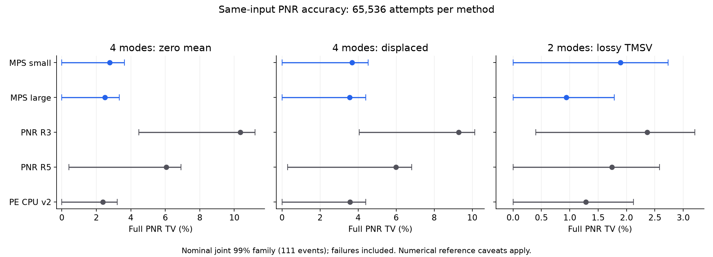
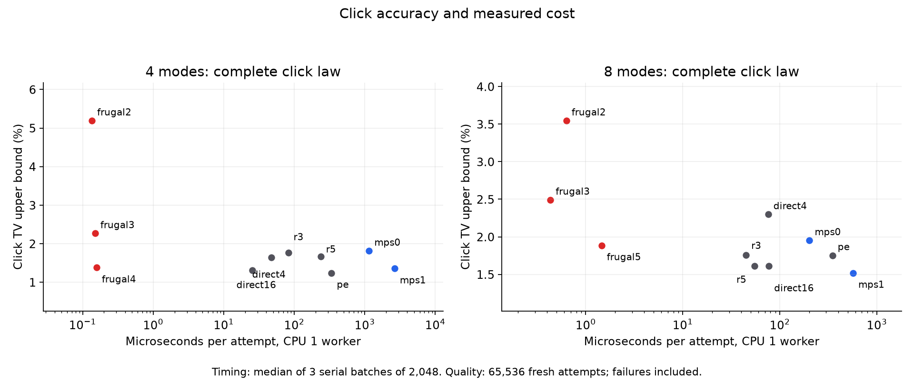

# 第93轮：一般Gaussian相干MPS核心及完整精度对照

本轮完成了从固定秩二核心到多输入、复干涉、位移及相关Gaussian混态的C++轨迹实现，并对截断质量显式记账。33组小系统正式批次各65536条，另有64条实际1152输出双谱记录，共2162752条尝试。新大核心在四个小系统案例中均无失败；四模式零位移完整PNR TV上界3.3396%，旧R3下界4.4645%，限定同输入可确认至少1.3368倍改善。

总体目标仍未达到。新大核心同线程在四模式任务上比Photonic Engines慢；其真实规模64条中只有49条完成，15条预算耗尽。一般输入的相干更新和可计算投影误差已实现，但尚没有任意维度、同质量超越传统工具或九章的结果。

## 1. 实现变化与误差含义

Gaussian背景保留解析表示，非Gaussian核心存入潜在输入模式的MPS；每次探测施加完整相干算子之和。无探测映射支持任意位移和正负压缩，混态通过相关经典位移抽样。局部Fock越界与同次Schmidt截断合并为一次精确算术迹距离，跨物理跳跃继续累加。接近零奇异值的自适应缩减也收费。预算耗尽、光子上限或数值异常都保留为失败结果，不补抽。

新的端口选择把概率拆成正的相干率与中心化余项率，用有上界的拒绝采样减少高位移态的计算；选定端口后的相干更新完整保留。QR/SVD采用固定1线程的LAPACKE。当前代码上限为128输入、16384输出；键维仍可能迅速增长，不能以接口维度代替复杂度保证。[公式、约定和证明范围](research/iteration93_methods.md)。

直接点击沿用第91轮条件核心。本轮增加了同输入的完整点击精度面板，以及逐字一致的C++批量随机数接口；直接阈值后的受控混态核心仍需后续实现。

## 2. 精度：完整PNR与完整点击分别报告

以下为预先固定111事件族的名义联合99%区间，条件于iid及固定数值参考。域分离不证明真iid；数值交叉核对不等同于区间算术认证。全部失败映射到目标概率为零的专用结果。四模式参考枚举814385种光子数模式，并以100位精度配对和、总数卷积及真空子集独立核对；解析尾界低于3.66e−9。

| 方法 | 四模式零位移PNR TV | 四模式位移PNR TV | 损耗双模PNR TV |
|---|---:|---:|---:|
| MPS小核心 | 0.0000%–3.6276% | 0.0000%–4.5278% | 0.0000%–2.7352% |
| MPS大核心 | 0.0000%–3.3396% | 0.0000%–4.4077% | 0.0000%–1.7839% |
| 旧PNR R3 | 4.4645%–11.1971% | 4.0624%–10.1278% | 0.3988%–3.2053% |
| 旧PNR R5 | 0.4173%–6.9081% | 0.2963%–6.8264% | 0.0000%–2.5836% |
| Photonic Engines | 0.0000%–3.2232% | 0.0000%–4.4119% | 0.0000%–2.1251% |

与PE的区间重叠，不能按上界大小排序真实精度。旧R5在四模式的下界也不足以建立其与新核心的严格排序。只需要点击时，四模式Frugal K4上界1.3786%，新大核心上界1.3537%，同样未区分精度高低。

## 3. 速度：同输入、同线程，不混用质量结论

每次2048条，三轮严格串行，报告秒数中位；随机数、输出分配及采样计入，外部模型句柄准备单独记录，编译和I/O排除。Frugal单次ABI内部的布局及目标构建仍计入，组件用时保留；因此不把其数字称为纯缓存采样耗时。各方法均使用表中对应配置，失败仍计入工作量。CPU16列用于显示并行效果，不拿它冒充同线程优势。

| 输入 | 新大核心CPU1 | 新大核心CPU16 | PE CPU1 | 新核心CPU1 / PE CPU1 |
|---|---:|---:|---:|---:|
| pure4 | 5.4137690 | 0.8478335 | 0.6909103 | 7.8357 |
| displaced4 | 8.5632399 | 1.6665565 | 1.0515827 | 8.1432 |
| pure8 | 1.1621937 | 0.2482011 | 0.7128113 | 1.6304 |
| lossy_tmsv | 1.3058507 | 0.2031731 | 0.5439718 | 2.4006 |

四模式只采点击时，Frugal K4比新大核心CPU1快16849.58倍，两者点击精度区间重叠。旧第92轮秩二特例的3.8248倍PE速度优势不能推广到本轮一般四输入。完整逐配置数据见文末；[原始计时](results/iteration93_timing_v1/summary.json)。

## 4. 实际1152输出、50输入、双谱任务

固定64条、16个工作线程，主谱预算0.1、次谱0.01，局部维数6、键维32。原始协方差与子空间重构核对通过。49条完成，15条因预算耗尽停止；本批没有数值异常。总采样时间1398.432141秒，每次尝试21.850502秒。部分光子记录不计为成功样本，也不对49条成功结果作目标分布条件化。

总光子数CDF经验距离24.5620%，名义联合99%区间0.0000%–52.5238%。这个CDF上界不是完整PNR TV上界。失败概率上界46.9632%；精确算术截断模型加失败概率的全分布上界57.9632%，尚未包含程序全部浮点和求根误差，不能称为完整实现的认证。

九章3.0论文报告1.27微秒/记录；本配置每次尝试原始耗时比其慢约17,205,120倍，且存在失败。九章3.0是144物理输出各8个阈值格、共1152位的伪光子数分辨读出，不是理想无上限整数PNR。[原论文](https://arxiv.org/html/2304.12240v3)。既有R3/直接点击完整任务的25358.69/58041.29倍差距仍单列保留；本轮MPS没有改善这一吞吐缺口。[本批原始结果](results/iteration93_actual_quality_v1/summary.json)。

## 5. 验证、随机流和文献范围

全库1070项运行，1041成功，零失败/错误，29项案例及7个类跳过；新增10项MPS测试全部通过。独立分析重建111个事件，完成38148项检查，核对3097149个实际原生用途域无复用。PE的128个批次初始PCG状态不同；Frugal的224个实际工作线程种子不同，并以独立Python MT19937-64与C++派生核对。C++批量随机数的19908个值与原接口逐值一致。第83轮失效保证继续撤回，[勘误](RESEARCH_ERRATUM_ITERATION83_RNG.md)保持有效。

独立矩阵指数参考曾因截止过小失败；参考空子集适配与基线旧清单字段也各有一版执行失败，均保留源码和证据，使用新版本修正。最慢的旧Eigen容量探测在超过589秒后停止，保留未完成记录，不计成功或速度优势。未用失败后改写旧脚本的方法覆盖证据。

本轮在线核对了PE0.2.2与Frugal1.1当前主要采样源码，并核对历史二进制和源清单。已有Gaussian MPS文献的约一分钟指标对应中央张量构建，且其约0.03指标是切口丢弃质量；不能与本报告整条采样耗时或完整分布TV直接比较。[Gaussian MPS原论文](https://arxiv.org/html/2512.10643v2)。本轮没有执行该论文完整采样器，不能宣称胜过它。

[完整测试](results/iteration93_tests_v1/validation.json) · [独立审计](results/iteration93_verification_v1/validation.json) · [固定质量计划](research/iteration93_quality_plan_v1.json) · [上游核对](results/iteration93_upstream_check_v1/validation.json) · [下一轮计划](research/iteration94_plan.md)。

## 附：全部同输入配置

每行65536条质量尝试；耗时为CPU1的2048条中位。pure8只有总数CDF和完整点击TV，不提供完整PNR TV。较小核心失败总数1589；较大核心四组均为零。

| 配置 | 失败数 | 完整PNR TV／注明的总数CDF | 完整点击TV | CPU1秒/2048条 |
|---|---:|---:|---:|---:|
| pure4_mps0 | 307 | 0.0000%–3.6276% | 0.0000%–1.8114% | 2.3565724 |
| pure4_mps1 | 0 | 0.0000%–3.3396% | 0.0000%–1.3537% | 5.4137690 |
| pure4_r3 | 0 | 4.4645%–11.1971% | 0.0000%–1.7622% | 0.1683337 |
| pure4_r5 | 0 | 0.4173%–6.9081% | 0.0000%–1.6621% | 0.4856934 |
| pure4_pe | 0 | 0.0000%–3.2232% | 0.0000%–1.2398% | 0.6909103 |
| pure4_frugal2 | 0 | — | 3.2877%–5.1895% | 0.0002760 |
| pure4_frugal3 | 0 | — | 0.0000%–2.2656% | 0.0003066 |
| pure4_frugal4 | 0 | — | 0.0000%–1.3786% | 0.0003213 |
| pure4_direct4 | 0 | — | 0.0000%–1.6386% | 0.0964492 |
| pure4_direct16 | 0 | — | 0.0000%–1.3128% | 0.0519901 |
| displaced4_mps0 | 329 | 0.0000%–4.5278% | 0.0000%–1.6680% | 2.6149043 |
| displaced4_mps1 | 0 | 0.0000%–4.4077% | 0.0000%–1.4236% | 8.5632399 |
| displaced4_r3 | 0 | 4.0624%–10.1278% | 0.0734%–2.1078% | 0.1703335 |
| displaced4_r5 | 0 | 0.2963%–6.8264% | 0.0000%–1.4725% | 0.4693336 |
| displaced4_pe | 0 | 0.0000%–4.4119% | 0.0000%–1.4350% | 1.0515827 |
| pure8_mps0 | 262 | 总数CDF 0.0000%–1.2736% | 0.0000%–1.9516% | 0.4133927 |
| pure8_mps1 | 0 | 总数CDF 0.0000%–0.9450% | 0.0000%–1.5189% | 1.1621937 |
| pure8_r3 | 0 | 总数CDF 0.0000%–1.2111% | 0.0000%–1.7557% | 0.0917387 |
| pure8_r5 | 0 | 总数CDF 0.0000%–0.9486% | 0.0000%–1.6136% | 0.1120493 |
| pure8_pe | 0 | 总数CDF 0.0000%–1.0136% | 0.0000%–1.7531% | 0.7128113 |
| pure8_frugal2 | 0 | — | 0.7642%–3.5453% | 0.0012921 |
| pure8_frugal3 | 0 | — | 0.0000%–2.4911% | 0.0008846 |
| pure8_frugal5 | 0 | — | 0.0000%–1.8860% | 0.0029782 |
| pure8_direct4 | 0 | — | 0.0000%–2.2977% | 0.1550890 |
| pure8_direct16 | 0 | — | 0.0000%–1.6121% | 0.1577660 |
| lossy_tmsv_mps0 | 691 | 0.0000%–2.7352% | 0.1883%–2.1171% | 0.6571135 |
| lossy_tmsv_mps1 | 0 | 0.0000%–1.7839% | 0.0000%–1.1015% | 1.3058507 |
| lossy_tmsv_r3 | 0 | 0.3988%–3.2053% | 0.0000%–0.9589% | 0.2055433 |
| lossy_tmsv_r5 | 0 | 0.0000%–2.5836% | 0.0000%–0.8781% | 0.5878511 |
| lossy_tmsv_pe | 0 | 0.0000%–2.1251% | 0.0000%–1.1244% | 0.5439718 |
| lossy_tmsv_frugal4 | 0 | — | 0.0000%–1.1696% | 0.0003000 |
| lossy_tmsv_direct4 | 0 | — | 0.0000%–1.0567% | 0.0160701 |
| lossy_tmsv_direct16 | 0 | — | 0.0000%–0.9947% | 0.0169289 |
