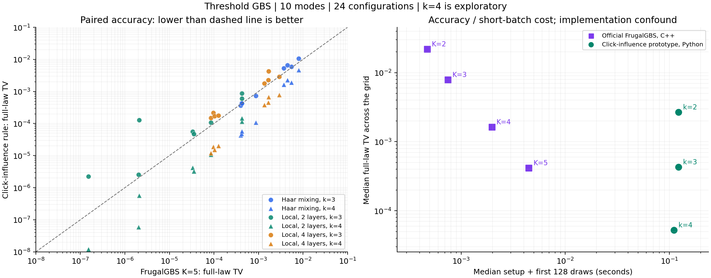
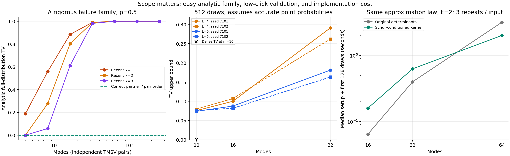

# GBS 经典算法探索：第二轮研究报告

日期：2026-11-04。第一轮报告与原始数据保持原样，见 [RESEARCH_REPORT.md](RESEARCH_REPORT.md)。

## 1. 本轮结论

**找到了相对于一个强经典基线的、小规模精度优势，但还没有速度优势。**

我们把“保留全部未点击约束、选择少量已点击约束”的原型扩展为条件点击影响选择器，并实际接入官方 FrugalGBS。在看到基线结果后追加的 k=4 探索中，24 个 10 模式输入和 3 个较亮的 12 模式输入上，原型的完整分布总变差距离（TV）均低于 FrugalGBS K=5。不过，当前 Python 原型首批 128 个样本的配对成本中位数分别高出约 24.5 倍、74.7 倍。

这支持继续研究它的精度与成本关系；**不支持宣称战胜 FrugalGBS 的整体性能，不支持宣称战胜量子优势，也不确认原创性。** k=4 是事后追加的统一预算扩展，复用了已查看的输入，不能包装成独立确认试验。k 是保留的点击约束数，K 是 Frugal 的累积量截断阶数，两者并不是相同的资源预算。

本轮还得到三个独立结果：

1. 对“保留最近 k 个点击”给出一个合法 GBS 输入家族上的解析失败公式；固定 k 时，TV 随规模增大趋近 1。改为保留真正的关联伙伴或调整测量顺序，同一家族可以精确采样。
2. 实现与旧近似分布等价的 Schur 条件化内核。在本次 64 模式成本测试中更快，在 16、32 模式更慢；18 组同随机数配对的样本逐位一致。
3. 建立无需枚举全部输出的 TV 点概率验证器。32 模式低点击实例得到了约 0.16–0.18 的统计上界；覆盖解释依赖浮点概率准确，尚非区间数值认证。

## 2. 实验对象与评判标准

研究对象是零位移 Gaussian 态经被动干涉和纯损耗后的**阈值点击分布**。探测器只报告 0 或至少 1 个光子；本轮没有实现完整 PNR 采样，没有暗计数、模式失配、真实时间复用探测器或实验校准误差。参数 eta 表示透过率，不是丢失比例。协方差使用 hbar=2、真空 I、xxpp 排序，概率数组按物理模式 little-endian 位掩码排列。

使用全局误差

\[
\operatorname{TV}(P,Q)=\tfrac12\sum_x|P(x)-Q(x)|.
\]

TV=0 表示分布相同，TV=1 表示支持完全可区分。小规模结果计算完整 P、Q 后得到 TV，不是从 128 个样本直方图估计。低阶相关性或点击总数分布相近不能自动保证完整 TV 小。

阈值 GBS 的精确 Gaussian 条件化与点击分支增长已有文献基础；本项目并不把这些基本运算宣称为新算法。[Quesada、Arrazola、Killoran，2018](https://arxiv.org/abs/1807.01639)

### 本轮数据规模

| 输入组 | 不同协方差输入 | 本项目方法评估 | Frugal K=2,3,4,5 评估 | 定位 |
|---|---:|---:|---:|---|
| discovery | 36 | 360 | 144 | 10 模式；3 种拓扑、2 个压缩强度、3 个透过率 |
| holdout | 24 | 240 | 96 | 10 模式；预留种子，均匀及非均匀参数；后来复用做 k=4 探索 |
| bright | 3 | 27 | 12 | 12 模式 Haar，r=0.8、eta=0.8 |
| 合计 | **63** | **627** | **252** | **879 次完整分布方法评估** |

这 63 个协方差输入来自 15 个干涉仪矩阵的参数变体，其中 24 个 holdout 输入只对应 6 个干涉仪。胜负计数和中位数用于描述这个网格，不能当作 24 或 63 个独立总体样本做显著性推断。

初始 k=2、k=3 规则与预留配置先固定，再查看相应质量结果。发现缺少同预算 k=3 对照后，补跑相同输入的 pairwise/recent k=3。看到 Frugal 比较后，再统一追加 k=4。全过程保留原始目录、配置和源码快照，未把事后扩展冒充预先指定测试。

另外完成 36 次 16/32/64 模式成本运行、12 项点概率统计界、36 次解析家族交叉核查。上述数据分别计数，不加入 879 次完整分布评估。完整通用分布参考仍只到 12 模式。

## 3. 新选择规则到底改变了什么

令 Z 为已经观测到的全部零位置，C 为选中的至多 k 个已点击位置。原型采用的下一位概率是

\[
Q(X_i=1\mid h)=P(X_i=1\mid X_Z=0,X_C=1).
\]

没有选中的点击，在这一条件概率计算中被放松。Z 加上前缀长度本来就能编码完整旧比特，因此这里应称为**计算时放松部分点击约束**，不能据此套用“把历史压缩成一个随机摘要”后的遗漏条件互信息等式。

### 两种新增选择器

- **零条件互信息**：先对全部 Z=0 做 Gaussian 条件化，再依据这个特定条件态中的成对互信息选点击。这不是对所有 Z 观测结果平均的条件互信息。
- **条件点击影响**：从空的 C 开始，逐次加入使下一位点击概率改变最大的已点击候选 j。评分为

\[
\Delta_j=
\left|P(X_i=1\mid Z=0,C=1,X_j=1)
-P(X_i=1\mid Z=0,C=1)\right|.
\]

两者只使用协方差和小事件概率；完整 P 从未传入选择器。后者是可计算的贪心启发式，没有普适最优保证。

**同预算比较支持选择本身有作用。** 在 24 个初始预留配置上，条件点击影响 k=2 相比无条件 pairwise k=2 改善 23 个、退步 1 个；k=3 也是 23/24。k=4 追加测试中仍为 23/24。零条件互信息的改善更弱，k=2 为改善 16、退步 7、近似平局 1；k=3 为改善 15、退步 9。因此下一步优先保留条件点击影响规则，互信息规则继续作为便宜对照。

完整逐实例指标保留在各正式运行的 `metrics.csv`、`records.jsonl` 中；[summary.json](results/phase2_analysis/summary.json) 也列出全部退步案例索引，不只保存成功样例。

## 4. 与官方 FrugalGBS 的实际比较

FrugalGBS 通过累积量展开和近似边缘的链式采样构造经典模拟器，已报告对百模式实验的既有验证指标取得较好表现。它的实验验证成绩不能直接替代任意输入上的完整 TV 保证。[原论文](https://arxiv.org/abs/2511.14923)，[官方代码](https://github.com/tomdodd4598/FrugalGBS)

本轮固定官方提交 `fa8b796f2afebd4845a2e335e457735952617ef8`，使用 double 精度、单 CPU 线程。计时采样调用未修改的官方 `generate_samples`。为计算小系统的完整 Q，另生成强制分支追踪器，保留官方 SIMD 算术、内部近似前缀质量和实际阈值饱和策略。该追踪分布是连续均匀阈值模型下的浮点程序诱导分布，不是有限 PRNG 状态的穷举。

接入验证含 15 个夹具，覆盖真空、非均匀热态、相关 Gaussian 态、非均匀损耗与实际触发阈值饱和的实例。9 个非真空夹具各使用 200,000 个官方样本核对追踪分布；直方图差异均落在明确计算的有限样本界内。热态完整分布误差约 10^-15；首次两个模式的边缘误差不超过 3.34×10^-16。构建、验证和正式对赛以二进制 SHA256 绑定。[接入细节](research/frugal_integration.md)

### 10 模式的完整 TV 中位数

每种拓扑有 8 个参数配置。更小为更好。

| 方法 | Haar | 局部 2 层 | 局部 4 层 |
|---|---:|---:|---:|
| Frugal K=4 | 0.00546430 | 0.000676792 | 0.00231632 |
| 条件点击影响 k=3 | 0.00301630 | 0.0000827905 | 0.000997309 |
| Frugal K=5 | 0.00228192 | 0.0000341849 | 0.000745050 |
| 条件点击影响 k=4，追加探索 | **0.000873969** | **0.00000374167** | **0.000201074** |

最初 k=3 规则优于 Frugal K=4 的 24/24 个输入，但仅在 3/24 个输入上优于 K=5。追加 k=4 后，24/24 个输入的 TV 都低于 K=5，逐实例 TV 比值的中位数为 0.17856，即这组输入上的配对误差下降中位数约 82.1%。不要把这个比值与“两个中位数的比值”混淆。

在 3 个较亮 12 模式输入上，k=4 的 TV 为 0.0163490、0.0142352、0.0127551；相对 Frugal K=5 的逐实例 TV 比值中位数为 0.34209。这仍是小系统合成输入，不是真实量子硬件数据。

### 计算成本仍明显落后

下表为初始化加首批 128 个样本的核心计算中位时间，排除完整 Q 的评估、子进程启动和 JSON/I/O；Python 的动态选择成本计入采样。

| 方法 | 24 个 10 模式输入 | 3 个较亮 12 模式输入 |
|---|---:|---:|
| Frugal K=5 | 4.47 ms | 11.57 ms |
| 条件点击影响 k=3 | 122.6 ms | 765.8 ms |
| 条件点击影响 k=4 | 110.8 ms | 865.0 ms |

逐输入的 k=4/Frugal 冷批时间比值中位数分别为 24.52 和 74.75。k=4 在部分低亮度输入中比 k=3 的测得时间略少，是因为保留预算更大时无需运行选择的前缀更多，也可能受负载影响；不能将几个百分点的单批差异称为可靠加速。

Python 与优化 C++/SIMD 的差异使这些时间不能隔离算法复杂度。但已有精度结果也不能保证改写 C++ 后就一定更快。目前只是两种实现之间可见的精度—成本交换。没有测试 Frugal 更高阶版本、MPS、Gaussian reset 等所有竞争方法，更没有给出全领域最优性结论。[完整预算扩展分析](research/phase2_budget_extension.md)

## 5. 一个可证明的失败家族

取 n 对相互独立的双模压缩真空，阈值输出满足

\[
A_j=B_j\sim\operatorname{Bernoulli}(p),\qquad p=\tanh^2r.
\]

按 A_1,…,A_n,B_1,…,B_n 的顺序测量。若 A 区有 L 个点击，而 L>k，则沿着正确的 B 输出路径，B_j 对应的 A_j 总被另外至少 k 个较新的点击挤出“最近 k 个”的保留集合。每个相应 B 点击只以边缘概率 p 产生；匹配整个目标串的条件概率是 p^L。于是

\[
\boxed{\operatorname{TV}(P,Q_{\rm recent})
=\sum_{\ell=k+1}^{n}{n\choose\ell}p^\ell(1-p)^{n-\ell}(1-p^\ell).}
\]

对固定 k、0<p<1，该式趋近 1。例如 p=1/2、k=2：

| 总模式数 2n | 完整 TV，解析公式 |
|---:|---:|
| 16 | 0.802230835 |
| 32 | 0.988482043 |
| 64 | 0.999899457 |
| 128 | 0.999999990 |

同一目标若按 A_1,B_1,A_2,B_2,… 顺序测量，recent k≥1 就精确；在原顺序使用成对互信息保留真实伙伴，k≥1 也精确。

**这个家族本身极易经典采样：抽 n 个独立 Bernoulli 比特后复制即可。** 它证明某个近似规则会失败，不能证明 GBS 困难或我们打破了量子优势。64、128 模式的数值来自特殊家族解析公式，不是这些规模的通用完整分布枚举。

正式 36 个小规模解析/协方差交叉检查全部通过。另归档了一个数值敏感性实验：数学等价的 cosh/sinh 表达式使协方差改变约 8.88×10^-16，某些严格支持的支路便触发相消保护。这些失败没有通过删除小概率或放松阈值隐藏。[理论与证明](research/phase2_theory.md)，[表达式敏感性记录](results/phase2_paired/expression_sensitivity.json)

## 6. Schur 内核：缩小行列式不等于所有规模都更快

未点击是 Gaussian 观测。给定 Z=0，剩余模式的协方差为

\[
W_R=V_{RR}-V_{RZ}(V_{ZZ}+I)^{-1}V_{ZR}.
\]

在下一位条件概率的比值中，P(Z=0) 可以约去。因此仅对所选点击与当前模式形成的小矩阵做包含排除，每个小行列式维度至多 2(k+1)。与此同时，大协方差的条件化、缓存与矩阵更新仍有成本，不能遗漏。

我们实现按零集合缓存以及逐次 rank-two 更新，限制缓存条数与字节数。在固定选择器下，这与旧方法是同一个近似分布的代数重写。

单线程、Haar、r=0.6、eta=0.35、k=2；每个模式数用两个种子，各重复 3 次，从全新模型/采样器开始。每批 128 个样本：

| 模式数 | 原行列式内核，中位秒数 | Schur 内核，中位秒数 | 结果 |
|---:|---:|---:|---|
| 16 | 0.06444 | 0.15975 | 新内核更慢 |
| 32 | 0.40013 | 0.62896 | 新内核更慢 |
| 64 | 3.19075 | 2.01587 | 本次约 1.58 倍加速 |

18/18 个配对使用同一输入与同一随机数，生成的位数组完全一致；另有小规模完整分布等价测试。这不是“64 模式全局精度已验证”，也不是对 Frugal 的大规模性能胜负。CPU/操作系统负载不受完全控制。[成本数据](results/phase2_kernel_cost/metrics.csv)

## 7. 无需完整枚举的全局 TV 统计验证

对归一化的 P、Q，有恒等式

\[
\operatorname{TV}(P,Q)=
\mathbb E_{X\sim Q}\left[\left(1-\frac{P(X)}{Q(X)}\right)_+\right].
\]

即便 P 在 Q 支持之外有质量，等式也成立，因为 TV 也等于 Q 超过 P 的那部分概率质量之和。Q 的点概率可以沿自己的顺序条件概率相乘；P 的点概率在点击较少时可以通过零条件化加小规模包含排除计算。

对于超过 L 次点击或点概率数值评价失败的样本，保守地给分数 Y=1，不丢弃、不重抽。若 n 个样本独立来自事先固定的 Q，使用

\[
\operatorname{TV}(P,Q)\le
\min\left(1,\overline Y+\sqrt{\frac{\log(1/\alpha)}{2n}}\right)
\]

具有至少 1-alpha 的单次统计覆盖解释。这里是基础概率恒等式与 Hoeffding 界的应用，不主张新定理。

本轮先固定 6 个输入，每个抽 512 个样本；同批样本用于 L=4、6，共 12 个比较，每项 alpha=0.05/12，以并集界给出这 12 项同时 95% 的统计覆盖。下表取 L=6：

| 模式数 | 两个输入的样本平均点击数 | 两个 TV 上界 | 超过 L 的样本数 | 目标数值失败数 |
|---:|---:|---:|---:|---:|
| 10 | 0.867 / 0.926 | 0.07387 / 0.07598 | 0 / 0 | 0 / 0 |
| 16 | 1.395 / 1.514 | 0.08764 / 0.08189 | 5 / 1 | 1 / 1 |
| 32 | 3.008 / 2.859 | 0.18112 / 0.16311 | 22 / 21 | 29 / 21 |

10 模式的真实完整 TV 为 0.00131560、0.00141395，均被界覆盖。16、32 模式没有枚举完整目标。全部 3,072 个原始独立样本保留，Q 采样和 Q 密度评价均未失败。

**覆盖解释依赖被接受的浮点 P、Q 概率正确。** 失败保护只是诊断，不是严格误差区间；当前没有向外舍入认证。因而应称“带数值条件的统计上界”，而非无条件数值证书。32 模式上界明显受高点击截断与相消失败影响；例如第一例有 51/512 个最坏分数，贡献约 0.0996，再加统计余量 0.07316。

更重要的是，这些是平均约 1–3 点击的低点击输入，不是高点击量子优势实验区间。[验证器、证明与完整数据](research/tv_validation.md)

## 8. 本轮审计与仍然存在的限制

86 项项目测试全部通过；官方接入另有 15 项验证。独立审计发现并修复了链式 KL 的两个边界问题：由 1-q(1) 反推极小 q(0) 会制造错误无穷，以及容许的微小归一化残差会产生假链式恒等式误差。修复只涉及诊断，不改变采样器或 TV。旧正式运行的有限 KL 恒等式残差均低于 5.3×10^-16，不受这两个边界夹具影响。

还修复了中断目录覆盖保护、子进程失败记录、构建—验证二进制绑定。完整源码、输入、目标和生成分布均归档。第三方代码保留 MIT/BSD 许可证；全部被包含文件与固定提交的 Git blob 字节吻合。[独立审计](research/phase2_independent_audit.md)

目前没有完成的关键工作包括：相同语言和时间预算下的竞争、真正高点击大模式区的可靠全局精度验证、真实硬件数据、与 MPS/Gaussian reset 的同条件比较，以及系统性原创性查新。相关的近期 Gaussian reset 预印本报告在固定压缩、损耗参数条件下的 O(N eta^3) PNR TV 界；我们没有实现或复现该结论，不能把它算作本项目成果。[Lim 2026 预印本](https://arxiv.org/abs/2610.06526)

完整零观测条件化、Schur 补、贪心选择、链式 TV、Hoeffding 界都属于已有工具。当前潜在贡献只能在**具体点击选择规则、可复现质量—成本比较、可检查的失败机制和验证流程组合**中寻找；“暂未找到完全相同规则”不是原创性证明。[查新记录](research/phase2_prior_art.md)

## 9. 下一步研究判断

我建议保留“全部零约束 + 条件点击影响 k=4”作为主候选，同时保持 Frugal 为强基线。理由是它已经给出完整分布上的精度收益，而不只是通过若干低阶统计测试；现有成本差距足够清楚，下一步有明确可否证的目标。

优先级如下：

1. **消除实现层面的巨大差异。** 将小事件内核与选择器做成 C++/批量线性代数实现，和 Frugal 用相同精度、线程、初始化及样本数量计时。看同一 TV 水平下的成本，不能只看同一个 k/K。若成本仍长期落后，应缩小或放弃“纯选择器替代 Frugal”的目标。
2. **检验质量是否随规模失控。** 新种子、新输入、逐级增加平均点击数，预先固定预算与失败策略。低点击点概率验证要提高数值可靠性；高点击时直接给 1 的界将失效，需要更强参考或不同验证工具。
3. **探索结构与顺序。** 解析反例说明关联伙伴和测量顺序能决定成败。可以预先按可计算的关联图选择顺序，并在新输入上检验；不能用精确 TV 为每个实例事后挑最优顺序。
4. **考虑混合方法。** Frugal 负责快速预测，只在可事前计算的触发条件下调用较贵的约束概率修正。触发器必须计费，且需在新样本上验证；这是待研究假设，不是已实现成果。

下一轮最值得追求的可发布结论是“在哪类 GBS 输入和哪种误差标准下，同一资源预算获得更好的采样”，而不是直接宣布一般 GBS 被经典高效模拟。

## 10. 复现、记录与交付

- 最新总表：[results/phase2_analysis/summary_tables.md](results/phase2_analysis/summary_tables.md)
- 可机器读取摘要：[summary.json](results/phase2_analysis/summary.json)
- 原始正式输入/分布：各 `results/phase2_*` 目录。
- 数值失败与敏感性：独立 JSON 日志，不删除失败样本。
- 测试记录：[unit_tests.log](results/phase2_analysis/unit_tests.log)
- 采样器及参考源码：`src/gbslab/`。
- 官方构建与验证：`experiments/build_frugal.py`、`src/gbslab/frugal.py`。
- 参数、源码与二进制哈希：各运行元数据、源码快照及 `third_party/upstream_manifest.json`。

所有正式输出目录拒绝覆盖。精确参考缓存只用于评估，不用于候选拟合；缓存要求单写者。压缩包同时包含可移植 Git history bundle 和可重建缓存，实际外部 GitHub 仓库尚未创建。当前 GitHub 连接缺少创建仓库操作，备用网页未登录；本轮没有将这些局限说成已经完成的远程发布。
