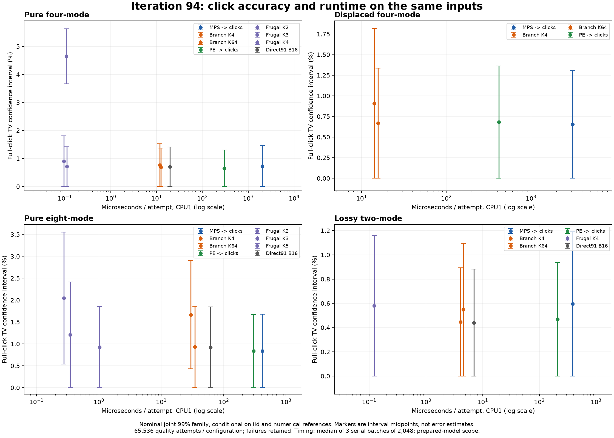

# 第94轮：PNR等待根优化与Gaussian分支直接点击

第83轮随机流勘误继续有效：旧PNR名义99%保证已撤回，第84轮已域分离并重采。第94轮新增的全部结论来自新的实验域和样本；地址不复用不代表数学证明iid，也不表示偏差消失。[勘误](../../corrections/83-rng.md)、[第84轮重采](84.md)。

本轮把直接点击的Gaussian分支表示接成了完整C++采样器，不再只是矩阵接口；PNR核心则减少等待根反复构造规范态的工作。**任意输入优势和九章规模优势仍未达到。** 新直接核在实际规模64次尝试全部失败；PNR有11次失败，必须连同失败一起评价。

## 1. 已完成的计算与验证

26个小系统配置各65536条，另有实际PNR和直接点击各64次，共**1704064次正式尝试**。PE、Frugal和旧直接91基线均重新生成样本。预定82事件共享0.01失败概率；完整点击TV、可得PNR TV、CDF及失败概率分别标注，不把CDF上界称作全分布上界。

独立审计通过**24580项检查**，重建全部82个具名事件、原始直方图、失败界、计时中位数和文件哈希。正式样本实际消耗的**1397502个原生用途域**无重复；PE的128个PCG初态、Frugal的224个实际工作种子分别核对，后者与第93轮也无重复。控制重放不计入独立质量N。

全库1076项运行，1047成功，零失败/错误，29项案例和7个整类跳过；10项MPS及6项新分支测试通过。科学源码/二进制的冻结哈希未变。[独立核验](../../../results/iteration94_verification_v1/validation.json)、[全库测试](../../../results/iteration94_tests_v1/validation.json)、[随机流审计](../../../results/iteration94_rng_audit_v1/validation.json)。

## 2. PNR路线：降低重复计算，精度仍须单独测量

核心为`native/gaussian_mps_core94_v2.cpp`。中间等待根只做正范数QR，在接受点才构造完整规范态；使用对数割线及括区间回退，保留残差、迭代上限、误差预算和随机数消耗。101项独立根检查和8项物理门控通过；最大状态差5.8692e−9，属于数值检验，不是浮点实现的严格认证。

实际主谱同一92光子控制轨迹，v1到v2三次串行中位由26.0683秒降到21.3443秒，**快1.2213倍**，光子数、错误码和随机数消耗相同。此前93到94v1的另一组控制为1.0918倍；不跨不同实验相乘，也不推广成完整双谱吞吐加速。[控制与分项测量](../../../research/iteration94_checkpoint_v2.md)。

新质量结果如下；每个方法/输入65536条，均无失败。八模式只给CDF，不能替代其完整PNR TV。

| 输入 | 方法 | 指标 | 名义联合99%区间 |
|---|---|---|---:|
| 四模式零位移 | MPS | 完整PNR TV | 0.0000%–3.4055% |
| 四模式零位移 | PE | 完整PNR TV | 0.0000%–3.3247% |
| 四模式位移 | MPS | 完整PNR TV | 0.0000%–4.2407% |
| 四模式位移 | PE | 完整PNR TV | 0.0000%–4.1757% |
| 八模式零位移 | MPS | 总光子数CDF | 0.0000%–1.0838% |
| 八模式零位移 | PE | 总光子数CDF | 0.0000%–1.0186% |
| 损耗双模 | MPS | 完整PNR TV | 0.0000%–2.0722% |
| 损耗双模 | PE | 完整PNR TV | 0.0000%–1.9822% |

四模式MPS与PE的完整PNR精度区间重叠；同CPU1，MPS每条2027.789355微秒，PE 297.711572微秒，MPS仍慢**6.8113倍**。第93轮相对旧R3的已证精度改善保留为历史结果，本轮未给R3重新采样，不把历史不同置信族冒充本轮联合比较。

## 3. 直接点击：可计量投影，但实际规模表示仍不够

`native/gaussian_click_branch94_v1.cpp`以初始Gaussian态的真空投影纯化向量为基底；利用联合真空概率计算Gram内积。每端口直接抽取0/1，再压缩Gaussian分支子空间，没有隐含光子数采样。显式计算残差并收取纯态迹距离sqrt(丢弃范数平方)，超预算即保存失败，不裁剪负范数。

48棵完整点击树及27项80位投影距离检查通过；最大距离恒等式差5.5512e−17。下表是完整浮点数值律的距离，含失败输出，不是抽样置信区间或区间算术认证。

| 输入/配置 | 完整点击TV数值 | 失败概率数值 |
|---|---:|---:|
| 四模式 K4，预算1 | 0.28644194% | 0 |
| 位移四模式 K4，预算1 | 0.69140497% | 0 |
| 八模式 K4，预算1 | 1.46162599% | 0.79099404% |
| 四模式 K64，预算0.01 | 5.0307e−17 | 0 |
| 位移四模式 K64，预算0.01 | 3.0358e−17 | 0 |
| 八模式 K64，预算0.01 | 0.00053530485% | 0.00053530485% |

八模式K64在65536条正式样本中未遇失败，不等于其失败概率为零；完整树已显示一个非零小概率失败事件。八模式K4正式样本有535条预算失败，全部计入TV和失败界。[完整树/投影审计](../../../results/iteration94_branch_audit_v1/validation.json)。

## 4. Frugal、PE与旧直接核：速度和精度一起比较

下表均为同输入完整点击TV的名义联合99%区间。CPU1时间为每批2048条、三轮严格串行中位除以2048；原生CPU16数据和所有重复值另存。计时使用已准备模型，含输出、随机数和采样；外部准备、编译及文件I/O排除，Frugal ABI内部目标构建包含在内。PE/MPS额外生成光子数后阈值化，读者需计入其输出能力差别。

| 输入 | 方法 | 完整点击TV区间 | 每条微秒，CPU1 | 失败/65536 |
|---|---|---:|---:|---:|
| 四模式零位移 | PNR MPS → 点击 | 0.0000%–1.4557% | 2027.789355 | 0 |
| 四模式零位移 | 直接分支 K4 | 0.0000%–1.5313% | 11.712158 | 0 |
| 四模式零位移 | 直接分支 K64 | 0.0000%–1.3737% | 12.340869 | 0 |
| 四模式零位移 | PE PNR → 点击 | 0.0000%–1.3035% | 297.711572 | 0 |
| 四模式零位移 | Frugal K2 | 3.6693%–5.6289% | 0.107373 | 0 |
| 四模式零位移 | Frugal K3 | 0.0000%–1.8094% | 0.095166 | 0 |
| 四模式零位移 | Frugal K4 | 0.0000%–1.4217% | 0.110693 | 0 |
| 四模式零位移 | 旧直接91 B16 | 0.0000%–1.4072% | 19.625049 | 0 |
| 四模式位移 | PNR MPS → 点击 | 0.0000%–1.3091% | 3086.412939 | 0 |
| 四模式位移 | 直接分支 K4 | 0.0000%–1.8177% | 14.052197 | 0 |
| 四模式位移 | 直接分支 K64 | 0.0000%–1.3360% | 15.670264 | 0 |
| 四模式位移 | PE PNR → 点击 | 0.0000%–1.3635% | 415.913330 | 0 |
| 八模式零位移 | PNR MPS → 点击 | 0.0000%–1.6779% | 417.518750 | 0 |
| 八模式零位移 | 直接分支 K4 | 0.4310%–2.9002% | 29.810742 | 535 |
| 八模式零位移 | 直接分支 K64 | 0.0000%–1.8602% | 34.558936 | 0 |
| 八模式零位移 | PE PNR → 点击 | 0.0000%–1.6724% | 303.158203 | 0 |
| 八模式零位移 | Frugal K2 | 0.5379%–3.5496% | 0.275391 | 0 |
| 八模式零位移 | Frugal K3 | 0.0000%–2.4148% | 0.345068 | 0 |
| 八模式零位移 | Frugal K5 | 0.0000%–1.8541% | 1.019775 | 0 |
| 八模式零位移 | 旧直接91 B16 | 0.0000%–1.8448% | 61.456494 | 0 |
| 损耗双模 | PNR MPS → 点击 | 0.0000%–1.1909% | 384.561035 | 0 |
| 损耗双模 | 直接分支 K4 | 0.0000%–1.0953% | 4.535303 | 0 |
| 损耗双模 | 直接分支 K64 | 0.0000%–0.8948% | 4.091650 | 0 |
| 损耗双模 | PE PNR → 点击 | 0.0000%–0.9362% | 208.652832 | 0 |
| 损耗双模 | Frugal K4 | 0.0000%–1.1610% | 0.121875 | 0 |
| 损耗双模 | 旧直接91 B16 | 0.0000%–0.8817% | 7.058447 | 0 |

四模式新K64的TV上界1.3737%小于Frugal K2下界3.6693%，在声明假设下，该例误差至少小**2.6712倍**，但耗时是K2的**114.9345倍**。与Frugal K4精度区间重叠，新核慢**111.4870倍**，不能宣布更准或综合获胜。

相对旧直接91 B16，四模式新K64同线程快**1.5902倍**，两者抽样精度区间重叠。位移输入本轮没有Frugal支持对照，表中留空，不用零位移结果替代。所有速度比仅覆盖列出的固定输入和配置。[正式计时](../../../results/iteration94_timing_v1/summary.json)、[比较数据](../../../research/iteration94_frontier_v1.json)。

## 5. 1152输出双谱实际任务与九章差距

PNR固定d6、键维32、两谱预算0.1/0.01、16工作线程。64次尝试中**53成功、11失败**；所有失败保留为额外输出。两谱采样调用总耗时**584.753330秒**，每次尝试**9.136771秒**，不是只统计成功子集。该时间包含核心模型准备与采样，排除前置损耗分解、数据I/O及独立参考计算；单次新质量运行与第93轮的种子不同，不作受控算法加速比。

总光子数CDF误差区间为**0.0000%–46.6926%**；失败概率上界**39.2548%**。预算和失败给出的理想算术完整TV上界为**50.2548%**，未认证浮点/求根总误差，且不把它混同于CDF上界。[实际PNR记录](../../../results/iteration94_actual_quality_v1/summary.json)。

直接分支K8在相同实际模型下**64/64主谱预算失败，成功样本为0**。失败概率及完整点击TV下界均为**86.8654%**。5.597656秒是失败尝试累计时长，不能当成功样本吞吐，也不能与九章计算速度优势。[实际直接点击失败证据](../../../results/iteration94_branch_actual_quality_v1/summary.json)。

先行4条控制已在第3–4次点击附近遇到约0.93–0.98的投影收费。次谱K4试验在126.0513秒后中断，未产出完整次谱记录；原始主谱结果和中断文件保留。这暴露两项独立问题：保留已测端口历史使纯化表示冗余，稠密子集分解又随无点击集合增长。独立热态控制中，未来律可保持精确而当前纯化压缩仍收费，支持下一步研究约化条件态。[容量试验及中断记录](https://github.com/qiyuanhuakai/deziroGBS/blob/0f87aa4b1fbb8baae4e66a456e1505bfd5564d05/results/iteration94_branch_actual_pilot_v1/interruption.json)。

九章3.0的144个物理输出各8个阈值格合成1152位；每原端口0–8个点击是有限伪PNR，不是理想无界光子计数。论文报告1.27微秒/记录；本轮PNR原始每次尝试仍慢约**7,194,308倍**。两者硬件、质量和模型口径不同，这个比值只量化原始时间差距，绝非同精度比较。[九章3.0原论文](https://arxiv.org/html/2304.12240v3)。

将模型输出逐格阈值化后，用全部64次尝试与九章实测的1,492,642条记录比较总点击数。PNR的经验CDF最大距离为**18.6827%**，在阈值155处达到。直接核的经验距离为**100.0000%**，因为全部尝试失败。失败计数统一放在所有物理点击数之上。该描述性对照位于预定82个事件之外。[实测直方图](https://github.com/qiyuanhuakai/deziroGBS/blob/0f87aa4b1fbb8baae4e66a456e1505bfd5564d05/results/iteration81_jiuzhang_accuracy_v3/histograms.npz)、[阈值与两侧CDF](../../../research/iteration94_frontier_v1.json)。

## 6. 结论范围与后续

本轮两个检查点、所有执行版本、失败和最终质量样本均保留。密集QR、SVD、条件轨迹、Gram及压缩在C++中；Python承担编排、独立参考和统计，仓库脚本数量不是计算密集程度的度量。

PE比较固定于0.2.2官方CPU v2，Frugal固定于已核对的1.1 AVX2 FP64构建。[既有源码来源核验](https://github.com/qiyuanhuakai/deziroGBS/blob/0f87aa4b1fbb8baae4e66a456e1505bfd5564d05/results/iteration93_baseline_provenance_v2/validation.json)及[上游核查](https://github.com/qiyuanhuakai/deziroGBS/blob/0f87aa4b1fbb8baae4e66a456e1505bfd5564d05/results/iteration93_upstream_check_v1/validation.json)保留。2026-11-14再次读取的[Gaussian MPS论文v2](https://arxiv.org/abs/2512.10643v2)和[Gaussian分支编码论文v2](https://arxiv.org/abs/2603.15258v2)仍是相关方向；本轮未执行这些论文作者的完整采样实现，不宣称击败所有最新算法。张量构建时间、每键丢弃质量与完整采样时间/TV必须区分。

下一轮优先研究迹掉已测端口后的正条件态压缩、光学低秩真空概率更新，以及PNR的Schmidt预算和失败率；不靠放宽预算或删除失败换取速度。[方法](../../../research/iteration94_methods.md)、[第95轮计划](../../../research/iteration95_plan.md)。总体研究目标保持进行中。
