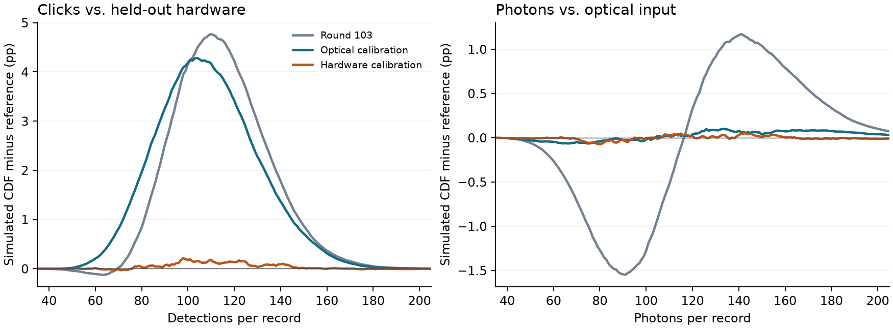

# 第 104 轮 · 九章输入的光子数、点击数与硬件差距

同一套 1,152 位采样器现在可以分别校正到两个目标。按双谱光学输入校正，总光子数累计分布的实测误差从第 103 轮的 1.54–1.55 个百分点降至 0.08–0.10 个百分点。使用半数硬件记录校准，另一半硬件记录上的总点击数误差为 0.21–0.23 个百分点。精确双谱输入与硬件记录本身存在可量化的差距。[精选核验](../results/iteration104_release_v1/validation.json)

| 校正目标 | 输出 | 微秒/条 | 相对九章的批吞吐 | 总光子数 KS，光学参考 | 总点击数 KS，硬件留出 |
|---|---|---:|---:|---:|---:|
| 光学输入 | 直接点击 | 0.437 | 2.90 倍 | 0.101 个百分点 | 4.281 个百分点 |
| 光学输入 | PNR | 0.462 | 2.75 倍 | 0.083 个百分点 | 4.269 个百分点 |
| 硬件点击总数与光学光子总数 | 直接点击 | 0.956 | 1.33 倍 | 0.071 个百分点 | 0.213 个百分点 |
| 硬件点击总数与光学光子总数 | PNR | 1.002 | 1.27 倍 | 0.092 个百分点 | 0.226 个百分点 |

每行使用 1,048,576 条独立新记录，RTX 5080 Laptop 每批输出 16,384 条，计时包含传回主机的全部 1,152 个探测位和 144 个空间光子数。KS 是累计概率的最大绝对差。四行的光子数 KS 同时误差半径为 0.218 个百分点，硬件点击数 KS 为 0.475 个百分点，按独立采样假设计算。论文中的九章 3.0 使用伪光子数分辨探测，记录速率对应每条 1.27 微秒。上表 PNR 是模拟器输出的逐探测位光子数，硬件对照使用可观测的点击总数。[原始计时](../results/iteration104_packed_v1/summary.json) · [逐轮验证直方图](../results/iteration104_validate_v1) · [九章实验论文](https://arxiv.org/abs/2304.12240) · [硬件原始数据来源](https://quantum.ustc.edu.cn/web/node/1121)



## 输入光学模型与硬件究竟差多少

名义双谱输入给出平均 103.896 次点击、方差 448.170；1,492,642 条硬件记录平均 106.124 次。单用均值即可推出，精确光学分布与实测点击数直方图的 KS 距离至少为 **1.336 个百分点**。进一步使用每个总光子数下点击数的一阶和二阶矩，该下界升至 **3.295 个百分点**。对硬件样本施加同时 99% DKW 置信带，硬件总体与名义光学输入的下界约为 **3.162 个百分点**。总体置信结论依赖硬件记录独立同分布；样本直方图与固定数值光学模型的 3.295 个百分点下界可直接复算。[光学矩](../results/iteration104_optical_v1/summary.json) · [固定检验函数与硬件划分](../results/iteration104_fit_v1) · [独立积分路径复算](../results/iteration104_contour_v1/summary.json)

计算中令 N 为总光子数、C 为总点击数。以总光子数生成函数为起点，对所有 1,152 个单探测位及 662,976 个探测位对分别计算真空概率与 N 的联合生成函数。四维与二维行列式给出 C 和 C(C−1) 的生成函数，傅里叶系数给出各 N 对应的未归一化条件矩。对 30 至 260 个光子，在每个整数点击数上用二次多项式上界一个取值 0 至 1 的单调检验函数。对其余光子数保守地使用上界 1。将光学期望上界与实测期望相减，即得到 KS 的下界。两条复积分路径使用 1,024 和 640 个节点、不同半径及相位，所得光学期望上界只相差 1.21 × 10⁻¹⁴。这里的光学参考基于存档协方差的数值计算。[C++ 行列式计算](../native/click_moments104_v1.cpp) · [生成函数文献](https://arxiv.org/abs/2209.05330)

## 校正的局部代价

光学路线只用光学总光子数分布及条件点击数均值、方差拟合接受概率。硬件路线额外使用随机划出的 746,321 条硬件点击总数，同时拟合光子总数和点击总数的边缘分布，用另 746,321 条记录检验。划分来自直方图，不含采集时间顺序。两者共享 4,194,304 条训练用模拟记录，平均接受率分别为 60.55% 和 12.50%。硬件拟合达到优化器的迭代上限，文中误差取自固定接受表的留出实测。每次接受或拒绝使用独立的随机数用途编码，GPU 只为接受记录展开全部输出。用相同输入逐条复核了 47,735 条接受记录和拆批续采。[校正程序](../experiments/iteration104_fit_v1.py) · [CUDA 采样](../native/packed_filter104_v1.cu) · [逐条一致性](../results/iteration104_packed_v1/summary.json)

对 36、107 号空间端口的全部 65,536 种点击结果，光学校正路线与精确光学参考的 TV 不超过 **1.616%**，硬件校准路线位于 **0.968% 至 2.803%**，均为新样本统计界。硬件校准模型的整机总点击数与名义光学模型的 KS 至少 **3.012 个百分点**（点击路线）。55 至 190 个总光子的条件下，点击均值对光学参考的加权均方根误差从光学校正的 0.050 次升到硬件校准的 2.218 次。三个有硬件记录可对照的八位面板，硬件校准的经验 TV 为 0.744%、1.053%、1.178%，光学校正为 0.747%、0.969%、0.959%。[完整点击及 PNR 留出](../results/iteration104_validate_v1/summary.json) · [硬件八位面板](../results/iteration104_audit_v1/summary.json)

同输入、同输出任务，每批 2,048 条，生成整条记录后只取 36、107 号空间端口的 16 位点击，光学与硬件路线分别用时 0.568、1.219 微秒/条。第 103 轮同机单线程 Frugal K2 用时 11.534 微秒，完整点击 TV 为 11.620%；K4 用时 42.624 微秒，TV 为 6.007%。对 289、861 号物理探测位的 PNR，本轮两种校正分别用时 0.585、1.253 微秒，光子数联合 TV 上界分别为 0.221%、0.847%（包含参考尾部）；同机 photonic-engines CPU v2 用时 481.227 微秒，32,768 条记录的经验 TV 为 0.350%。对照中 GPU 与 CPU 的设备、批量和输出范围均有记录。[本轮同宽耗时](../results/iteration104_audit_v1/summary.json) · [Frugal、photonic-engines 原始对照](../results/iteration103_baselines_v1/summary.json) · [Frugal 论文](https://arxiv.org/abs/2511.14923)

## 任意端口数下可给整条记录误差界的输入

对于每个可区分光谱中只有一个受压缩空间超模的输入，可直接从有损单模生成函数抽取该谱的总光子数，再按传输强度把光子分配到任意数目的输出端口。同一光谱的输出可以遍及所有端口，不同光谱可以具有不同且相互重叠的空间分布。PNR 路线累加到达端口的光子数，点击路线直接标记到达端口。每条记录的期望工作量随输出宽度、光谱数与平均光子数之和增长。误差界将各谱的截尾质量、整数光子数表舍入误差，以及平均光子数乘以端口分配表 TV 相加。确定性浮点数值检查和该模型的概率误差界分开记录。[C++ 实现](../native/spectral_allocation104_v1.cpp) · [所有宽度的速度和完整分布误差界](../results/iteration104_spectral_v1/summary.json)

| 端口 | 点击，微秒/条 | PNR，微秒/条 | 完整记录 TV 上界 |
|---:|---:|---:|---:|
| 144 | 0.213 | 0.174 | 2.99 × 10⁻¹⁴ |
| 1,152 | 0.595 | 0.591 | 1.69 × 10⁻¹³ |
| 4,097 | 1.627 | 1.673 | 5.51 × 10⁻¹³ |
| 16,384 | 5.658 | 5.811 | 2.21 × 10⁻¹² |

以上为两个可区分的受压缩超模、16 个 CPU 线程、完整稠密输出。16 端口单线程点击为 0.202 微秒/条，整条记录的 TV 上界为 1.35 × 10⁻¹⁴。同输入 Frugal K2 为 15.936 微秒、TV 为 61.367%，K4 为 63.351 微秒、TV 为 53.374%。16 位光学参考的两种独立计算相差 3.18 × 10⁻¹⁶ TV。[同输入基准](../results/iteration104_spectral_v1/summary.json)

对每个可区分谱中有多个受压缩输入模式的一般被动光路，程序可接受完整传输矩阵和挤压参数，保留各谱的主超模。舍弃模式与真空的重合概率为各模式 1/cosh(r) 的乘积；相应迹距离在损耗和探测下不会增大。在 16 端口、每谱八个受压缩输入的测试上，三档残余挤压对应的完整点击 TV 实测分别为 0.0614%、0.5545%、3.7125%。对九章高功率矩阵，同一降秩把平均光子数从 **116.286 降到 2.507**。其整机 PNR TV 至少 **99.978%**，点击 TV 至少 **99.705%**。九章结果表使用前述双谱全输入采样器；在九章上使用降秩需要保留更多相互干涉的受压缩模式。[传输矩阵测试与截断界](../results/iteration104_transfer_v1/summary.json) · [整机误差下界](../results/iteration104_release_v1/validation.json)

## 复现

在固定归档根目录运行。前两条命令输出 1,152 个探测位的完整记录、空间组计数，以及下一段可使用的随机数记录偏移。采样器支持把该偏移传给同种子后续调用。GPU 运行环境沿用第 103 轮 Windows CUDA / PyTorch；任意宽度的超模采样核心使用 C++ 和 OpenMP。

```powershell
python experiments/iteration104_packed_v1.py draw optical-clicks.npz --seed 104200001 --shots 2048
python experiments/iteration104_packed_v1.py draw hardware-pnr.npz --target hardware --pnr --seed 104200002 --shots 2048
python experiments/iteration104_transfer_v1.py draw transfer-pnr.npz --input results/iteration104_transfer_v1/input16.npz --pnr --seed 104200003
python experiments/verify_iteration104_v1.py new-validation
```

重建光学、采样、校正及核验的顺序为 optical、sample 的 pilot、fit、validate、packed 的 benchmark、audit 与 contour。独立运行 spectral 和 transfer 的 benchmark，最后运行核验与 figure。每个阶段接受新输出目录。[各阶段校验值](../results/iteration104_release_v1/validation.json)
