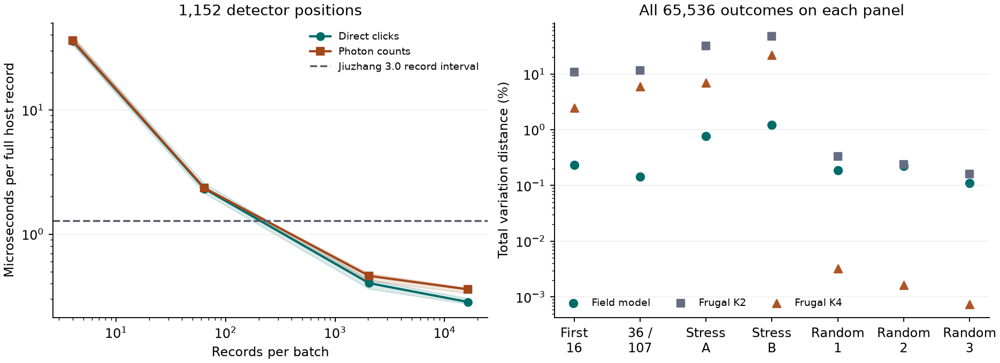

# 第 106 轮 · 跨光源干涉、直接点击与逐位光子数

九章 3.0 高功率输入有 25 对光源、两个谱、1,152 个时间复用探测位。本轮在 RTX 5080 Laptop 上生成完整的逐位记录。每批 16,384 条时，直接点击为 **0.285 微秒/条**，逐位光子数为 **0.360 微秒/条**。前 16 位完整联合点击分布相对名义光学目标的总变差距离（TV）为 **0.2347%**，第 105 轮逐源模型为 10.5979%，同宽 Frugal K2 的完整前缀为 10.7711%。误差最大的已测 16 位面板为 **1.2198%**，给出整个光学模型联合分布的 TV 下界。[精选核验与运行条件](../results/iteration106_release_v1/validation.json) · [第 105 轮全宽 Frugal 对照](iteration105_checkpoint_v1.md)



## 两种输出的实测速率

下表是从发起采样到主机拿到全部 1,152 个值的单条平均耗时，单位为微秒。计时前加载模型，对同批量的设置随机交错测量 15 次，取中位数。点击可另外按每八位一个字节返回，完整记录占 144 字节。PNR 返回每个探测位的光子数，出现超过 255 的记录时按原随机地址重新生成宽整数输出，压力测试覆盖到单端口 **13,395 个光子**。

| 每批条数 | 完整点击 | 完整 PNR |
|---:|---:|---:|
| 4 | 35.800 | 36.150 |
| 64 | 2.319 | 2.350 |
| 2,048 | 0.403 | 0.461 |
| 16,384 | 0.285 | 0.360 |

九章 3.0 论文记录速率折合 **1.27 微秒/条**。最大实测批量下，上表点击吞吐为硬件记录速率的 **4.46 倍**，PNR 为 **3.53 倍**。只取位压缩点击时为 **0.155 微秒/条**。九章记录时间槽点击，可聚合成空间端口的伪光子数；模拟器的逐位 PNR 另与名义光学概率比较。第 104 轮光学校正路线在同 GPU、相同大批量下为 0.437 / 0.462 微秒，本轮逐位输出分别加快 **1.54 / 1.29 倍**。[本轮计时、四分位和原始直方图](../results/iteration106_words_v1) · [第 104 轮精选核验](../results/iteration104_release_v1/validation.json) · [九章 3.0 论文](https://arxiv.org/abs/2304.12240)

## 光学精度与 Frugal

面板取相同光学输入，完整枚举每个 16 位面板的 65,536 种点击词。下表的 Frugal 使用官方 FP64 CPU 递推并按指定 16 位输入生成记录。前 16 位的 K2 结果另从官方 1,152 位完整目标独立核对。其余面板报告对应的投影任务；本轮一列均来自同一 1,152 位整机模型的边缘分布。数字为完整面板 TV。

| 观测面板 | 本轮光场模型 | Frugal K2 | Frugal K4 |
|---|---:|---:|---:|
| 前 16 位 | 0.2347% | 10.7711% | 2.4628% |
| 空间端口 36、107 的 16 位 | 0.1440% | 11.6202% | 6.0070% |
| 按基线两位误差逐位挑选 | 0.7663% | 31.654% | 6.978% |
| 空间端口 34、35 的 16 位 | 1.2198% | 47.513% | 21.725% |
| 三组随机分散探测位 | 0.1115–0.2246% | 0.162–0.336% | **0.00075–0.00326%** |

Frugal K4 在三个分散面板上的误差均较低。对聚集探测位，最难面板上本轮相对 K4 减少 **20.51 个百分点**。对全部 **662,976 对**探测位逐一计算完整两位 TV，平均 **0.01343%**，最大 **0.19312%**。发布核验还将九个完整面板中的 988 对投影与普查逐一比对，最大差为 1.14 × 10⁻¹⁵。[完整面板与普查](../results/iteration106_packed_v1) · [Frugal 概率与计时](../results/iteration106_frugal_v1) · [Frugal 论文](https://arxiv.org/abs/2511.14923)

另用每条路线各 1,048,576 条新生成记录验证生产内核。以各面板上模型概率大于光学概率的点击词构成预先固定的事件，18 项双侧检验同时使用 99% 置信界。最难面板给出生产内核整机点击 TV 至少 **0.9998%**、整机 PNR TV 至少 **1.0308%**，这些统计界以模拟记录独立为条件。名义光学模型的总光子数 TV 为 **8.23 × 10⁻⁸**，这是基于生成函数的数值结果；实际百万条 PNR 样本相对模型的总光子数 KS 为 **0.0733 个百分点**。两项度量分别覆盖总数分布与有限样本误差。[预先固定的事件与独立样本](../results/iteration106_witness_v1) · [总数分布与傅里叶尾界](../results/iteration106_packed_v1/summary.json)

**同 GPU 对照。** 前 8 位、每批 2,048 条、相同主机字节格式，本轮投影内核为 **0.147 微秒/条**，模型完整 TV 为 **0.0958%**；官方 Frugal GPU FP32 K2 / K4 为 **3.788 / 4.112 微秒/条**。各用 262,144 条验证时，三者经验 TV 分别为 **0.559%、9.386%、1.317%**。前 144 位、每批 64 条，本轮为 **2.586 微秒/条**，官方 Frugal GPU FP32 / FP64 K2 为 **0.843 / 1.235 秒/条**。对完整 1,152 位、每批 4 条，第 105 轮同机单线程 Frugal K2 的采样阶段为 **1,504.95 秒/条**，含初始化为 **1,513.67 秒/条**，本轮 GPU 已加载模型的点击为 **35.80 微秒/条**。[同 GPU 观测范围与实测](../results/iteration106_device_v1/summary.json) · [官方后端计时与统计区间](../results/iteration104_device_release_v1/validation.json)

**光子数对照。** 289、861 号探测位的完整双端口 PNR，光学模型 TV 为 **0.01426%**，计入每端口达到 12 个光子后的参考尾部。等量 32,768 条样本下，本轮经验 TV 为 **0.297%**，photonic-engines CPU v2 为 **0.350%**。后者在同输入的四模纯化上为 481.227 微秒/条。两项计时的设备与输出宽度不同。[双端口精度](../results/iteration106_device_v1/summary.json) · [等样本量核验](../results/iteration106_witness_v1/summary.json) · [photonic-engines](https://github.com/Quandela/photonic-engines)

## 九章硬件校准

固定输入光路和采样程序，只用按文件顺序排列的前 746,336 条硬件记录拟合总点击数均值和方差，再用后 **746,306 条**验证。拟合将光强均值乘以 **1.023706**，光强波动的指数改为 **0.998122**。位压缩内核解出逐位记录后，直接点击和 PNR 转点击的硬件总点击数经验 KS 分别为 **0.344、0.259 个百分点**；同模型的另一种原生读出分别为 **0.199、0.245 个百分点**。独立同分布假设下，每路线两样本 KS 的保守半径为 **0.435 个百分点**。纯光学参数的相应硬件误差约 **4.23–4.30 个百分点**。

硬件校准的代价可从相同光学参考直接量出：总光子数 TV 增至 **4.145%**，前 16 位点击 TV 增至 **0.840%**，289、861 号双端口 PNR TV 增至 **0.248%**。硬件版的大批量逐位点击和 PNR 分别为 **0.291、0.361 微秒/条**。[硬件拟合、留出分布和光学代价](../results/iteration106_device_v1) · [按文件顺序划分的记录](../results/iteration104_record_order_v1) · [硬件公开数据](https://quantum.ustc.edu.cn/web/node/1121)

## 高亮度下的共同光场

每个双光束源用一对相位共轭的复高斯场表示。各源振幅通过同一复传输矩阵累加后取模平方，两个可区分谱再相加强度。这保留了跨源干涉的空间结构。逐位 PNR 在给定强度时抽泊松计数。直接点击在同一强度下以真空概率 exp(−λ) 作一次阈值判定。用一个正的离散亮度变量修正总光子数的阶乘矩，六个支点匹配前 11 阶。由总光子数和同端口二阶阶乘矩解出有效谱权重，把弱谱平均强度的 **28.107%** 移入强谱，同时固定每个源的总平均光子数。这些都是模拟器参数，光学目标仍使用实验公布的两个谱。

每个空间端口的八路传输以首个奇异向量近似，并逐探测位恢复原光学平均强度。保留完整局部矩阵时，前 16 位 TV 为 0.23486%，一阶压缩为 0.23470%。CUDA 内核以一次复场传播同时产生八个独立条件点击或计数；点击每个随机阈值用 32 位整数，给定已算出的强度，仅阈值量化对完整 1,152 位 TV 的上界为 1.35 × 10⁻⁷。光场近似、浮点传播、抽样统计各自另行核验。[GPU 传播与探测](../native/word_field106_v1.cu) · [光学矩拟合](../experiments/iteration106_field_v1.py) · [全位对交叉检查](../experiments/verify_iteration106_v1.py)

## 保留量子态的多源采样与扩维

另一条 C++ 路线将同谱的光源组成树。在给定总发射光子对数的扇区，按源压缩振幅的乘积叠加所有相容的 Fock 态。每抽中一个输出端口就对态施加该端口的湮灭算符。总对数超过预算时，转入子树继续保留其中可处理的相干性。用损耗环境输出补齐等距传输。标记输入对数的高斯行列式独立算出这条自适应规则的边缘分布；两个源的显式积和式还复核了复生成函数。

- **弱光、16 端口、两个双光束源。** 完整点击 TV 从逐源模型的 **1.929%** 降至 **0.000175%**，单线程 **0.274 微秒/条**。Frugal K2 / K4 的 TV 为 1.688% / 0.0706%，用时 6.943 / 20.224 微秒。另用 8 个相干双光束源取得 **70,572 条双光子记录**，验证全部同端口和跨端口出射事件。
- **九章高功率、两谱各 25 源。** 这条路线实际输出整条记录，每组最多 8 源。受已实现的对数预算限制，前 16 位 TV 只从 10.598% 降至 **10.561%**；36、107 面板为 **5.063%**。第 105 轮允许八源在任意光子数扇区完全相干时，前 16 位的理论分组误差为 **5.325%**。尚需扩大对高光子数扇区的相干处理。
- **131,072 个物理端口、固定两个双光束源。** 对数上限为 16。每批 32 条、16 个 CPU 线程，整条点击 / PNR 为 **67.66 / 65.91 微秒**。理想算术下，两条完整联合分布的 TV 上界均为 **0.03517%**，来自回退扇区概率及源总数量化；有限精度另用解析面板检验。前 16 位的数值 TV 为 **9.99 × 10⁻⁹**。同一光路的全局光场法在含四个亮端口的八位面板上误差为 **8.087%**，量子态方法为 **9.32 × 10⁻⁷%**。
- **占用源数也随宽度增加。** 在 4,096 端口、64 对源的单谱输入上，GPU 共同光场的点击 / PNR 为 **3.13 / 3.19 微秒**，固定八位面板 TV 为 **4.711%**。外推到更多高占用源时，这个数值与九章最难面板的 1.220% 都是需要缩小的差距。下一步应针对聚集与分散探测位分别检验残余的高阶量子相关。

[相干分组 C++ 实现](../native/source_groups106_v1.cpp) · [弱光对照](../results/iteration106_weak_v1) · [相同光路的扩维对照](../results/iteration106_rankwidth_v1/summary.json) · [增加占用源数与高地址随机流测试](../results/iteration106_width_v1/summary.json)

## 复现

在固定归档的工作目录中运行。GPU 使用 Windows CUDA 和 PyTorch，CPU 核心使用 GCC/OpenMP。前两条生成同一批记录的两种输出；点击可加 `--packed`，按硬件校准可加 `--label hardware`。后两种通用输入使用 `transfer`（复矩阵，端口 × 两倍源数）和 `squeezing`（谱 × 源数）。

```sh
python experiments/iteration106_words_v1.py draw clicks.npy --shots 2048 --seed 106250000
python experiments/iteration106_words_v1.py draw photons.npy --shots 2048 --seed 106250000 --pnr
python experiments/iteration106_groups_v1.py draw coherent.npy --input results/iteration106_width_v1/example.npz --pair-cutoff 16 --shots 128 --seed 106250001 --pnr
python experiments/iteration106_field_v1.py draw field.npy --input results/iteration106_width_v1/example.npz --shots 128 --seed 106250002
python experiments/verify_iteration106_v1.py results/recheck106
```
