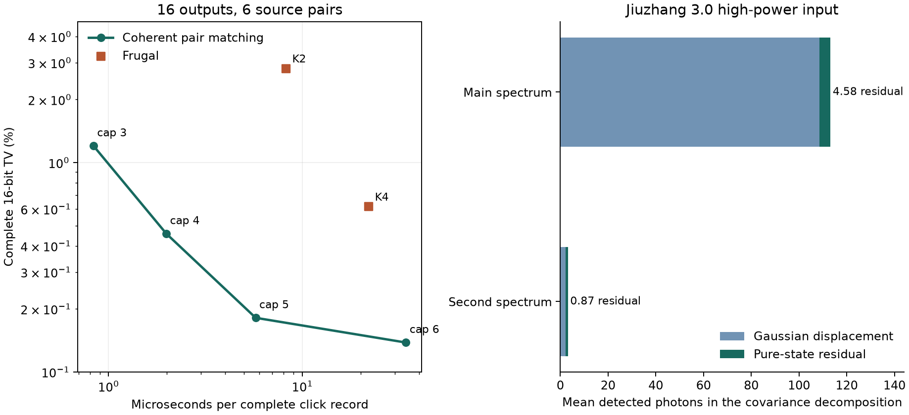

# 第 108 轮 · 整机光子数、相干光子对与完整分布误差

在 16 个端口、6 对源、平均发射 1.2 对光子的稠密光路上，新相干采样器返回完整点击记录用 **1.99 微秒/条，完整分布 TV 为 0.4571%**。同机 Frugal K4 为 **22.03 微秒/条、0.6157%**。在另一组 4,096 端口、1,024 个独立谱的输入上，每条记录平均探测到 156.27 个光子，完整 PNR 与点击的理想算术 TV 上界均为 **0.000506%**。实际九章 3.0 主要能量集中在一个谱，表现与这组独立谱输入相差很大。[逐项核验](../results/iteration108_release_v1/validation.json)



## 九章 3.0 两条读出路线

直接点击先生成指定探测位的点击及其余区域是否为空，再按条件点击概率展开 1,152 位记录。PNR 则从光学态计算两个指定探测位的光子数与其余全部端口光子总数的联合概率。两条路线都用同一个相关光场决定区域内的空间分布。前者利用真空条件下的小矩阵，后者利用总光子数生成函数及两个探测位的傅里叶系数。C++/CUDA 执行随机数生成、区域读出和光子分配。[计算方法](../experiments/iteration108_laws_v1.py) · [GPU 读出](../native/global_readout108_v1.cu)

| 实际九章高功率输入 | 直接点击 | 逐位 PNR |
|---|---:|---:|
| 1,152 位整条记录，每批 16,384 条，聚焦 36、107 号空间端口 | 0.384 微秒 | 0.402 微秒 |
| 相对论文的 1.27 微秒/条，大批量吞吐倍数 | 3.31 倍 | 3.16 倍 |
| 默认配置，等宽取前 8 位，每批 2,048 条 | 0.506 微秒 | 0.763 微秒 |
| 默认配置，前 8 位的经验 TV，独立 262,144 条 | 0.609% | 0.688% |
| 默认配置，整机总点击数与 746,306 条硬件留出记录的经验 KS | 4.122 个百分点 | 4.083 个百分点 |

计时设备为 RTX 5080 Laptop，包含主机取回结果。九章实物使用伪光子数分辨探测。相同 GPU 上 Frugal FP32 K2/K4 的前八位计时为 **3.788 / 4.112 微秒**，相同样本量的经验 TV 为 **9.386% / 1.317%**。第 107 轮的整机大批量吞吐更高，点击 / PNR 为 0.267 / 0.329 微秒。新聚焦配置在光学模型中将探测位 289、861 的 PNR 与全机总数一起校正。两个探测位归入 12+ 尾档的参考分布，经独立方法重算一致。32,768 条记录的两位 PNR 经验 TV 为 **0.217%**，photonic-engines 为 **0.350%**，该工具在约化光路上为 481.23 微秒/条。[同 GPU 对照和聚焦配置](../results/iteration108_jiuzhang_v1/summary.json) · [完整记录与硬件留出检验](../results/iteration108_bench_v1/summary.json) · [九章 3.0 论文](https://arxiv.org/abs/2304.12240) · [原始硬件数据](https://quantum.ustc.edu.cn/web/node/1121)

**上一轮的整机偏差。** 在相同 131,072 端口、两个强源对上，65,536 条记录的全零点击概率偏差从 **8.868 降至 0.202 个百分点**，总光子数 KS 从 **9.020 降至 0.445 个百分点**。按光学参考积分，包含指定八位和四个区域空置标志的完整点击表 TV 约 1.95 × 10⁻⁹，三维 PNR 表约 2.31 × 10⁻⁹（均为概率单位）。两位计数加上其余区域总数即可确定全机总数。区域内部仍有误差，PNR 转点击后在跨区域八位的经验 TV 为 **4.060%**。该项与全零事件一起检验，能区分总数偏差和空间分配偏差。[本轮完整直方图](../results/iteration108_bench_v1) · [第 107 轮同输入](../results/iteration107_global_v1)

## 相干光子对在同一光路上的速度和精度

给定某个谱发射了 n 对光子，先按两光子振幅矩阵独立抽取 n 个候选光子对。对这 2n 个位置枚举所有完美匹配，按振幅相干求和，经拒绝采样恢复该扇区的量子分布。每条记录独立处理相互可区分的光谱，损耗端口在读出时丢弃。接受的到达位置可直接设置点击位，也可按端口累计光子数。超过对数上限或尝试预算的记录沿原输入源独立路由。实验保留了回退记录和次数。[C++ 相干内核](../native/pair_matching108_v1.cpp) · [损耗积分与稀疏记录](../experiments/iteration108_compact_v1.py)

| 完整 16 位输出，CPU，每批 2,048 条 | 相干法，上限 4，微秒 / TV | Frugal K4，微秒 / TV |
|---|---:|---:|
| 2 对源，单谱，平均发射 2.043 对 | 0.66 / 4.182% | 21.39 / 13.781% |
| 6 对源，单谱，平均发射 1.2 对 | 1.99 / 0.4571% | 22.03 / 0.6157% |
| 6 对源，单谱，平均发射 2.5 对 | 5.14 / 3.8544% | 20.21 / 2.0360% |
| 3 对源，两个谱，平均发射 1.782 对 | 0.85 / 0.7394% | 42.02 / 1.4173% |

此处 TV 枚举全部 65,536 个输出，包含接受、尝试用尽和高阶回退三部分的完整模型概率。光学参考由独立 binary128 程序重算，两种参考的最大 TV 差为 2.64 × 10⁻¹²。相干法使用 12 个 CPU 线程，所测上游 Frugal CPU 适配器使用一个线程，时间比反映这两种实际实现。6 对源、平均 1.2 对时，把相干上限从 4 提至 5，TV 再降至 **0.1813%**，耗时 **5.74 微秒**。平均 2.5 对时，上限 4 的误差比 Frugal K4 高 1.818 个百分点。这些小规模输入也适用第 107 轮的完整 16 位预计算点击表。[全部五组光路和上限扫描](../results/iteration108_exact_v1) · [Frugal 算法论文](https://arxiv.org/abs/2511.14923) · [上游 C++/CUDA 实现](https://github.com/tomdodd4598/FrugalGBS)

同一 16 端口、6 对源、平均发射 1.2 对光子的 PNR 对照使用每批 256 条。相干法 **4.11 微秒/条**，photonic-engines CPU v2 **2,390.7 微秒/条**。两者均返回全部 16 个端口的光子数。8,192 条样本中的两端口经验 TV 分别为 **0.875% / 0.272%**，总光子数经验 KS 为 **0.669 / 0.510 个百分点**。独立的双模干涉检验中，24,083 条双光子记录的符合事件数为零。四端口复数干涉仪另以产生算符多项式逐项计算了 130 个 Fock 态。[PNR 完整记录对照](../results/iteration108_whole_pnr_v1) · [独立干涉检验](../results/iteration108_compact_bench_v1)

### 完整分布上界

令 xⱼ = tanh²rⱼ，hₙ 为这些 xⱼ 的 n 阶完全齐次对称多项式，Mₙ = (2n−1)!!。单谱发射 n 对的概率为 pₙ = hₙ ∏ⱼ(1−xⱼ)。对一个有序候选，记各匹配振幅为 aₘ。接受率为 |Σₘaₘ|² / (Mₙ Σₘ|aₘ|²)，由柯西不等式可知至多为一。候选分布乘接受率正比于量子概率。到达位置的排列不影响 PNR 和点击记录。对被动光路作含损耗的等距扩张，得到该扇区的平均接受率 Aₙ = n! hₙ / [Mₙ (Σⱼ xⱼ)ⁿ]。没有发射时直接输出真空。

在上限 c、尝试预算 L 下，一个谱的回退概率为 P(n>c) + Σₙ₌₁ᶜ pₙ (1−Aₙ)ᴸ。完整输出的理想算术 TV 至多为这一概率。对独立光谱，联合界为一减去各谱成功概率的乘积。丢弃损耗、合并光谱及将计数转成点击都保持这一上界。精选结果包含四组上界的 90 位十进制复算。数值边界、浮点实现和有限样本分别核验。很小的公式上界不作为机器舍入上界。[上界计算](../experiments/iteration108_matching_v1.py) · [核验程序](../experiments/verify_iteration108_v1.py)

### 同时增加空间端口数和源数

下表的 131,072 × 256 复传输矩阵由稠密随机 QR 构造，128 对源均被激发。稀疏记录按行返回全部非零端口及计数，未列端口为零。核验程序用相同种子解码并逐项比较了稀疏与稠密记录。

| 131,072 个端口、128 对源，单谱 | 平均发射 0.12 对 | 平均发射 0.015 对 |
|---|---:|---:|
| 完整点击和 PNR 的理想算术 TV 上界 | 0.00002059% | 0.000000000689% |
| 稀疏点击 / PNR，每批 8,192 条，微秒/条 | 3.93 / 6.03 | 0.430 / 0.473 |
| 稠密点击 / PNR，每批 32 条，微秒/条 | 27.88 / 23.98 | 22.14 / 21.39 |

在 0.12 对的同一输入上，Frugal K4 的前 16 位模型 TV 为 8.08 × 10⁻¹³（概率单位），16 位约化采样为 20.49 微秒/条。在此维度，相干法上界覆盖整条记录，Frugal 精度数据覆盖前 16 位。单谱的全局读出、相干法和低光子数直接法的原始计时分别存档。[稠密与稀疏计时](../results/iteration108_compact_bench_v1/summary.json) · [Frugal 和 photonic-engines 对照](../results/iteration108_quantum_bench_v1/summary.json) · [低光子数读出](../results/iteration108_low_bench_v1)

**高占用、独立光谱。** 在同一稠密空间干涉仪上叠加 1,024 个独立的同参数谱，每谱平均发射 0.12 对，总计 **122.88 对**。4,096 个端口、64 对源时，每条记录平均探测到 **156.27 个光子**，稠密点击 / PNR 为 **282.7 / 281.1 微秒**，两种完整分布的 TV 上界为 **0.000506%**。8,192 个端口、128 对源时，稠密点击 / PNR 为 **2,068 / 1,923 微秒**，上界为 **0.000443%**。4,096 端口每批 16 条，相干法完整点击为 447.3 微秒。上游 Frugal K2/K4 在 16 位约化光路分别抽取并合并 1,024 个谱为 5,383 / 11,190 微秒，16 位模型 TV 为 0.0000884% / 0.000000532%。计时协议复用了同一光谱输入。上述实验变化的是独立光谱数量，不能将此上界转用于九章实际双谱输入。[高占用原始记录统计与完整上界](../results/iteration108_bright_v1)

## 实际强光谱还差多少

实际九章输入的两个谱分别平均发射 **133.40 / 3.72 对**。相干上限为 4 时，主谱在全部 8,192 条检验记录中回退，前 8 位联合点击数值 TV 为 **12.720%**，36 号空间端口的 8 位为 **7.493%**，点击耗时约 **114 微秒/条**。高速的直接点击路线在前 8 位相同样本协议下为 0.609% 经验 TV。[相干法在真实输入上的失败区间](../results/iteration108_actual_quantum_v1) · [直接路线精度](../results/iteration108_jiuzhang_v1)

对实际输出协方差作纯压缩态与经典高斯位移的分解后，主谱平均探测的 **113.13 个光子**可分为 **108.55 个位移光子和 4.58 个纯态残余光子**。纯态残余超过 6 对的概率为 1.280%，第二个谱对应概率为 0.0000829%。两组经典噪声协方差均通过半正定检验，纯态辛条件的最大残差为 4.0 × 10⁻¹⁵。下一步可围绕这 4.58 个残余光子计算其与位移的相干项，直接检验 12.720% 的前八位误差能降到多少。两部分在生成探测事件前仍须相干叠加。[协方差矩阵与数值检验](../results/iteration108_residual_v1)

## 复现

从固定归档检出完整工程。GPU 路线使用 CUDA 与 PyTorch。相干采样器使用 C++20、OpenMP 和登记过的 Philox 随机数域。下列示例分别生成实际九章的两种输出、稀疏 PNR，以及多谱高占用稠密记录。新输入可用 `iteration108_device_v1.py prepare` 准备两条 GPU 路线的表。原始工程与上游基线环境要求见[前一轮报告](iteration107_checkpoint_v1.md)。

```sh
python experiments/iteration108_device_v1.py draw clicks.npy --input results/iteration108_bench_v1/jiuzhang.npz --tables results/iteration108_jiuzhang_v1/targeted.npz --shots 256 --seed 108120000
python experiments/iteration108_device_v1.py draw photons.npy --input results/iteration108_bench_v1/jiuzhang.npz --tables results/iteration108_jiuzhang_v1/targeted.npz --shots 256 --seed 108120001 --pnr
python experiments/iteration108_compact_v1.py draw sparse.npz --input results/iteration108_compact_bench_v1/weak4096.npz --pnr --shots 2048 --seed 108120002
python experiments/iteration108_replicas_v1.py draw bright.npy --input results/iteration108_compact_bench_v1/weak4096.npz --replicas 1024 --cap 5 --tries 8192 --cache-mb 144 --shots 128 --seed 108120003 --pnr
python experiments/verify_iteration108_v1.py results/recheck108
```
