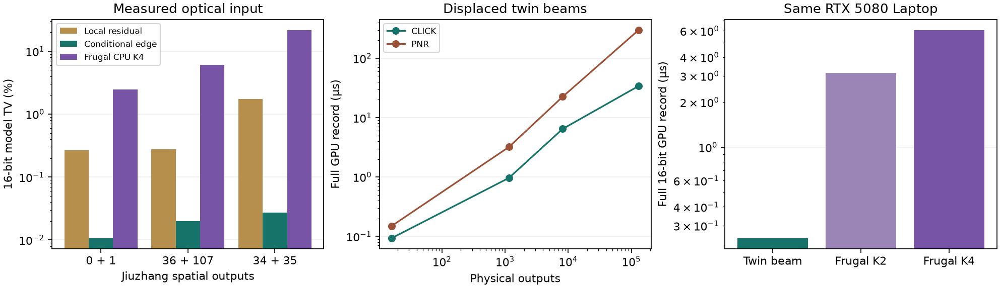

# 第 109 轮 · 位移干涉、重叠端口读出与高占用双光束

在实际九章 3.0 双谱输入上，前八个探测位的完整点击分布有 256 种结果。把位移和剩余的压缩光分别探测再合并，模型总变差距离（TV）为 **1.1913%**。让两者在同一光学模式内干涉，TV 降至 **0.00478%**，约缩小 249 倍。另一组探测位 288–295 的对应结果为 **0.9519% → 0.00627%**。光路、测量窗口和参考分布相同。这里用确定性概率计算比较两种模型。每条都返回 1,152 个端口的独立采样速度及整机误差见下表。[模型与消融](../experiments/iteration109_model_v1.py) · [原始概率与记录直方图](../results/iteration109_tree_v1)



## 实际九章 3.0 输入

| 每条完整 1,152 位记录，RTX 5080 Laptop | 直接生成点击 | 生成逐位光子数 |
|---|---:|---:|
| 每批 2,048 条，含主机取回 | 1.294 µs | 0.440 µs |
| 每批 16,384 条，含主机取回 | 1.106 µs | 0.348 µs |
| 相对九章论文 1.27 µs/条的批量吞吐倍数 | 1.15 倍 | 3.65 倍 |
| 262,144 条记录，前八位经验 TV | 0.633% | 0.588% |
| 总点击数与 746,306 条硬件留出记录的经验 KS 距离 | 4.659 个百分点 | 4.529 个百分点 |

九章 3.0 将 144 个空间端口各分为八个阈值探测位，记录各位是否点击；同一空间端口的点击数提供有限的伪光子数读出。表中的 PNR 返回每个探测位的整数光子数，与硬件比较时按是否有光子转换成点击。硬件列给出实验时间基准，两侧的总点击数距离量化了实际分布差异。第 108 轮聚焦读出在相同大批量下为 0.384 / 0.402 µs，本轮直接点击慢 2.88 倍，PNR 快 1.16 倍。[九章 3.0 论文](https://arxiv.org/abs/2304.12240) · [本轮整机速度与硬件直方图](../results/iteration109_device_v1) · [第 108 轮](iteration108_checkpoint_v1.md)

同卡比较时，双方均交付相同八个主机点击位，每批 2,048 条。新直接法 **1.335 µs/条、经验 TV 0.633%**；Frugal FP32 K2 为 **3.788 µs、9.386%**，K4 为 **4.112 µs、1.317%**。直接法较 K4 快 **3.08 倍**，经验 TV 低 **0.684 个百分点**。每种方法均用 262,144 条记录。新方法先读出整机再取八位，Frugal 在相应约化光路上生成八位。按所声明 iid 模型，新方法和 K4 的保守 TV 上界分别为 1.052% 和 1.736%，区间有重叠。[同输出计时](../results/iteration109_peers_v1) · [Frugal 运行记录](../results/iteration104_frugal_device_v1) · [Frugal 原论文](https://arxiv.org/abs/2511.14923)

**整机光子数仍有偏差。** 光学目标与 GPU 模型都对全部 1,152 位求和。提高共享位移所占的比例后，平均光子数始终为 116.286，总光子数分布 TV 从 3.197% 降至 **1.961%**，CDF 最大差从 1.814 降至 **1.113 个百分点**。总数是完整 PNR 记录的函数，因此 1.961% 也给出该 GPU 模型完整 PNR TV 的下界。计算用了 4,096 点生成函数反演和指数尾界；此处比较光学模型，硬件总点击数是另一项指标。[全部五个参数点与完整概率](../results/iteration109_global_v1)

## 在 143 对空间端口上保留联合分布

给定同一个随机位移场，每条树边保留两个空间模式的条件高斯态。先抽根，再按父端口已观察到的结果抽子端口。直接点击对无点击子集做容斥，直接生成八位字；PNR 按双变量生成函数递推子端口的整数，再按光学分束权重分配到探测位。沿树归纳，每条边都恢复压缩光路上对应的两端口边缘律，顶点可同时属于多条边。压缩把每组八个实测传输行近似成一个空间模式，表中参考始终使用原始传输矩阵。优先保留三条指定边，其余边按压缩残余的光学协方差选择。[树和递推系数](../experiments/iteration109_tree_v1.py) · [C++ 条件采样核心](../native/displaced_tree109_v1.cpp)

| 空间端口对，各含全部 16 个探测位 | 各空间模式独立读出，共享位移 | 树条件读出 | 相同 16 位约化输入 Frugal CPU K4 |
|---|---:|---:|---:|
| 0、1 | 0.26461% | **0.01069%** | 2.46281% |
| 36、107 | 0.27450% | **0.01984%** | 6.00698% |
| 34、35 | 1.72778% | **0.02734%** | 21.72500% |

每格均为全部 65,536 个点击词的模型 TV。树边的光子数联合律也可阈值化得到这个点击分布。另在全部 143 条边上各选定四位，最大四位模型 TV 为 **0.01064%**。探测位 289、861 的 PNR 联合分布（分别设 12+ 尾档）模型 TV 为 **0.00138%**。对照成本较高：通用树在 12 个 CPU 线程、每批 256 条下，整机直接点击 / PNR 为 **254.64 / 28.01 µs**。该默认树的 32,768 条样本在上述两位 PNR 上经验 TV 为 **0.220%**，相同样本量下 photonic-engines CPU v2 在两位约化态为 **481.23 µs/条、0.350%**。默认树与指定三条边的树分别保存。未连边的联合分布由条件乘积近似。[树的实测](../results/iteration109_tree_v1) · [指定边和光学概率](../results/iteration109_global_v1) · [约化 PNR 对照](../results/iteration107_peers_v1) · [Frugal 的 16 位模型律](../results/iteration106_frugal_v1)

## 有成对纠缠和共享位移的高占用输入

另一条可解析路线让每个信号端与一个闲置端组成双模压缩真空，所有闲置端再接受由八个共享高斯变量驱动的稠密位移。一个闲置端的位移幅度可与远处端口相关。在理想算术下，两种读出都遵循这个输入族的完整量子分布。对第一个光子数 n 采样后，第二个端口的条件态为位移数态 D(β)|n⟩。PNR 用缔合拉盖尔多项式计算每个输出数的条件概率。直接点击用两个单端真空概率和联合真空概率直接抽四种字，无需生成 n。端口数为奇数时，额外一个端口接受同一组共享变量的相干位移。[GPU 内核](../native/displaced_twins109_v1.cu) · [输入构造与完整分布参考](../experiments/iteration109_twins_v1.py)

| 物理端口 | 平均探测光子数 | 直接点击 µs/条 | PNR µs/条 |
|---:|---:|---:|---:|
| 16 | 9.67 | 0.093 | 0.149 |
| 1,152 | 822.42 | 0.963 | 3.196 |
| 8,192 | 5,894.35 | 6.458 | 22.502 |
| 131,073 | **93,804.45** | **34.158** | **299.913** |

单独计时的批量分别为 2,048、2,048、512、31 条。每种规模首对端口的部分转置最小辛本征值在 **0.330–0.553**，小于真空单位 1 的纠缠阈值。对最大输入，理想模型超过程序光子数或位移强度保护阈值的联合概率上界为 1.90 × 10⁻⁴⁷；单独将位移因子存成 FP32 引入的整机 TV 上界为 **0.000496%**。两项均未覆盖全部浮点、概率反演与随机数误差。程序遇到读出保护时报告失败。[各批次计时](../results/iteration109_twins_v1/summary.json) · [保护阈值与因子舍入核验](../experiments/verify_iteration109_v1.py)

在 16 位完整输出上，独立积分 65,536 个真空事件并反演，与 binary128 光学参考的 TV 差为 **9.46 × 10⁻¹³**（概率单位）。Frugal CPU FP64 的 K2 / K4 完整模型 TV 为 **6.711% / 1.007%**。同一 RTX 5080 Laptop 交错计时，双光束直接法为 **0.247 µs/条**，Frugal GPU FP32 K2 / K4 分别为 **3.146 / 6.083 µs**，直接法快 **12.7 / 24.6 倍**。交错计时与上表单独批测的结果分列。三者各抽 262,144 条时，完整经验 TV 分别为 **8.672%、11.406%、8.744%**。从光学目标本身独立抽取同样数量的记录，256 次重复的经验 TV 中间 95% 为 **8.611%–8.855%**。这解释了为何 65,536 个类别上的经验偏差会远大于确定性模型误差。[同卡计时、训练与留出直方图](../results/iteration109_peers_v1) · [Frugal 16 位模板构建记录](../results/iteration109_frugal_build_v1)

对同一双光束输入的前两个物理端口，8,192 条 PNR 记录的联合经验 TV 为 **1.908%**，photonic-engines 为 **1.889%**。两者均交付两个整数，每批 128 条，GPU 双光束法为 **2.31 µs/条**，photonic-engines CPU v2 为 **2,340.97 µs/条**。16 至 131,073 端口的结果适用于上述成对纠缠结构。实际九章光路包含不同源对之间的量子干涉，其数据使用前两节的光路和独立指标。[PNR 样本和光学参考](../results/iteration109_twins_v1/laws.npz)

## 核验、复现与下一步

- 双模位移递推在 324 个 PNR 概率格上与独立复数生成函数反演比较，最大绝对差 **7.89 × 10⁻¹⁶**。1,380 个位移数态转移概率另与截断到 90 维的产生/湮灭算符矩阵指数比较，最大绝对差 **1.12 × 10⁻¹⁵**。纯双光束控制中，两条路线各生成 32,768 条，两个端口读数不等的记录均为零，最高观测到每端 17 个光子。[递推核验](../results/iteration109_global_v1/summary.json) · [数态核验](../results/iteration109_peers_v1/summary.json)
- 统计用种子按实验与路线分配。CPU 的 Philox 地址区分谱、记录和用途；GPU 区分潜变量、探测及分束。按记录偏移分批重放与整批输出逐值核对。所有公布的经验 TV 均附样本量，确定性边缘误差按对应探测位解释。[采样入口](../experiments/iteration109_sample_v1.py) · [CUDA 位移读出](../native/displaced_local109_v1.cu)
- 原始速度包含把输出带回主机，模型准备单列，默认 CPU 树准备约 0.74 秒。复现使用本快照的第 96、104、106、107 轮参考与运行库，以及同版本 Eigen、CUDA、PyTorch 和 photonic-engines 外部源码。后续步骤按目录名读取前一步的产物。重跑时另建工作树，保留前述历史依赖，并让下列七个第 109 轮结果目录从空缺状态开始。归档中的同名目录已包含成品。[逐文件 SHA-256 与精选核验](../results/iteration109_release_v1/validation.json)

```sh
python experiments/iteration109_sample_v1.py results/iteration109_tree_v1
python experiments/iteration109_device_v1.py results/iteration109_device_v1
python experiments/iteration109_global_v1.py results/iteration109_global_v1
python experiments/iteration109_twins_v1.py results/iteration109_twins_v1
python experiments/iteration109_frugal_build_v1.py results/iteration109_frugal_build_v1
python experiments/iteration109_peers_v1.py results/iteration109_peers_v1
python experiments/verify_iteration109_v1.py results/iteration109_release_v1
```

下一步优先压低实际九章整机的 **1.961% 总光子数 TV**，同时保留可检查的跨端口边缘。候选方法是按光学总数生成函数校正 PNR 扇区，以及把重叠条件读出搬到 GPU。直接点击需要独立控制整机总点击数和跨区域空置事件。后续比较沿用相同的硬件留出区段和同卡 Frugal 输入。
