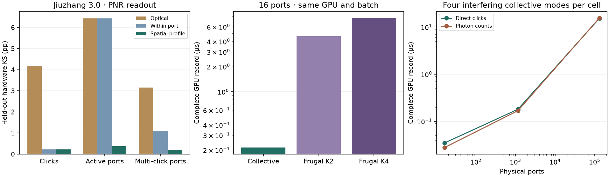

# 第 110 轮 · 整机光子数、空间点击重数与多模干涉

实际九章 3.0 双谱输入上，第 109 轮 GPU 模型的整机总光子数 TV 为 **1.961%**。本轮在保留局部位移干涉的同时，校正了**总光子数与指定八位点击字的联合分布**。两套独立概率算法交叉计算，校正后该联合分布的 TV 差为 **1.33 × 10⁻¹²**（概率单位）。独立生成 262,144 条完整 PNR 记录，用时 **0.400 µs/条**，总光子数经验 CDF 最大差为 **0.124 个百分点**。这个误差覆盖所列联合观测量；完整的逐端口 PNR 记录还包含其余端口之间的关联。[独立 C++ 核验](../results/iteration110_independent_v1/summary.json) · [完整记录直方图和计时](../results/iteration110_device_v1)



## 九章硬件上的速度与精度

九章 3.0 有 144 个空间端口，每个端口分到八个阈值探测位。多位同时点击提供有限的伪光子数读出。比较硬件时，我们把逐位 PNR 按正光子数转成点击。带硬件校准的两条路线均生成完整 1,152 位记录，保留空间端口 34、35 的指定光学约束。[九章 3.0 原论文](https://arxiv.org/abs/2304.12240) · [模型、样本和指标](../results/iteration110_release_v1/validation.json)

| 完整记录或留出指标 | 直接生成点击 | 生成逐位光子数 |
|---|---:|---:|
| 每批 16,384 条，含主机取回 | **1.132 µs/条** | **0.402 µs/条** |
| 相对论文 1.27 µs/条的批量吞吐 | 1.12 倍 | 3.16 倍 |
| 总点击数，硬件留出 KS 距离 | 0.162 个百分点 | 0.229 个百分点 |
| 有点击的空间端口数，硬件留出 KS 距离 | **0.114 个百分点** | **0.373 个百分点** |
| 有至少两个点击的空间端口数，硬件留出 KS 距离 | 0.114 个百分点 | 0.195 个百分点 |
| 前 36 / 后 36 个空间端口的区域总点击数，硬件留出 KS 距离 | 0.666 / 0.766 个百分点 | 0.545 / 0.423 个百分点 |
| 空间端口 36、107 是否分别触发，四种结果的硬件经验 TV | 1.304% | 1.214% |

**同卡、同样返回主机前八位**时，每批 2,048 条，同一光学输入上 Frugal FP32 K2 / K4 为 **3.788 / 4.112 µs**。与同一段硬件留出记录比较，Frugal 两档的前八位经验 TV 为 **10.167% / 2.052%**。本轮直接点击为 **1.391 µs、0.691%**，PNR 转点击为 **0.718 µs、0.873%**。直接法较 K4 快 2.96 倍，经验 TV 低 1.360 个百分点。每种模拟方法使用 262,144 条记录。以光学模型替换硬件参考时，四种方法的经验 TV 依次为 Frugal K2 **9.386%**、K4 **1.317%**、本轮直接 **1.307%**、本轮 PNR **1.071%**。本轮的硬件版使用了独立训练段，Frugal 直接输入光学协方差。0.010 个百分点的经验差距小于本次样本量的统计分辨率。[固定 Frugal GPU 记录](../results/iteration104_frugal_device_v1) · [硬件训练与留出](../results/iteration110_profile_v1) · [Frugal 原论文](https://arxiv.org/abs/2511.14923)

### 光学校正如何工作

1. 在共享位移场的奇异向量方向上调整三个方差参数，再将每个空间模式的 2 × 2 局部协方差恢复。所有单空间端口协方差元素的最大改变量为 **3.11 × 10⁻¹⁵**。只使用八个光学总数生成函数频点，拟合后的总光子数 TV 已由 **1.9608% 降到 0.4977%**。优化用完 100 次函数求值，公布的是该次找到的可行参数。[拟合目标与概率](../results/iteration110_spectrum_v1)
2. 对探测位 272–275、280–283 的 256 个点击字和全机总光子数求联合律。在总数的复数生成函数上，要求一组探测位处于真空只需在那些位上做小行列式更新。对全部真空子集做容斥，得到每个点击字。独立 C++ 路径直接计算真空条件下其余光学模式的实协方差，再按总光子数递推，完全绕开复数行列式的相位追踪。1024 个数档之外的光学尾概率上界为 **5.84 × 10⁻³⁸**。两种算法对原始光学联合律的 TV 差为 **9.57 × 10⁻¹³**。[傅里叶法](../experiments/iteration110_joint_v1.py) · [实协方差法](../native/conditioned_number110_v1.cpp)
3. GPU 用最小改动耦合校正这张联合表。仅当原类别概率过剩时才移动记录，改变总数时保留指定点击字并分配剩余光子。拟合场的理论移动比例为 **1.0863%**，实测 **1.1070%**。独立概率递推核对的总光子数 TV 差为 **1.42 × 10⁻¹³**。直接点击有自己的修正表，完整覆盖端口 34、35 的 16 个阈值位；它直接改动位串并保留全部其他位置。PNR 的八位与总数约束、直接路线的十六位约束都延续到硬件版。[CUDA 耦合](../native/sector_readout110_v1.cu) · [原始与校正表](../results/iteration110_joint_v1)

不使用硬件训练数据时，拟合光学场在前八位的经验 TV 为直接 **0.604%**、PNR **0.529%**，PNR 在探测位 289、861 的联合光子数经验 TV 为 **0.0418%**（每轴含 12+ 尾档）。硬件版在同两位的 PNR 经验 TV 增至 **0.6390%**。这些数值使用同一光学目标和相同样本量，展示了校准硬件统计对未保护光学观测量的代价。[光学版](../results/iteration110_device_v1/summary.json) · [两位 PNR 核对](../results/iteration110_release_v1/validation.json)

### 如何校准与检验硬件

按原始文件连续顺序，取前 **746,336** 条构建训练表，后 **746,306** 条留作检验。前后段总点击数的经验 KS 距离为 **0.182 个百分点**。校准分两步。先在同一空间端口的八个探测位之间拆分或合并碰撞，PNR 保持各空间端口的光子总数。此时 PNR 的活动空间端口数仍比硬件相差 **6.425 个百分点**。[按文件顺序统计](../results/iteration104_record_order_v1) · [端口内校准](../results/iteration110_hardware_v1)

第二步固定空间端口 34、35，余下 142 个空间端口只记录“有零、一、……、八个点击的端口各有多少”。训练表按这 142 个端口的总点击数分组，保存 **301,484** 种匿名计数向量及频数。生成时，按原占用数的秩分配新占用数，在同秩端口间随机打散；再将一个探测位的全部光子作为一组搬到空位。给定新占用数的多重集，这种排序使需搬动的已点击位数最少。每条平均搬动 **6.61 / 6.70** 个已点击位。独立样本中直接 / PNR 分别有 **5 / 2** 条落在训练缺失的总数档，保留原记录。逐条核对完整总光子数、全部逐位光子数的多重集、总点击数和两个固定空间端口的原记录。区间内具体哪个端口触发及 36、107 号端口相关性单列为位置检验，硬件经验距离保留了有限采样误差。[匿名训练表、所有留出直方图](../results/iteration110_profile_v1) · [空间重排内核](../native/spatial_profile110_v1.cu)

## 四模干涉、混态与高维完整输出

四个独立挤压输入经过稠密复数干涉仪和不等损耗，各集体光学模式再均匀分配到一组探测器。光子数路线直接抽取每个集体模式探测到的光子数，再分配到物理端口。直接点击路线在准备阶段积分掉光子数，运行时只抽取每组被点击的位数并均匀选择相应子集。四个集体模式的全部七种二分切割均检出纠缠，部分转置最小辛本征值为 **0.423–0.689**（真空单位 1）。[光路、Fock 递推与完整概率](../experiments/iteration110_collective_v1.py) · [直接点击和 PNR 内核](../native/collective_readout110_v1.cu)

| 物理端口与结构 | 平均探测光子数 | 点击 / PNR，µs/条 | 完整两路线的数值预算上界 |
|---|---:|---:|---:|
| 1,152；72 个四模干涉单元，各接 16 位 | 109.79 | 0.181 / 0.169 | 9.03 × 10⁻¹⁰ |
| 131,072；8,192 个四模单元，各接 16 位 | 12,491.84 | 15.24 / 15.60 | 1.03 × 10⁻⁷ |
| 131,072；32,768 个四模单元，各接 4 位 | **49,967.36** | **15.84 / 19.51** | **4.11 × 10⁻⁷** |
| 131,073；一个四模单元，每组 32,768 或 32,769 位 | 1.52 | 17.97 / 19.25 | 1.26 × 10⁻¹¹ |

最后一列单位为概率；4.11 × 10⁻⁷ 对应 **0.0000411%**。预算按每单元发射超过 68 个光子的 Chernoff 尾界、稀疏化质量和整数概率表的核验舍入量求和。该界以理想光学概率递推为前提，浮点与伪随机实现另外核对。不同单元间的独立性用于这组光路。最后一行另外展示了单个集体光学输入扩到奇数宽度的成本。[配置、批量与各次计时](../results/iteration110_collective_v1/summary.json)

**完整 16 位、同卡、交错计时。** 每批 2,048 条，四模单元接 16 位。新直接法为 **0.213 µs/条**，Frugal GPU K2 / K4 为 **4.619 / 7.626 µs**，相对 K4 快 **35.8 倍**。三者各取 262,144 条与光学真值比较，完整经验 TV 为 **3.476%、21.159%、4.458%**。另独立枚举全部 65,536 个点击词，新算法的模型 TV 与 binary128 光学参考相差 **3.97 × 10⁻¹⁴**；Frugal CPU FP64 的 K2 / K4 模型 TV 为 **20.023% / 2.150%**。此处把模型概率与有限样本直方图分别列出。[同卡样本与核验](../results/iteration110_peers_v1)

**同一光路的完整 16 端口 PNR。** 每批 128 条，各生成 4,096 条。新方法 **0.913 µs/条**；photonic-engines v0.2.2 的 CPU / CUDA 设置为 **1,481.34 / 1,483.87 µs**。两端口联合经验 TV 分别为 **1.010%、1.351%、0.759%**；整机总光子数经验 KS 分别为 **1.091、0.829、0.388 个百分点**。上游使用 v2、窗口 4、其默认小规模 CPU 路径，两个配置均无截尾记录。本轮核对的 Frugal 上游 HEAD 与 1.1 标签一致，photonic-engines 上游 HEAD 与 v0.2.2 一致。[PNR 直方图](../results/iteration110_peers_v1/laws.npz) · [Frugal 固定源码](https://github.com/tomdodd4598/FrugalGBS/tree/fa8b796f2afebd4845a2e335e457735952617ef8) · [photonic-engines 固定源码](https://github.com/Quandela/photonic-engines/tree/6c1ed6f8f11ffc9f3c268757f0fe0bd48a768d82)

**有损、多谱混态。** 另一套 C++ 实现从各个谱的高斯生成函数行列式相乘，按总阶逐层计算所有端口的联合 Fock 概率。对上述四模单元核对 **1,028,790** 个占用向量，PNR 整张表与产生算符路线的 TV 差为 **1.12 × 10⁻¹¹**，点击重数表差为 **3.91 × 10⁻¹⁴**。另以真实九章探测位 0、272、280、856 的双谱混态直接构建联合读出；重复该四位边缘形成独立单元时，131,072 端口平均探测 13,014.76 个光子，点击 / PNR 为 **16.56 / 15.96 µs**。复制的四位光学边缘与原始 1,152 位整机分别测试。[混态核心](../native/gaussian_core110_v1.cpp) · [光学真值与跨实现核对](../results/iteration110_mixed_v1)

## 跨单元干涉的差距

在所有输出共同参与的归一化光学模式 v 上施加相位 θ，物理变换为 I + (exp(iθ)−1)vv†。继续使用解耦单元采样，就会丢掉这次跨单元干涉。用 v 上光子数的特征函数可计算完整两种读出的误差上界；再按总光子数的余数分层可以收紧上界。这一推导利用纯化重叠、迹距离的测量单调性和相位操作与总光子数的对易关系。秩二实矩阵更新使计算量与被混合的总端口数脱钩。[公式实现和全矩阵对照](../experiments/iteration110_bus_v1.py)

在 **131,072 端口、平均 49,967 个光子**上，θ 为 0.003 / 0.02 / 0.1 弧度时，忽略该耦合对完整输出的数值上界分别为 **0.314%、2.090%、10.353%**，另加上表的单元预算。16 位上可逐词检验：θ=0.1 时实际模型 TV 为 **1.308%**，Frugal CPU K2 为 **4.766%**，K4 为 **0.0142%**；θ=1 时相应解耦误差升至 **12.270%**，Frugal K4 为 **2.018%**。强跨单元干涉需要在采样过程中处理。下一步研究把这个共享模式的光子数作为有限中间状态，并用同一角度扫描和完整分布复核。九章方向则优先处理标签相关性；36、107 号端口在硬件版仍有约 **1.2–1.3%** 的四态 TV 差距。[全部耦合角和数值残差](../results/iteration110_bus_v1)

## 复现

完整归档包含 C++/CUDA 源码、Windows 实测运行库、输入来源、数值概率表、留出计数和逐文件 SHA-256。运行环境沿用第 109 轮的 CUDA、PyTorch、Eigen 及上游依赖；真实硬件文件采用九章公开的 high power (1).bin，核对 SHA-256 后只从前半段建表。可用 `--raw` 指定已下载的文件路径。[第 109 轮运行入口](iteration109_checkpoint_v1.md) · [原始数据发布方](https://quantum.ustc.edu.cn/web/node/1121) · [本轮核验与校验值](../results/iteration110_release_v1/validation.json)

在另一个工作树保留前序各轮依赖，第 110 轮结果目录从空缺状态开始，依次执行：

```sh
python experiments/iteration110_spectrum_v1.py results/iteration110_spectrum_v1
python experiments/iteration110_joint_v1.py results/iteration110_joint_v1
python experiments/iteration110_device_v1.py results/iteration110_device_v1
python experiments/iteration110_hardware_v1.py results/iteration110_hardware_v1
python experiments/iteration110_profile_v1.py results/iteration110_profile_v1
python experiments/iteration110_collective_v1.py results/iteration110_collective_v1
python experiments/iteration110_mixed_v1.py results/iteration110_mixed_v1
python experiments/iteration110_peers_v1.py results/iteration110_peers_v1
python experiments/iteration110_bus_v1.py results/iteration110_bus_v1
python experiments/iteration110_independent_v1.py results/iteration110_independent_v1
python experiments/verify_iteration110_v1.py results/iteration110_release_v1
```
