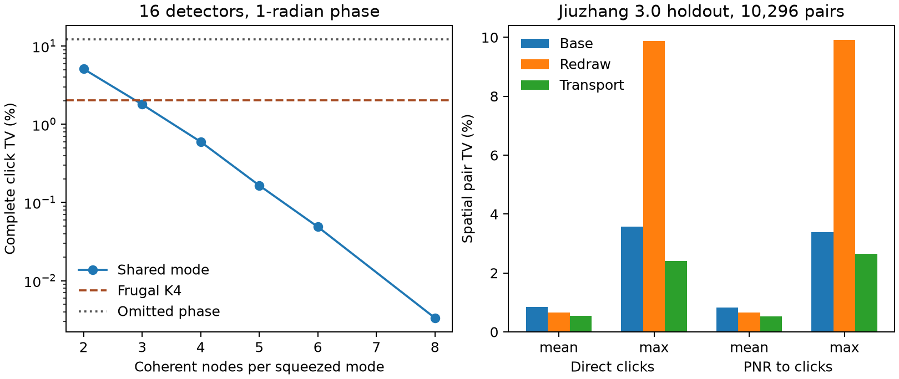

# 第 111 轮 · 跨单元共享模式干涉与九章空间端口校正

第 110 轮留下了一条可复验的反例。四个有损四模单元通过同一个复叠加模式耦合，相移为 1 弧度时，忽略相移会使完整 16 位点击分布的总变差距离（TV）达到 **12.270%**。本轮把这个相移显式放进采样器，同一输入的完整分布误差降至 **0.04884%**。单 CPU 线程每条 11.91 µs，同输入 Frugal K4 为 20.47 µs、TV 为 2.018%。[原反例](../results/iteration110_bus_v1/summary.json) · [完整核验](../results/iteration111_release_v1/validation.json)



## 直接点击和逐端口光子数

同一台机器使用 Intel Core Ultra 9 275HX 和 RTX 5080 Laptop GPU。16 端口参考包含全部 65,536 个点击字，由独立高精度高斯真空概率程序求得。模型 TV 比较概率本身。经验 TV 比较随机样本直方图与该参考，每种方法都抽 65,536 条，稀有点击字使这一指标明显高于模型 TV。[采样代码](../native/shared_measure111_v1.cpp) · [同输入 Frugal 对照](../results/iteration111_matched_v1)

| 16 位点击，批大小 2,048 | µs/条 | 完整模型 TV | 完整经验 TV |
|---|---:|---:|---:|
| 共享模式，每轴 6 节点，单 CPU 线程 / 8 线程 | 11.91 / 2.24 | 0.04884% | 17.755% |
| Frugal CPU FP64，K2 / K4 | 5.31 / 20.47 | 7.340% / 2.018% | — |
| Frugal GPU FP32，K2 / K4 | 3.79 / 7.04 | — | 20.346% / 17.866% |

单线程相对 K4 快 **1.72 倍**，完整模型 TV 小 **41.3 倍**。K2 单线程则快于本轮方法 **2.24 倍**。对已固定的 16 位输入，还可另花 0.074 秒把 65,536 项收缩为抽样表，单线程每条 0.046 µs；这个加速随完整点击表的大小增长。后面的 131,072 端口实验直接生成记录。[两种执行方式的计时](../results/iteration111_sampling_v1/sampling.json) · [FrugalGBS 上游](https://github.com/tomdodd4598/FrugalGBS)

光子数路线在四个单元中先生成各端口的整数。每端口在 16 个余数上求局部概率，物理输入发生回绕的整机概率上界为 0.00536%。两个端口的参考来自高精度系数递推，总光子数参考来自协方差本征值。下表全部返回 16 个端口的结果，批大小 128，各抽 4,096 条。上游 photonic-engines 使用纯化后的 32 模光路，取前 16 个物理输出，CPU 与 CUDA 均无截断标记。[概率参考与完整对照](../results/iteration111_peers_v1) · [photonic-engines 源码版本](https://github.com/Quandela/photonic-engines/tree/6c1ed6f8f11ffc9f3c268757f0fe0bd48a768d82)

| 逐端口光子数，4,096 条 | µs/条 | 两端口经验 TV | 总光子数经验 CDF 最大差 |
|---|---:|---:|---:|
| 共享模式，每轴 6 节点，单 CPU 线程 / 8 线程 | 14.54 / 4.02 | 1.910% | 1.584 个百分点 |
| photonic-engines CPU | 40,166 | 2.259% | 1.079 个百分点 |
| photonic-engines CUDA | 12,231 | 1.631% | 1.069 个百分点 |

共享模式光子数表准备耗时 7.34 秒。直接收缩该模型的概率，两端口 TV 为 **0.0320%**，总光子数 CDF 最大差为 **0.0249 个百分点**，完整 16 端口 PNR TV 预算为 **2.469%**。经验指标中 CUDA 基线在两个观测量上均低于本轮样本。[同样本量原始直方图](../results/iteration111_matched_v1/matched.npz)

## 如何保留跨单元干涉

将局部有损高斯态纯化为光学变换 $S_0$ 作用于真空态。跨单元相移仅改变一个归一化的复叠加模式。将该相移移至 $S_0$ 之前，得到的纯高斯态只有两个非零压缩参数。每个压缩振子用一组相干态近似，系数由 Gram 矩阵和已知压缩态内积解得。完整态是相干分支的叠加。点击和光子数读出都保留不同分支间的交叉项，因此能产生相消和相长干涉。[压缩参数、保真度和 18 组精度扫描](../results/iteration111_memory_v1/projection.json)

设归一化的分支系数为 $c_i$，局部测量结果为 $y$。先以 $|c_i|/\sum_j|c_j|$ 选择分支，按该分支的局部正概率产生各单元的候选输出，再用完整相干概率与包络之比接受。柯西–施瓦茨不等式给出包络；平均接受率为 $1/(\sum_i|c_i|)^2$，与重复单元数无关。每轴 6 节点的 16 位实验中，逐一核对了所有 65,536 个候选字，接受概率范围为 0.0335–0.7119，理论平均接受率为 32.54%。随机数分别寻址到实验、记录和用途。大规模重复单元可先抽局部结果直方图，再均匀排列为完整记录。[拒绝采样和全部候选字核验](../experiments/verify_iteration111_v1.py)

## 131,072 端口的整记录误差

32,768 个四模单元全部参与同一个 1 弧度跨单元相移。平均目标光子数为 49,967.36。取每轴 8 节点，共 64 个相干分支，两条路线各实际生成 128 条完整记录。这里的误差预算来自纯态投影及测量收缩性。保真度在 60 位十进制精度下计算，光学参数、概率表和采样使用浮点数；概率预算按数值计算报告。[完整点击样例](../results/iteration111_matched_v1/matched.npz) · [光子数、符号表与计时](../results/iteration111_wide8_v1)

| 完整输出 | 准备时间 | 8 个 CPU 线程每条 | 整记录 TV 上界或预算 |
|---|---:|---:|---:|
| 131,072 个点击 | 0.019 秒 | 0.279 毫秒 | 0.61965% |
| 131,072 个光子数 | 137.78 秒 | 3.460 毫秒 | 0.68570% |

光子数采用模 28 的局部读出并保留 46,791 个最常见四端口结果，其余映为真空。全态投影贡献 **0.61965%**，任一端口光子数达到 28 的并集界 **0.03329%**，合并稀有结果贡献 **0.03276%**。对最后一项另用周期 31 重算，差值落在两个周期的回绕界内。128 条记录观测到平均 49,948.23 个光子，按整条记录估计的均值标准误为 34.32。上轮相同跨单元相移被忽略时，宽输入的误差上界为 61.765%。这些数字覆盖上述共享模式光路族。[每轴 6 节点的速度与误差预算](../results/iteration111_wide_v1/wide.json)

进一步取四个不同的单元，分别有 3、4、2、4 个端口，单元内部干涉、损耗和压缩均不同。引入两个非正交共享模式，内积绝对值为 0.461，相移分别为 1.1 和 −0.82 弧度。两个相移不对易。计算只需对一个 8 阶更新求本征分解，出现四个活跃压缩振子。逐项对照全部 8,192 个点击字，忽略相移的 TV 为 **9.017%**，每轴 4 节点后为 **0.00821%**，两端口光子数 TV 为 **0.00165%**。该例分支数升至 256；跨单元模式数量增长是下一步压缩计算量的关键。[非均匀光路与两个不对易相移](../results/iteration111_heterogeneous_v1/heterogeneous.json)

## 九章 3.0 的独立比较

九章 3.0 使用伪光子数读出，论文报告硬件每条记录 **1.27 µs**。本节使用实际双谱传输输入与高功率硬件数据，并沿用前半段 746,336 条训练、后半段 746,306 条评估的顺序。把空间端口按窗口分组，保留每窗活跃端口数，学习有标号的占用模式。校正以整组八个探测位为单位，只移动模拟分布中概率过高的一部分窗口。每条记录的光子总数、点击总数和指定保护端口都逐条核对。PNR 输出先转为点击再与硬件比较。[九章 3.0 论文](https://arxiv.org/abs/2304.12240) · [校准表与留出统计](../results/iteration111_transport_v1)

| 131,072 条完整模拟记录，每条 1,152 位 | 直接点击 | 先生成光子数 |
|---|---:|---:|
| 完整输出耗时（批大小 16,384） | 1.130 µs | 0.437 µs |
| 10,296 对空间端口平均经验 TV，校正前 → 后 | 0.848% → 0.540% | 0.823% → 0.530% |
| 最差端口对，校正前 → 后 | 3.566% → 2.417% | 3.392% → 2.648% |
| 端口 36、107，校正前 → 后 | 1.433% → 0.302% | 1.128% → 0.169% |
| 总点击数 CDF 最大差 | 0.294 个百分点 | 0.368 个百分点 |
| 首八位相对硬件 / 相对光学的经验 TV | 0.928% / 1.516% | 0.997% / 1.481% |

硬件两个时间段互比，端口对平均经验 TV 为 0.114%，最差为 0.392%。本轮校准后平均值约为该参考的 4.7 倍。完整的实测 1,152 位分布仍有高阶关联；表格覆盖空间端口对、总点击数和首八位。首次尝试重新抽取整个窗口，在直接点击路线中使最差端口对 TV 升到 9.879%。据此改为仅移动过剩概率，实际变动约 2.3% 的窗口。两种方案共用上述评估数据，最终数字是同一留出集上的开发比较，跨硬件文件的泛化需另外检验。[整窗重抽的原始对照](../results/iteration111_windows_v1/windows.json) · [校正后的全部端口对计数](../results/iteration111_transport_v1/holdout.npz)

## 复现

从本轮固定归档运行，所需第 110 轮及更早的输入随该研究分支保留。原生 CPU 采样使用 C++17、OpenMP 和 Philox；CUDA 空间校正使用 RTX 5080 Laptop GPU。硬件原始数据的 SHA-256 在训练表中，路径可通过 `--raw` 指定。实验脚本输出目录传入新目录时，请沿用下列轮次目录名以便后续步骤读取。

```sh
python experiments/iteration111_memory_v1.py results/iteration111_memory_v1
python experiments/iteration111_sampling_v1.py results/iteration111_sampling_v1
python experiments/iteration111_peers_v1.py results/iteration111_peers_v1
python experiments/iteration111_matched_v1.py results/iteration111_matched_v1
python experiments/iteration111_wide_v1.py results/iteration111_wide_v1
python experiments/iteration111_wide_v1.py results/iteration111_wide8_v1 --nodes 8 --radix 28
python experiments/iteration111_heterogeneous_v1.py results/iteration111_heterogeneous_v1
python experiments/iteration111_windows_v1.py results/iteration111_windows_v1 --redraw
python experiments/iteration111_windows_v1.py results/iteration111_transport_v1
python experiments/verify_iteration111_v1.py results/iteration111_release_v1
```
