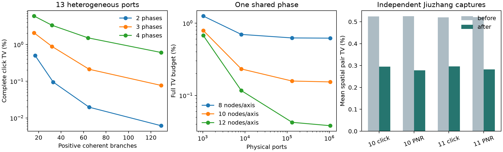

# 第 112 轮 · 共享模式压缩、整记录误差预算与九章跨文件检验

第 111 轮用 256 个相干分支处理两个不对易相移。本轮在**同一条 13 端口光路**上把分支压到 129 个，完整点击分布的总变差距离（TV）从 **0.00821% 降至 0.00617%**。在宽光路上，求出每个单元的光学边缘分布后，可以对跨单元关联造成的整记录误差单独计价。131,072 端口、1 弧度共享相移下，直接点击与逐端口光子数的完整 TV 预算分别为 **0.04249% 和 0.32043%**。两者均已生成可读回的整条记录。[精选核验](../results/iteration112_release_v1/validation.json) · [原始记录与两种设备的计时](../results/iteration112_emit_v1)



## 相干分支数如何随光路变化

四个单元分别有 3、4、2、4 个端口，内部混合、压缩和损耗均不相同。先保留第 111 轮的两个共享相移，再加入第三和第四个相移。对全局压缩振子用成对的相干态近似，在完整纯态的内积上优化节点位置，约束权重非负。每种光路的光学参考由独立高精度程序逐项计算，覆盖全部 8,192 个点击字。[光路与分支扫描](../results/iteration112_fit_v1/fits.json) · [完整概率数组](../results/iteration112_cases_v1/laws.npz)

| 129 个正权分支 | 两个共享相移 | 三个共享相移 | 四个共享相移 |
|---|---:|---:|---:|
| 完整点击模型 TV | 0.00617% | 0.07709% | 0.60666% |
| 任意读出的纯态距离上界 | 0.2911% | 1.6731% | 7.3349% |
| 原拒绝采样公式的理论接受率 | 26.95% | 16.63% | 8.28% |

另试了先将偶对称相干态正交化，再选稀疏的多维指标集。这种方法可以逐项核对已保留的态范数；在两个相移、预算 129 的实例上，带符号的展开只给出 **0.261%** 的理论接受率。实际采样改用正权分支，先抽四个单元的粗分组联合结果，再以条件累积分布确定组内的精确符号，省去重试。[稀疏展开对照](../results/iteration112_cases_v1/cases.json) · [C++ 条件读出](../native/coarse_readout112_v1.cpp)

## 13 端口的同输入速度与精度

点击实验每种配置抽 65,536 条，批大小 2,048。下表为每条完整 13 位记录的时间和**模型 TV**。Frugal 分别按实际 13 位实例化上游 CPU FP64 和 GPU FP32 内核。GPU K4 两种输入的耗时为 4.28、3.83 µs，完整经验 TV 为 4.752%、5.371%；本轮粗分组读出的对应经验 TV 为 4.675%、5.374%。[两个相移](../results/iteration112_two_peers_v1/peers.json) · [四个相移](../results/iteration112_four_peers_v1/peers.json) · [Frugal 上游版本](https://github.com/tomdodd4598/FrugalGBS/tree/fa8b796f2afebd4845a2e335e457735952617ef8)

| 直接点击，单 CPU 线程 | 两个相移：µs / 模型 TV | 四个相移：µs / 模型 TV |
|---|---:|---:|
| 本轮，129 分支，粗分组表已准备 | 0.079 / 0.00617% | 0.075 / 0.60666% |
| Frugal K2，标准采样入口 | 2.283 / 3.0877% | 2.271 / 4.9174% |
| Frugal K4，标准采样入口 | 7.868 / 0.26456% | 7.775 / 0.94644% |

**固定 13 位输入时，精确全表更合适。** 给三种方法相同的 C++ 抽样表后，精确光学、Frugal K4 和本轮投影每条均约 **0.019–0.024 µs**。精确光学枚举加建表约 0.129 秒，Frugal 全树加建表约 0.101 秒；本轮两个相移的粗分组准备为 0.308 秒，另需拟合分支。表格第一行相对 Frugal 标准入口的速度差包含预计算优势。宽光路使用下节的局部表。[相同缓存条件下的对照](../results/iteration112_cache_v1/cache.json)

光子数实验直接输出 13 个端口的整数。使用每端口模 12 读出，再合并极稀有的局部结果。两个相移时，回绕与合并的整机预算之和为 0.00124%，加上 65 分支投影后的完整 PNR TV 预算为 0.6609%；四个相移时完整预算为 12.5895%。表中的模型精度另由两个跨单元端口的高精度光子数递推和整机总光子数生成函数求出。[PNR 精度与原始记录](../results/iteration112_coarse_v1) · [photonic-engines 上游版本](https://github.com/Quandela/photonic-engines/tree/6c1ed6f8f11ffc9f3c268757f0fe0bd48a768d82)

| 逐端口光子数，每种方法 8,192 条，批大小 128 | 两个相移 | 四个相移 |
|---|---:|---:|
| 本轮单 CPU 线程，µs/条 | 7.15 | 6.59 |
| photonic-engines CPU / CUDA，µs/条 | 2,780 / 2,751 | 2,691 / 2,933 |
| 本轮两端口模型 TV / 总光子数模型 CDF 最大差 | 0.00493% / 0.00716 个百分点 | 0.3632% / 0.4020 个百分点 |
| 两端口经验 TV，本轮 / 上游 CPU / 上游 CUDA | 1.059% / 0.696% / 0.584% | 0.466% / 0.678% / 0.722% |

本轮两套 PNR 表分别准备了 7.72、7.56 秒。上游 v2 在同一物理输入的 26 模纯化上运行并取前 13 个端口，所有样本均未触及上游计算截断。四相移的两端口指标与完整分布上界之间仍有明显差距。

## 为宽光路的全部输出计价

设每个单元采用真实光学边缘概率 $q_g$。把相干投影的测量概率写成分支对求和，各分支对的局部归一化测量系数为 $L_{ag}$。在乘积分布下，$L_{ag}/q_g-1$ 的期望为零。展开全部单元的乘积后，不同单元子集在平方可积函数空间内彼此正交。这样就能计算一阶项，并用局部平方范数对所有更高阶项求上界。再用纯态保真度补上投影误差，得到相对于完整光学目标的 TV 预算。[同类单元推导的数值实现](../experiments/iteration112_marginals_v1.py) · [非均匀单元实现](../experiments/iteration112_unequal_v1.py)

具体地，令 $t_{ag}=\sum_y |L_{ag}(y)-q_g(y)|^2/q_g(y)$。在一个分支对上，二阶及以上项的平方范数为 $\prod_g(1+t_{ag})-1-\sum_g t_{ag}$。先按分支对权重的绝对值求和，再与一阶项正交合并。四单元上直接枚举的卡方距离与按一至四阶求和的差小于 $10^{-12}$。宽输入的概率、矩阵计算和误差预算使用浮点数，并计入最终抽样表的舍入。[独立恒等式核验](../results/iteration112_independent_v1/checks.json)

| 完整记录 | 端口数 | 全记录 TV 预算 | 8 个 CPU 线程，µs/条 | RTX 5080 Laptop GPU，µs/条 |
|---|---:|---:|---:|---:|
| 单一共享相移，直接点击 | 131,072 | 0.04249% | 141.65 | 16.66 |
| 单一共享相移，逐端口光子数 | 131,072 | 0.32043% | 110.26 | 21.43 |
| 单一共享相移，直接点击 | 1,048,576 | 0.03816% | 1,185.48 | 143.60 |
| 四类不同单元、两个不对易相移，直接点击 | 458,789 | 0.14317% | 632.02 | 81.27 |

每行生成 128 条，GPU 耗时包含完整结果回传。另以相同 Philox 地址在 CPU 和 GPU 上逐字节比较 8 条记录，检查改变批次分割后的结果。非均匀实验中，四类单元的端口数分别为 3、4、2、4，重复数与耦合权重也不同。131,072 端口 PNR 的 0.32043% 包含纯态投影 0.15332%、高阶关联等约 0.04735% 及回绕和稀有结果 0.11976%。该 PNR 配置一次完整误差核算耗时 328 秒，可用于固定输入的后续批次。[完整概率预算](../results/iteration112_count_marginals_v1/bounds.json) · [异构光路](../results/iteration112_unequal_v1/unequal.json)

同一条 131,072 端口光路上，第 111 轮直接计算分支间干涉，8 个 CPU 线程为 279 µs/条（点击）和 3,460 µs/条（PNR），预算为 0.620% 和 0.686%。本轮同线程数分别快 **1.97 倍、31.4 倍**，并收紧了两个整记录误差预算。[第 111 轮对照](../results/iteration111_release_v1/validation.json)

## 多共享模式的稀疏激发采样

还有一种保留量子关联的实现。在进入各单元的局部高斯变换前，共享压缩态的少量激发被均匀分配到许多单元。对总激发数 $N$，进入两两不同单元的概率为 $(C)_N/C^N$。投影到这个子空间的迹距离损失由发生碰撞的概率平方根控制。局部高斯变换和检测均保留总宇称，因此在该子空间内，可以抽取占用单元集合，再在相应的单激发内部空间中做关联测量。其余单元直接输出各自的背景记录。C++ 逐次作用湮灭算符，CUDA 并行生成背景，最后返回所有端口。[原生光子测量](../native/dilute_photons112_v1.cpp) · [光子数与点击样本](../results/iteration112_records_v1)

四个共享相移、1,048,576 个端口时，这条路线的整记录 TV 预算为 **0.834%（点击）、0.918%（光子数）**，批量实测约 **385、692 µs/条**。另对固定 2、4 个激发的关联读出分别生成 131,072 条，与独立的有序粒子张量计算比较；四组检验中，单格最大标准化偏差均低于 3.5。百万端口结果适用于这里的共享光路结构；13 端口试验已经显示，共享模式增加会显著提高固定分支预算下的误差。[有限尺寸与占用数核验](../results/iteration112_independent_v1) · [局部测量重叠算符与尺寸扫描](../results/iteration112_dilution_v1)

## 九章 3.0 的跨采集文件盲测

只用高功率文件 1 的前 746,336 条硬件记录，按照已有模型的空间端口对残差组织第二组窗口，拟合后固定全部参数。文件 10 和 11 合计 **3,186,388 条**，此前各轮没有使用它们训练。两份文件均从官方分卷按字节范围取回，核对原始 CRC32、长度和 SHA-256。论文中的九章 3.0 使用伪光子数检测，报告每条 **1.27 µs**。下表的 PNR 结果均先按正光子数转换为点击，与硬件作相同读出比较。[官方数据来源与文件摘要](../results/iteration112_hardware_v1/sources.json) · [九章 3.0 原论文](https://arxiv.org/abs/2304.12240)

| 固定模型对全部 10,296 个空间端口对的平均经验 TV | 直接点击，校正前 → 后 | PNR，校正前 → 后 |
|---|---:|---:|
| 文件 10，1,601,553 条 | 0.524% → 0.295% | 0.525% → 0.278% |
| 文件 11，1,584,835 条 | 0.520% → 0.296% | 0.521% → 0.282% |

两种模型各生成 262,144 条。把每份硬件文件按原顺序分成 32 段，两个读出在全部 **128 项**分段对比中的平均端口对 TV 均下降。校正后两个文件的最差端口对约 **1.54%–1.62%**。文件 10 与 11 互比的平均端口对 TV 为 **0.0724%**。若用每个新文件头 32,768 条另调总点击数，再对后续记录测试，PNR 的总点击数 CDF 最大差在两个文件上均增大；上表使用固定模型。[分段结果](../results/iteration112_release_v1/time_windows.npz) · [所有端口与亮度校准对照](../results/iteration112_hardware_v1/hardware.json)

融合两次 GPU 空间校正后，分别核对 65,536 条直接点击与 PNR 记录，和串行执行两次校正的结果逐字节相同。随机交替计时，生成完整 1,152 位记录为 **1.145 / 0.433 µs**（每批 16,384 条并回传）。相对论文硬件速率约为 **1.11 / 2.93 倍**；这两个速率对应上述近似模型与列出的分布误差。[配对计时](../results/iteration112_fused_v1/fused.json)

另外固定 18 组跨空间的八位观测，每个空间端口恰好使用一次。在相同的 65,536 条/组下，文件 11 的八个物理探测位经验 TV 均值为 **1.140% / 1.087%**（直接点击 / PNR），Frugal K2 / K4 为 **1.251% / 1.352%**。换成同一双谱输入的精确光学目标，顺序变为 **1.387% / 1.312%** 与 **0.917% / 0.894%**。硬件校准在这组观测上更贴近实测，Frugal 更贴近光学模型。上游 K4 只返回这八位时，单 CPU 线程为 2.34 µs/条。光学对照也覆盖 18 组八个空间端口的联合占用分布。[全部八位直方图与参考概率](../results/iteration112_panels_v1)

## 复现

使用本轮固定归档。硬件原始分卷按需下载至相邻的 external_sources 目录。C++17/OpenMP、CUDA、上游 Frugal 与 photonic-engines 的环境沿用上一轮。实验需要第 110、111 轮的输入与归档计算库；下载单个精选 JSON 即可阅读结论。

```sh
python experiments/iteration112_cases_v1.py results/iteration112_cases_v1
python experiments/iteration112_fit_v1.py results/iteration112_fit_v1
python experiments/iteration112_coarse_v1.py results/iteration112_coarse_v1
python experiments/iteration112_frugal_build_v1.py results/iteration112_frugal_build_v1
python experiments/iteration112_peers_v1.py results/iteration112_two_peers_v1 --buses 2
python experiments/iteration112_peers_v1.py results/iteration112_four_peers_v1 --buses 4
python experiments/iteration112_cache_v1.py results/iteration112_cache_v1
python experiments/iteration112_dilution_v1.py results/iteration112_dilution_v1
python experiments/iteration112_records_v1.py results/iteration112_records_v1
python experiments/iteration112_marginals_v1.py results/iteration112_marginals_v1
python experiments/iteration112_marginals_v1.py results/iteration112_count_marginals_v1 --pnr
python experiments/iteration112_unequal_v1.py results/iteration112_unequal_v1
python experiments/iteration112_emit_v1.py results/iteration112_emit_v1
python experiments/iteration112_independent_v1.py results/iteration112_independent_v1
python experiments/iteration112_hardware_files_v1.py ../external_sources/jiuzhang3_iteration112_independent
python experiments/iteration112_hardware_v1.py results/iteration112_hardware_v1
python experiments/iteration112_fused_v1.py results/iteration112_fused_v1
python experiments/iteration112_panels_v1.py results/iteration112_panels_v1
python experiments/verify_iteration112_v1.py results/iteration112_release_v1
```
