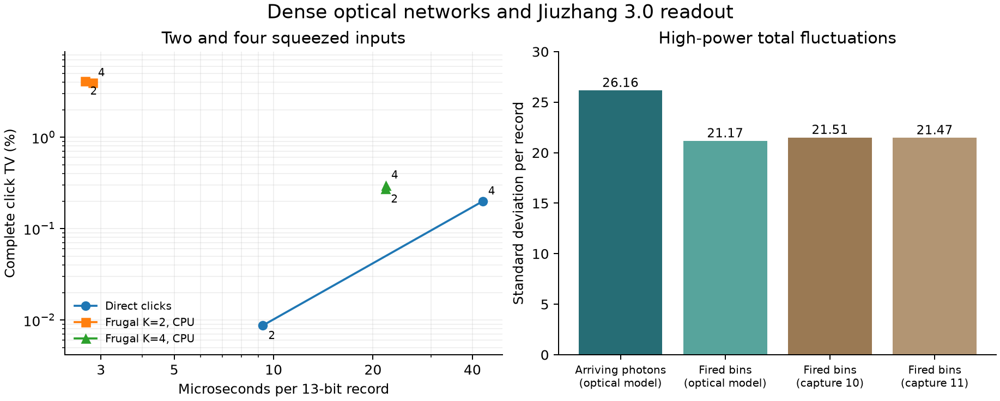

# 第 114 轮 · 稠密干涉网络中的少源采样与九章光子数读出

**1,048,576 个端口、两个受激光源**的稠密有损干涉网络上，8 个 CPU 线程写出一整条逐端口光子数记录（PNR）需要 **35.77 µs**，整记录 TV 截断上界为 **1.265 × 10⁻⁹**。独立的直接点击路线使用 81 个相干态分支，整记录 TV 投影上界为 **0.002764%**，每条 **92.50 µs**。两条路线都允许各端口有不同损耗，输入光源数量、亮度与输出端口数分别影响计算成本。[精选核验](../results/iteration114_release_v1/validation.json)



## 如何扩展端口数

**逐端口光子数。** 从各挤压输入的光子总数分布选择发射数 $N$，保留同一 $N$ 内各输入占据方式之间的相干性。每次在剩余光子的对称 Fock 空间构造湮灭振幅 $A$，输出 $i$ 的选择权重为 $\|A T_i^T\|^2$。按 32 个端口一组预计算传输行的 Gram 矩阵前缀，先二分定位分组，再选择组内端口、收缩态。重复落在同一端口会累加光子。把损耗实现成附加环境输出，记录时只保留可见端口。若截断处以上的发射概率为 $\epsilon$，保留的条件分布与完整光学分布的 TV 至多为 $\epsilon$。组合开销随受激源数和保留发射数增长。[C++ 采样](../native/source_rank114_v1.cpp) · [稠密光路生成与复核](../experiments/iteration114_rank_v1.py)

**直接点击。** 用相干态叠加逼近输入挤压态，各分支经过同一复传输矩阵。在提议分支中，点击之间的空白区间按累积光强直接跳过，检测器只产生开或关。对已经点击的端口计算各分支对的干涉项，按完整光学权重接受样本。环境态内积保留损耗对相干性的影响。正系数拟合令两源基础配置的接受率从 0.687% 提升到 40.068%；四源基础配置从 1.541% 提升到 25.287%。两源高精度配置使用正权重 Gauss–Hermite 求积，输入态重叠另用 55 位十进制精度复算。输入态迹距离给出任何输出测量的整记录 TV 上界。[相干态拟合](../experiments/iteration114_positive_v1.py) · [完整点击核验与原始计时](../results/iteration114_precise_v1)

| 输出端口 / 受激源 | PNR 时间，µs | PNR 整记录截断上界 | 直接点击时间，µs | 点击整记录投影上界 |
|---|---:|---:|---:|---:|
| 1,152 / 4 | 0.431 | 7.853 × 10⁻⁷ | 28.40 | 3.8862% |
| 131,072 / 4 | 2.866 | 7.853 × 10⁻⁷ | 10.21 / 150.75 | 3.8862% / 0.81642% |
| 1,048,576 / 2 | 35.77 | 1.265 × 10⁻⁹ | 46.30 / 92.50 | 0.49476% / 0.002764% |

每行输出全部端口、每端口 1 字节。时间为预热后分批写入宿主内存的每条中位数。百万端口每种配置和线程数各生成 1,024 条，批大小为 16。已给定传输矩阵时，百万端口 PNR 准备约 0.091 秒，常驻数据 35.66 MB；高精度直接点击准备约 0.086 秒。不同规模使用不同矩阵和批大小。宽光路中分支间单端口乘积变小，复指数函数用小参数展开，直接点击的单位成本也随光路变化。上界来自精确算术中的物理截断或投影，浮点实现另用完整小光路、条件发射实验和硬件矩复核。[全部规模和单线程计时](../results/iteration114_positive_v1) · [高精度配置](../results/iteration114_precise_v1)

## 同一 13 端口光路与上游软件对照

以下均为本轮重新生成的 8,192 条逐端口记录。点击模型 TV 对照全部 8,192 种结果的高精度光学概率，经验 TV 包含采样波动。PNR 的双端口 TV 取端口 0、3，每个端口将至少八个光子的事件合并在一档。Frugal CPU 使用 FP64，GPU 使用 FP32；photonic-engines 使用 v2、显式损耗环境、CPU 或 RTX 5080 Laptop GPU，两个样本集均无截断报警。[逐方法计时与完整直方图](../results/iteration114_peers_v1)

| 方法 | 两源时间，µs | 四源时间，µs | 两源 / 四源精度 |
|---|---:|---:|---|
| 直接点击，正系数基础配置，8 线程 | 9.279 | 42.982 | 完整点击模型 TV 0.00873% / 0.19922% |
| Frugal K=2，CPU | 2.680 | 2.830 | 完整点击模型 TV 4.1270% / 3.9303% |
| Frugal K=4，CPU | 21.819 | 21.868 | 完整点击模型 TV 0.27161% / 0.29776% |
| Frugal K=4，GPU | 15.823 | 17.993 | 完整点击经验 TV 2.792% / 3.478% |
| 本轮逐端口光子数，8 线程 | 0.452 | 0.393 | 双端口经验 TV 0.1123% / 0.1289% |
| photonic-engines，CPU | 876.589 | 967.466 | 双端口经验 TV 0.2949% / 0.2025% |
| photonic-engines，CUDA | 845.093 | 996.188 | 双端口经验 TV 0.1583% / 0.3219% |

四源 PNR 的全机光子总数经验 CDF 最大差为 0.4402 个百分点，photonic-engines CPU / CUDA 为 0.5623 / 0.5242 个百分点。直接点击的高精度配置在两源 / 四源上的完整模型 TV 为 1.6591 × 10⁻⁸ / 0.01247%。逐次采样的批大小依次为本轮 256、Frugal 512、photonic-engines 128；上表不含本轮的固定准备时间。

固定 13 端口可缓存全部点击概率。向三种分布提供同一别名采样器，四源时高精度光学参考、Frugal K=2、K=4 分别需要 **0.1305 / 0.0591 / 0.0987 秒准备**，之后每条分别 **0.0177 / 0.0181 / 0.0179 µs**。这个选择在小光路重复采样时最快，完整表长随端口数以二的幂增长。基准所用提交与本轮复查的上游默认分支头相同。[相同缓存条件的比较](../results/iteration114_cache_v1/summary.json) · [FrugalGBS](https://github.com/tomdodd4598/FrugalGBS/tree/fa8b796f2afebd4845a2e335e457735952617ef8) · [photonic-engines](https://github.com/Quandela/photonic-engines/tree/6c1ed6f8f11ffc9f3c268757f0fe0bd48a768d82)

## 发射光子对的另一种采样法

为扩展受激源数量，在固定偶数 $N$ 下令 $B=T\,\mathrm{diag}(\tanh s)\,T^T$，其中 $T$ 包含损耗环境。先依次抽取 $N/2$ 个独立光子对，每对的位置权重为 $|B_{ij}|^2$。对无序记录，任一个配对提议产生的分布等价于对标签排列作平均。给定候选位置列表 $L$，接受概率为

$$
\frac{|\mathrm{haf}(B_L)|^2}{(N-1)!!\,\mathrm{haf}(|B_L|^2)}.
$$

Cauchy–Schwarz 不等式保证该比值至多为 1，接受后保留不同配对之间的量子干涉。只需为已提议的位置计算 $B$ 的元素。这样免去枚举所有源端 Fock 态，代价转为高发射数下的拒绝次数。用独立的产生算符多项式，对三端口有损光路的全部输出向量复核。固定发射四个或六个光子，每种方法各采 131,072 条，旧有逐光子收缩和新配对法的完整经验 TV 分别为 **0.470% / 0.431%** 和 **0.578% / 0.595%**。[C++ 配对计算](../native/pair_emission114_v1.cpp) · [完整分布复核](../experiments/verify_iteration114_v1.py)

第 113 轮使用的原始四相移光路有 13 个受激源。配对法截断到每次至多 10 个发射光子，准备 **0.0040 秒**，每条中位数 **16.49 µs**、均值 **17.70 µs**，整记录截断上界 **1.67955%**。第 113 轮的深展开则为 **9.876 秒**准备、**0.0740 µs**每条、**0.69823%**上界。准备和重复读出的取舍由同一光路直接量出。[三个配对实验](../results/iteration114_pairs_v1) · [上一轮光路](iteration113_checkpoint_v1.md)

## 九章 3.0 · 同一传输矩阵在两种亮度下的结果

**弱光模拟。** 使用公开的完整 1,152 × 50 复传输矩阵和两个独立谱。保持端口、损耗、各源与各谱的相对强度，将输入平均发射数由 **274.227** 调为 **1.500**，模型平均可见光子数为 **0.6361**。每谱截断到 8 后，16,384 条完整 1,152 端口 PNR 记录的整记录 TV 截断上界为 **0.12355%**，总光子数经验 CDF 最大差为 **0.5215 个百分点**。每条耗时中位数 **17.95 µs**、均值 **38.39 µs**。原高功率参数落入这两个截断范围的概率仅 **8.07 × 10⁻¹⁷**。九章 3.0 论文报告高功率设备每条完整伪光子数记录 **1.27 µs**；弱光 CPU 中位耗时是这一时间的 **14.1 倍**，亮度和读出都不同。[弱光样本与计时](../results/iteration114_pairs_v1/jiuzhang_transfer_weak.json) · [九章 3.0 原论文](https://arxiv.org/abs/2304.12240)

**高功率实测。** 使用原始亮度直接计算全部 10,296 个空间端口对的二阶矩，再与官方高功率文件 10、11（共 3,186,388 条）比较。设 $N$ 为到达检测通道的光子总数，$H$ 为触发通道数。模型预测 $N$ 均值 116.286，$H$ 均值 103.896；每条合并的光子数 $N-H$ 的均值 **12.390**、标准差 **6.3525**。模型内 $N,H$ 的相关系数为 **0.98603**。仅用整机 $H$ 的最优线性估计仍有 **4.3572 个光子 RMS** 误差；使用 144 个空间端口各自的触发数后为 **4.2709 个**。这些真实光子数误差是光学模型预测；采集文件可直接核对触发数和触发数之间的相关性。

| 触发数统计 | 原高功率光学模型 | 采集文件 10 | 采集文件 11 |
|---|---:|---:|---:|
| 全机均值 | 103.896 | 106.101 | 106.044 |
| 全机标准差 | 21.170 | 21.506 | 21.473 |
| 所有跨端口协方差的平均绝对差，模型对硬件（触发数平方） | — | 0.001624 | 0.001608 |

两份硬件文件彼此比较的平均协方差绝对差为 **0.000946**。144 个端口自身的光子数、触发数和混合方差另与第 113 轮独立求得的联合分布比较，最大绝对差为 **4.33 × 10⁻⁹**。三个跨端口混合协方差再用独立行列式生成函数的复步长导数核对，最大绝对差为 **4.97 × 10⁻¹⁴**。下一轮可优先处理配对算法的高发射数尾部，并按可见光子数条件化，减少在环境中损失的光子带来的计算量。[各端口矩阵与实测结果](../results/iteration114_saturation_v1) · [两份文件的官方来源和 SHA-256](../results/iteration112_hardware_v1/sources.json)

## 复现

使用归档工程、第 112 轮上游工具环境与官方输入。C++ 需支持 OpenMP 的 g++；Python 负责编排和独立核验。下面是 Windows 归档命令，Linux 构建的共享库使用相应的 .so 名称，旧轮依赖的预编译适配器按各自报告准备。

```sh
python experiments/iteration114_rank_v1.py results/iteration114_rank_v1 --dictionary signed
python experiments/iteration114_rank_v1.py results/iteration114_positive_v1 --library results/iteration114_rank_v1/rank.dll
python experiments/iteration114_rank_v1.py results/iteration114_precise_v1 --library results/iteration114_rank_v1/rank.dll --case precise
python experiments/iteration114_peers_v1.py results/iteration114_peers_v1 --library results/iteration114_rank_v1/rank.dll
python experiments/iteration114_cache_v1.py results/iteration114_cache_v1
python experiments/iteration114_pairs_v1.py results/iteration114_pairs_v1
python experiments/iteration112_hardware_files_v1.py ../external_sources/jiuzhang3_iteration112_independent
python experiments/iteration114_saturation_v1.py results/iteration114_saturation_v1
python experiments/iteration114_figure_v1.py results/iteration114_release_v1/comparison.png
python experiments/verify_iteration114_v1.py results/iteration114_release_v1 --rank results/iteration114_rank_v1/rank.dll --pairs results/iteration114_pairs_v1/pair.dll
```

[结果文件校验清单](../results/iteration114_release_v1/manifest.json)
