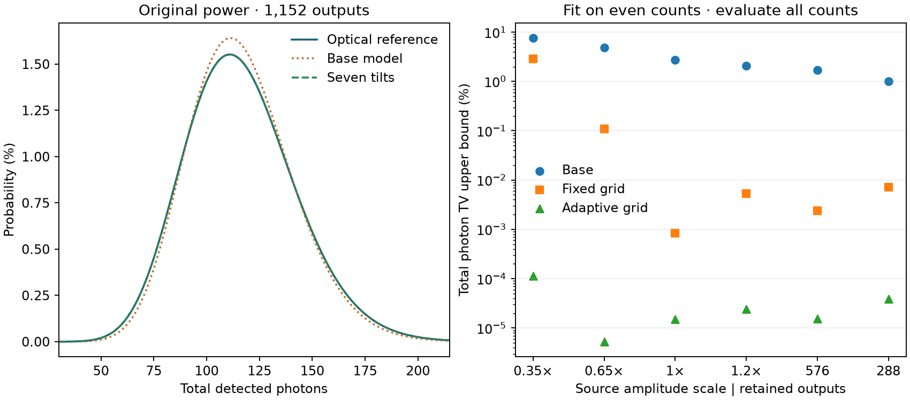

# 用同一个有损光学模型生成光子数和直接点击

## 4,096 条同输入正式对照与英文预印本

[论文 PDF](../papers/number-tilted-gbs/manuscript.pdf) · [LaTeX 源码](../papers/number-tilted-gbs/latex-source.zip) · [逐次计时与直方图](../results/iteration115_panel_v1) · [独立精度核验](../results/iteration115_panel_accuracy_v2/validation.json)

原功率第 34、35 个空间端口共 16 个探测通道。两种 GPU 读出使用同一个七分量模型。下表每种方法分别评分 4,096 条。PNR 的两通道经验 TV 对应各取一个探测器、每端饱和于 8 的 81 种光子数组合。完整点击字共有 65,536 种。计时单位为微秒/条。

| 读出 | 中位耗时 | 平均耗时 | 16 位点击经验 TV | 两通道 PNR 经验 TV |
|---|---:|---:|---:|---:|
| 直接点击 GPU | 0.131 | 0.154 | 25.934% | — |
| PNR GPU | 0.077 | 0.080 | 24.247% | 1.051% |
| photonic-engines CPU | 27,875.571 | 437,468.584 | 24.229% | 1.325% |
| photonic-engines CUDA | 15,145.428 | 575,287.109 | 24.217% | 0.916% |
| Frugal K=2 CPU | 9.985 | 10.399 | 55.688% | — |
| Frugal K=4 CPU | 27.286 | 27.239 | 37.425% | — |

完整 16 通道光子数模型的 TV 数值范围为 **2.167%–3.108%**，两通道 PNR 模型 TV 为 **0.2230%**。完整点击模型 TV 为 **2.1221%**，Frugal K2、K4 的对应值为 **47.5135%、21.7250%**。上表另报有限样本经验 TV。对精确光学点击分布抽取同样数量样本并模拟 1,000 次，经验 TV 中位数为 **24.46%**，中间 95% 为 **23.60%–25.53%**。

GPU 与 Frugal 的计时按每批 4,096 条，photonic-engines 按每块 128 条，两谱合成。均值含慢轨迹；单机有损光路只保留这 16 个输出的边缘。1,152 通道整机吞吐见下文。独立核验复播了两条 GPU 路线的已评分批次，相应直方图逐格吻合。[逐条输出与复现命令](../papers/number-tilted-gbs/README.md)

## 摘要

在九章 3.0 原功率、50 个输入轴、双谱、1,152 个探测通道的公开光路上，我们用可计算的总光子数分布校正一个快速空间采样器。七个正权重分量把总光子数的总变差距离（TV）数值上界从 **2.74083% 降至 0.0008379%**，相差 **3,271 倍**。用同一模型分别生成了 131,072 条直接点击记录和 131,072 条逐通道光子数记录。在每批 16,384 条时，GPU 摊销时间分别为 **1.056 和 0.346 微秒/条**。完整的空间分布还存在可测的误差。单看第 34、35 两个空间端口的触发数，TV 已达 **2.1221%**。本文同时给出能改善的观测量、校正的数学限制以及硬件实测差距。[核验结果](../results/iteration115_release_v1/validation.json)

## 光路、测量和参考分布

每次试验从同一个有损传输矩阵和两组挤压参数出发。每个空间端口对应八路复用探测通道。PNR 输出一个 1,152 维非负整数向量；直接点击输出相同维数的位串。九章 3.0 实测的是复用后的点击，空间端口可报告 0 至 8 路触发。多个光子落在同一路会合并。公开文件 10、11 共含 3,186,388 条记录，用于评价点击统计；模型的总光子数参考分布直接从光路计算。原论文给出的每条硬件记录时间为 1.27 微秒。[九章 3.0 论文](https://arxiv.org/abs/2304.12240) · [采集文件与校验值](../results/iteration112_hardware_v1/sources.json)

记 $X=(V-I)/2$，采用真空协方差为 $I$ 的单位。零位移高斯态总光子数的生成函数是 $G(z)=\det[I+(1-z)X]^{-1/2}$；两谱的生成函数相乘。我们用协方差本征值做高精度幂级数递推。原功率平均检测到 116.286 个光子，中位数为 115，99% 分位数为 185。比较总数时，以 $\frac12\sum_{n=0}^L|p_n-q_n|$ 加上两侧剩余质量之和的一半作为上界，包含两个尾部。文中的模型误差是浮点数值评价，实测直方图差距另行列出。[原功率系数](../results/iteration115_visible_v1/high_power.json)

## 从损耗环境构造可采样模型

对传输 $T$ 补充环境 $E=(I-T^\dagger T)^{1/2}$，在纯化后的环境测量一组同相正交分量。把测量结果当作潜变量，条件可见态的协方差由 Schur 补得到，均值是潜变量的线性函数。两谱的剩余纯态平均分别含 3.546、0.820 个光子，其余约 111.92 个光子的平均能量来自相关位移。高斯态中的经典噪声与量子核心分解已有张量网络采样先例。[条件化实现与尾界](../results/iteration115_displacement_v1/summary.json) · [Oh 等人的有损 GBS 模拟](https://doi.org/10.1038/s41567-024-02535-8)

为了快速读出，我们在每个八路端口选传输矩阵的首个左奇异向量，保留其实际分光比例。所有端口共享相关的高斯位移；每个端口保留自己的条件高斯边缘，近似步骤是将这些边缘取乘积。该处理丢失了剩余纯态的部分跨端口相干性。光路在保留方向之外至少有一个光子的概率为 0.6269%。另一种保留相干性的实现投影到每谱真空和一对光子，已实际运行双读出；若将投影上限提高到每谱 16、20 个光子，投影本身的整态迹距离上界分别为 1.5095%、0.3281%。后两个数只评价投影，运行时间来自实际实现的低截止方案。[空间端口模型](../experiments/iteration115_banks_v1.py) · [具有相干性的 C++ 读出](../native/displaced_pair115_v1.cpp)

## 正权重总数校正及其限制

设基础近似态为 $\rho$，总光子数算符为 $\hat N$。对满足归一化因子有限的 $z>0$，定义

$$
\rho_z=\frac{z^{\hat N/2}\rho\,z^{\hat N/2}}{G_\rho(z)},\qquad
\rho_*=\sum_k w_k\rho_{z_k},\quad w_k\geq0,\quad\sum_k w_k=1.
$$

于是每个光子数向量 $x$ 的概率变为 $q_z(x)=q(x)z^{N(x)}/G_\rho(z)$。在每个固定总数内，校正前后条件分布完全相同。由此还有一个可直接验证的等式：基础模型与校正模型之间的**整条 PNR 记录** TV，等于它们之间的**总光子数** TV。证明只需按 $N$ 对绝对值求和，同一组的概率差具有相同符号。这个等式比较校正前后两个模型。相对于真实光路，固定总数内的位置误差仍然存在。对纯态 GBS 作整体缩放以及固定光子数分布中的缩放消去有前人工作，本轮检验的是将正混合用于有损空间近似，并实现同一物理态的两种读出。[GBS 概率与缩放](https://arxiv.org/abs/1801.07488) · [正混合的实现](../experiments/iteration115_tilt_v1.py)

每个分量仍可以通过高斯潜变量采样。对局部条件协方差本征值 $e$，记 $d=1+(1-z)e$，校正后本征值是 $ze/d$，相干振幅乘以 $\sqrt z/d$。若位移由标准高斯向量乘矩阵 $A$ 生成，潜变量的精度矩阵更新为 $I+2(1-z)A\,\mathrm{diag}(1/d)A^\mathsf T$。局部归一化和潜变量行列式给出的对数归一化与整体谱计算最大差 $1.78\times10^{-15}$。每条记录抽取一次混合标签，两个谱共享这个标签。直接点击对每组八位用真空概率容斥后抽样。PNR 对局部光子数生成函数做系数递推，再按光学权重分光。[CUDA C++ 内核](../native/homodyne_bank115_v1.cu)

八路分组固定时，直接读出每组最多处理 256 个掩码；潜变量维数为 $d$、组数为 $B$ 时，每条记录的稠密变换工作量为 $O(d^2+Bd)$，另加逐组读出和完整记录写出。PNR 递推的工作量还依赖实际抽到的光子数。增加受激输入数量、提高亮度或放宽组宽都会改变成本。宽度为八的局部枚举不能直接推断任意光路上的相同速度或精度。

## 独立检验与硬件差距

| 检验 | 结果 |
|---|---|
| 七分量模型，光学总光子数，比较 0–440 及两侧尾部 | 基础 2.74083%，校正 0.0008379%；参考与模型在 440 以外的质量分别约 $5.02\times10^{-11}$、$4.89\times10^{-15}$ |
| 原光学模型，144 个八位点击分布的平均 TV | 基础 0.00667%，校正后 0.07106%；校正后的最大值 0.11479% |
| 10,296 个空间端口对，每对 81 种触发数组合 | 对两份硬件的平均 TV 为 1.3437%、1.3302%；硬件文件之间平均为 0.1793% |
| 总点击数直方图对两份硬件的经验 TV | 直接点击 4.1069%、4.0163%；PNR 后转点击 4.3625%、4.2675% |
| 强相关端口 34、35，精确枚举原光路 65,536 种点击结果，再聚合为 81 类 | 新模型 TV 2.1221%；同输入 Frugal K2、K4 分别 39.6855%、21.2967% |
| 完整记录精度范围 | 上述两端口已经给出约 2.12% 的整记录下界；高斯保真度给出的数值迹距离上界为 99.633%，区间仍宽 |

全部端口对的光学参考先投影到每组的保留方向，再对二维生成函数递推。投影的 TV 上界平均 0.9328%、最大 1.3504%，单组光子数截到 48 的最大参考尾质量为 $3.26\times10^{-8}$。新模型对这一压缩参考的平均 TV 为 0.1298%。另对四对端口用原光路完整枚举绕过投影；上表中 34、35 的结果来自这一检验。整态上界使用高斯保真度、混合凹性与浮点容差，尚无区间算术认证。[逐对分布与枚举](../results/iteration115_pair_banks_v1) · [保真度计算](../results/iteration115_fidelity_v1/summary.json) · [高斯态保真度公式](https://arxiv.org/abs/1507.01941)

再用偶数总光子数的光学概率确定权重，仅从这些训练格点的方差决定额外候选 $z$ 的跨度。保留所有奇数格点作检验，六种输入分别拟合。以下是包含奇偶及尾部的总数 TV 数值上界。该检验考察同一公开光路在不同亮度和裁剪下的稳健性。六种情况各自的权重和奇数条件 TV 均已存档。[留出结果与特征函数核对](../results/iteration115_robustness_v1)

| 通道数 | 振幅倍率 | 基础 TV | 自适应网格 TV |
|---:|---:|---:|---:|
| 1,152 | 0.35 | 7.5832% | 0.0001141% |
| 1,152 | 0.65 | 4.8168% | 0.00000528% |
| 1,152 | 1.00 | 2.7408% | 0.0000150% |
| 1,152 | 1.20 | 2.0580% | 0.0000240% |
| 576 | 1.00 | 1.7129% | 0.0000152% |
| 288 | 1.00 | 0.9961% | 0.0000391% |

## 速度的比较口径

原功率两条路线使用 RTX 5080 Laptop GPU，准备七分量参数约 1.76 秒。每批 4,096 条时，直接点击、PNR 的中位摊销时间为 1.162、0.455 微秒。增到每批 16,384 条时为 1.056、0.346 微秒，含生成随机数和把输出矩阵送回主机。对应九章论文 1.27 微秒/条的吞吐比为 1.20、3.67。两者的样本质量由上面的空间与硬件检验量化，GPU 数字也不代表单次请求延迟。固定随机数对照 32,768 条，FP32 和 FP64 直接点击有 23 条整记录不同，PNR 有 0 条不同。有限样本的实现误差与模型概率的数值误差需要分别解释。[逐批计时与精度](../results/iteration115_tilt_v1/summary.json)

在 34、35 的 16 通道对照上，Frugal CPU K2、K4 每条耗时 13.05、53.30 微秒，其精度见上表。小规模精确枚举可复用整张概率表，特别适合重复采样。弱光下另有两项独立结果。其一，按实际抵达的光子数截断，1,152 通道 CPU PNR 的整记录截断 TV 上界由 0.12354% 降到 0.000863%，每条中位数由 17.95 降至 2.01 微秒。其二，按下一个点击位置搜索，在 13 通道、2 或 4 个受激输入、最多 6 个点击的例子上，整点击分布 TV 为 0.00415%、0.00833%，分别耗时 1.71、1.78 微秒。原功率下，每谱截到 8 个可见光子只覆盖 $1.57\times10^{-11}$ 的联合概率，前一弱光方案的性能不能外推到这一条件。[可见光子数路线](../results/iteration115_visible_v1) · [直接点击路线](../results/iteration115_gaps_v1) · [上轮同输入对照](../results/iteration114_peers_v1)

对同一对端口的 65,536 个完整点击字直接求和，七分量模型 TV 为 **2.12210%**。精确枚举耗时 2.00 秒，此后缓存整表采样耗时 0.0136 微秒/条。另用同一双谱输入做 128 条小批量读出对照。GPU 直接点击和 PNR 分别耗时 1.96、0.78 微秒/条（批量 128）；photonic-engines 对原光学态纯化采样，CPU 与 CUDA 分别耗时 3.25、6.68 毫秒/条（分块 16）。两个探测通道光子数的 81 类经验 TV 分别为本模型 5.05%、上游 CPU 5.51%、上游 CUDA 6.73%。这些数含明显抽样噪声，不能据此作精度排名。全宽 8,192 条一批的 FP64 场计算另测得直接点击、PNR 各为 1.416、0.638 微秒/条。[同输入计时、参考分布和样本直方图](../results/iteration115_panel_pilot_v1)

## 复现

采用归档中第 112–114 轮的公开光学输入、上游工具及适配器环境，Windows 上使用支持 OpenMP 的 g++、CUDA 工具链、PyTorch、NumPy、SciPy、mpmath 和 Matplotlib。原始采集文件按清单下载至上级 external_sources 目录。本轮核心计算在 C++、CUDA C++ 和底层矩阵库执行。下面依次生成各阶段；如需保存发布结果，请在独立工作副本重跑。

~~~sh
python experiments/iteration112_hardware_files_v1.py ../external_sources/jiuzhang3_iteration112_independent
python experiments/iteration115_visible_v1.py results/iteration115_visible_v1
python experiments/iteration115_gaps_v1.py results/iteration115_gaps_v1
python experiments/iteration115_displacement_v1.py results/iteration115_displacement_v1
python experiments/iteration115_banks_v1.py results/iteration115_banks_v1
python experiments/iteration115_tilt_v1.py results/iteration115_tilt_v1
python experiments/iteration115_robustness_v1.py results/iteration115_robustness_v1
python experiments/iteration115_pair_banks_v1.py results/iteration115_pair_banks_v1
python experiments/iteration115_fidelity_v1.py results/iteration115_fidelity_v1
python experiments/iteration115_panel_v1.py results/iteration115_panel_pilot_v1 --shots 128 --block 16
python experiments/verify_iteration115_v1.py results/iteration115_release_v1
~~~

最终核验另用重复 Hafnian 独立枚举三个固定总数扇区，并用位移 Fock 基的显式振幅核对两种读出。每项分别抽取 98,304 条，三个扇区的经验 TV 为 0.173%、0.159%、0.488%；位移后光子数及点击的经验 TV 分别为 0.631%、0.469%。这些值含有限样本波动。[独立核验](../experiments/verify_iteration115_v1.py) · [归档文件 SHA-256](../results/iteration115_release_v1/manifest.json)

下一项直接对应现有误差的研究是恢复条件量子核心里相邻空间端口的相关性。固定总数的校正无法改变这种条件相关；34、35 的完整 16 位分布提供了可逐项复核的评价目标。
