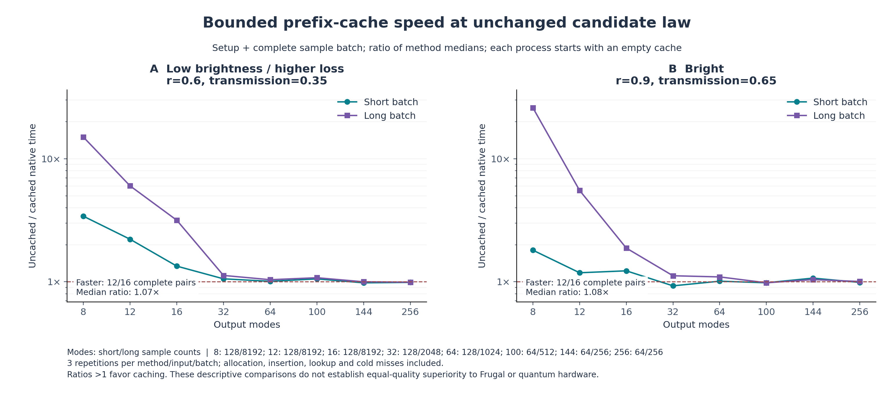
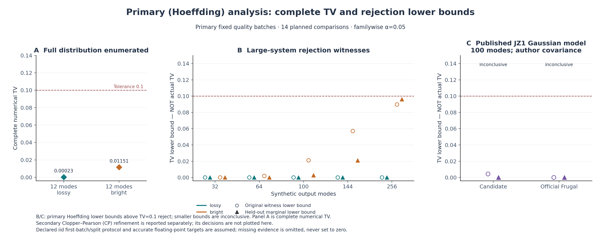

# 第五轮：可复现汇总

## 同一候选采样律的缓存速度

每个输入、批量和方法分别取预定重复运行的中位数。冷启动时间先在每次运行中计算 setup+sampling，再取中位数；倍率是未缓存中位数/缓存中位数。跨案例汇总再次对这些配对倍率取中位数，没有合并原始耗时或改取逐重复倍率。

计划 16 个输入、32 个输入×批量配对、216 次方法运行；记录 216 次，其中失败 0 次。

冷启动完整配对 32/32：缓存更快 24，更慢 8，相同 0；中位倍率 1.075×，范围 0.927–26×。

| 汇总范围 | 完整/计划配对 | 更快 | 中位倍率 | 范围 |
|---|---:|---:|---:|---:|
| 全部冷启动 | 32/32 | 24 | 1.075× | 0.927–26× |
| 全部纯采样 | 32/32 | 24 | 1.075× | 0.9275–26.2× |
| short batch 冷启动 | 16/16 | 11 | 1.056× | 0.927–3.412× |
| long batch 冷启动 | 16/16 | 13 | 1.108× | 0.9814–26× |
| lossy 冷启动 | 16/16 | 12 | 1.068× | 0.9807–15.01× |
| bright 冷启动 | 16/16 | 12 | 1.083× | 0.927–26× |

### 全部输入×批量配对

| 输入 | 批量类别 | N | 未缓存冷启动秒 | 缓存冷启动秒 | 冷启动倍率 | 纯采样倍率 |
|---|---|---:|---:|---:|---:|---:|
| m8_lossy | short | 128 | 0.0006962 | 0.000204 | 3.412 | 3.85 |
| m8_lossy | long | 8192 | 0.0451 | 0.003005 | 15.01 | 15.12 |
| m8_bright | short | 128 | 0.001801 | 0.0009964 | 1.807 | 1.88 |
| m8_bright | long | 8192 | 0.1079 | 0.004149 | 26 | 26.2 |
| m12_lossy | short | 128 | 0.001466 | 0.0006611 | 2.217 | 2.3 |
| m12_lossy | long | 8192 | 0.09175 | 0.01524 | 6.02 | 6.035 |
| m12_bright | short | 128 | 0.005987 | 0.005057 | 1.184 | 1.183 |
| m12_bright | long | 8192 | 0.3847 | 0.06952 | 5.534 | 5.537 |
| m16_lossy | short | 128 | 0.002776 | 0.002071 | 1.34 | 1.339 |
| m16_lossy | long | 8192 | 0.1881 | 0.05945 | 3.165 | 3.167 |
| m16_bright | short | 128 | 0.01721 | 0.01401 | 1.228 | 1.229 |
| m16_bright | long | 8192 | 0.9103 | 0.4841 | 1.88 | 1.88 |
| m32_lossy | short | 128 | 0.01955 | 0.01849 | 1.057 | 1.043 |
| m32_lossy | long | 2048 | 0.3091 | 0.2745 | 1.126 | 1.126 |
| m32_bright | short | 128 | 0.09167 | 0.09889 | 0.927 | 0.9275 |
| m32_bright | long | 2048 | 1.615 | 1.442 | 1.12 | 1.12 |
| m64_lossy | short | 128 | 0.1595 | 0.1581 | 1.009 | 1.005 |
| m64_lossy | long | 1024 | 1.216 | 1.17 | 1.04 | 1.039 |
| m64_bright | short | 128 | 0.5207 | 0.5149 | 1.011 | 1.013 |
| m64_bright | long | 1024 | 3.893 | 3.553 | 1.096 | 1.096 |
| m100_lossy | short | 64 | 0.236 | 0.2236 | 1.055 | 1.05 |
| m100_lossy | long | 512 | 1.78 | 1.65 | 1.079 | 1.078 |
| m100_bright | short | 64 | 0.5952 | 0.6064 | 0.9816 | 0.9809 |
| m100_bright | long | 512 | 4.592 | 4.679 | 0.9814 | 0.9812 |
| m144_lossy | short | 64 | 0.5336 | 0.5441 | 0.9807 | 0.9814 |
| m144_lossy | long | 256 | 2.157 | 2.157 | 0.9999 | 0.9999 |
| m144_bright | short | 64 | 1.481 | 1.383 | 1.071 | 1.071 |
| m144_bright | long | 256 | 5.358 | 5.144 | 1.042 | 1.042 |
| m256_lossy | short | 64 | 2.375 | 2.401 | 0.9892 | 0.9877 |
| m256_lossy | long | 256 | 9.802 | 9.879 | 0.9922 | 0.9922 |
| m256_bright | short | 64 | 4.901 | 4.959 | 0.9884 | 0.9877 |
| m256_bright | long | 256 | 19.3 | 19.19 | 1.006 | 1.006 |

每个计时进程的缓存从空开始，计入分配、填充、查询和全部 miss；没有由验证或枚举预热。原生准备加采样计时不含包装器输入/输出等开销，后者单独保存在原始记录。3 次重复的中位数是描述性比较，不能据此宣称普适显著加速。

## 官方 Frugal 小模式成本对照

这些倍率统一为官方 Frugal/缓存候选，>1 表示缓存候选更快。冷启动与纯采样分开报告。K5 Frugal 与 k4 retained-click 是不同采样律；计时本身不建立相同误差或量子优势结论。

| 输入 | 批量/N | 候选冷启动秒 | Frugal冷启动秒 | 冷启动倍率 | 候选采样秒 | Frugal采样秒 | 采样倍率 | 候选完整TV | Frugal完整TV |
|---|---|---:|---:|---:|---:|---:|---:|---:|---:|
| m8_lossy | short/128 | 0.000204 | 0.001414 | 6.932 | 0.0001738 | 0.0001079 | 0.6207 | 3.64075e-05 | 0.000242392 |
| m8_lossy | long/8192 | 0.003005 | 0.007697 | 2.561 | 0.002982 | 0.006716 | 2.252 | 3.64075e-05 | 0.000242392 |
| m8_bright | short/128 | 0.0009964 | 0.001112 | 1.116 | 0.0009461 | 0.0001075 | 0.1137 | 0.00340273 | 0.00893608 |
| m8_bright | long/8192 | 0.004149 | 0.008058 | 1.942 | 0.004117 | 0.006886 | 1.673 | 0.00340273 | 0.00893608 |
| m12_lossy | short/128 | 0.0006611 | 0.01262 | 19.09 | 0.00062 | 0.0006902 | 1.113 | 0.000218436 | 0.000567309 |
| m12_lossy | long/8192 | 0.01524 | 0.05652 | 3.708 | 0.0152 | 0.04534 | 2.983 | 0.000218436 | 0.000567309 |
| m12_bright | short/128 | 0.005057 | 0.01119 | 2.214 | 0.005017 | 0.0007231 | 0.1441 | 0.0107623 | 0.0191777 |
| m12_bright | long/8192 | 0.06952 | 0.05893 | 0.8477 | 0.06948 | 0.04821 | 0.6938 | 0.0107623 | 0.0191777 |

### 性能输入的补充完整分布质量审查

上述 TV 使用正式计时保存的同一协方差文件、同一二进制与冻结参数，枚举全部 P、候选 Q、Frugal Q；每个输入的采样律对两种批量相同，因此同一个 TV 列于两行。两个接口均请求 0 个样本；枚举发生在正式计时完成后，任何枚举开销均未加入或替换性能记录。

4 个预定小模式输入完成 4 个；候选完整数值 TV 较小 4 个。可合并核对的 8 个输入×批量配对中，候选冷启动更快且 TV 较小 7 个；纯采样更快且 TV 较小 4 个。

这项确定性审查在性能配置冻结后补充，覆盖全部四个预定 Frugal 对照输入；不是预注册独立统计确认，不新增统计 alpha，也没有新采样、重测时间或挑选有利输入。数值 TV 来自全分布，并非统计下界；保留浮点限定和可查的归一化修正。Frugal Q 来自已验证的 upstream SIMD 强制分支 trace，该枚举功能属于适配器审计接口。局部比较不能外推到大模式、Frugal 论文 GPU 配置或九章硬件。

## 独立固定质量批次

容差 TV≤0.1；14 个比较的总族错误预算为 0.05，原 D1 与新边缘见证各分配 0.025 / 0.025。完整数值 TV、统计上界与统计下界分别列出，不能互换。

| 合成输入 | N / pilot | 采样状态 | 完整数值TV | 原见证TV下界 | 新边缘TV下界 | 全局TV上界 | 合并决定 |
|---|---:|---|---:|---:|---:|---:|---|
| m12_lossy | 512 / 128 | ok | 0.00023 | 0 | 0 | 0.08281 | accepted_within_tolerance_conditional |
| m12_bright | 512 / 128 | ok | 0.01151 | 0 | 0 | 0.2904 | accepted_within_tolerance_conditional |
| m32_lossy | 2048 / 512 | ok | — | 0 | 0 | 0.2538 | insufficient_evidence |
| m32_bright | 2048 / 512 | ok | — | 0 | 0 | 1 | insufficient_evidence |
| m64_lossy | 2048 / 512 | ok | — | 0 | 0 | 0.8227 | insufficient_evidence |
| m64_bright | 2048 / 512 | ok | — | 0.001883 | 0 | 1 | insufficient_evidence |
| m100_lossy | 1024 / 256 | ok | — | 0 | 0 | 1 | insufficient_evidence |
| m100_bright | 1024 / 256 | ok | — | 0.0211 | 0.00263 | 1 | insufficient_evidence |
| m144_lossy | 1024 / 256 | ok | — | 0 | 0 | 1 | insufficient_evidence |
| m144_bright | 1024 / 256 | ok | — | 0.05711 | 0.02105 | 1 | insufficient_evidence |
| m256_lossy | 1024 / 256 | ok | — | 0 | 0 | 1 | insufficient_evidence |
| m256_bright | 1024 / 256 | ok | — | 0.0897 | 0.09617 | 1 | insufficient_evidence |

新见证只用 pilot 选事件，在独立留出后缀上作单侧检验。下界超过容差可以拒绝；未超过只能是该见证未拒绝，不能接受全分布接近。数值结果均保留浮点限定，失败与缺失没有记作零误差。

### 九章一号作者 Gaussian 模型：单独对照

| 方法 | N / pilot | 采样状态 | 原见证TV下界 | 新边缘TV下界 | 全局TV上界 | 目标/观测平均点击 | 合并决定 |
|---|---:|---|---:|---:|---:|---|---|
| candidate | 1024 / 256 | ok | 0.004293 | 0 | 1 | 41.04 / 39.86 | insufficient_evidence |
| frugal | 1024 / 256 | ok | 0 | 0 | — | 41.04 / 41.15 | insufficient_evidence |

这是已绑定的 JZ1 作者数学协方差模型，不是硬件实测分布，也不是 Frugal 论文的 JZ2/JZ3 GPU 实验复现。点击均值是描述性诊断，不是 TV。Frugal 本批为 generation-only，没有额外 logQ 回放，因此没有从这条缺失通道推导全局 TV 接受。候选采样包含 logQ；两者这些质量批次的时间边界不同，不从它们生成配对速度胜利。

## 图与源记录

性能由 `../iteration5_performance/metrics.json` 重新计算并与其 `summary.json` 核对；质量来自 `../iteration5_quality/summary.json`，未重新抽样或重算目标。精确输入散列、完整配对及失败记录见本目录 `summary.json`。

图的 SVG 版本与 PNG 同名；图中 lower bound 始终表示下界，不代表实际 TV。
