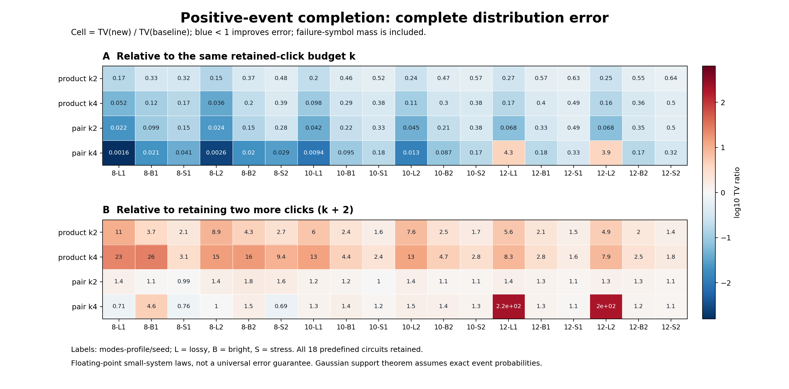

# 第六轮完整分布比较

Complete floating extended TV on these fixed small instances; Python full enumeration time is not sampling throughput or native cost. No novelty or universal accuracy claim.

所有TV均重读保存的P/Q数组计算，包含未解决分支的失败质量。数值相等采用绝对差1e-10，近零基线不计算比值。

| 新法 | 比较基线 | TV改善/恶化/数值相等 | TV比值中位数 | 最坏绝对恶化 | 最大失败质量 | Python枚举时间中位比 |
|---|---|---:|---:|---:|---:|---:|
| product_k2 | retained_k2 | 18/0/0 | 0.411378 | 0 | 0 | 1.348 |
| product_k2 | retained_k4 | 0/18/0 | 2.62945 | 0.0127797 | 0 | 0.9537 |
| product_k4 | retained_k4 | 18/0/0 | 0.247355 | 0 | 0 | 1.29 |
| product_k4 | retained_k6 | 0/18/0 | 6.31422 | 0.0038186 | 0 | 2.218 |
| pair_k2 | retained_k2 | 18/0/0 | 0.18367 | 0 | 0 | 1.34 |
| pair_k2 | retained_k4 | 1/17/0 | 1.25168 | 0.0032778 | 0 | 0.9457 |
| pair_k4 | retained_k4 | 16/2/0 | 0.0912119 | 0.000853534 | 0.00110648 | 1.279 |
| pair_k4 | retained_k6 | 3/15/0 | 1.25952 | 0.00110612 | 0.00110648 | 2.258 |

## 全部固定输入的完整TV

| 输入 | retained_k2 | retained_k4 | retained_k6 | product_k2 | product_k4 | pair_k2 | pair_k4 |
|---|---:|---:|---:|---:|---:|---:|---:|
| m8_lossy_s240611 | 0.00097699772 | 1.5244579e-05 | 3.3938012e-08 | 0.00016246757 | 7.8543505e-07 | 2.1563729e-05 | 2.4018118e-08 |
| m8_bright_s240611 | 0.01481053 | 0.0013427563 | 6.3152371e-06 | 0.0049180325 | 0.00016106922 | 0.0014653091 | 2.883443e-05 |
| m8_stress_s240611 | 0.025672861 | 0.0039111776 | 0.00021273307 | 0.0082153585 | 0.00065808113 | 0.0038837514 | 0.00016155037 |
| m8_lossy_s240612 | 0.0023173174 | 3.9105122e-05 | 9.7764785e-08 | 0.00034973747 | 1.4261232e-06 | 5.6458074e-05 | 1.0162396e-07 |
| m8_bright_s240612 | 0.024979712 | 0.0021210713 | 2.7845825e-05 | 0.0091673123 | 0.00043182183 | 0.0038155325 | 4.2436203e-05 |
| m8_stress_s240612 | 0.028905548 | 0.0051294168 | 0.00021450888 | 0.013994812 | 0.0020080794 | 0.0080759384 | 0.00014819171 |
| m10_lossy_s240611 | 0.0033661807 | 0.0001127772 | 8.4202197e-07 | 0.00067472668 | 1.1033574e-05 | 0.00014054545 | 1.0649981e-06 |
| m10_bright_s240611 | 0.033837062 | 0.0063363819 | 0.00041810713 | 0.015421753 | 0.001844667 | 0.0075556347 | 0.000602179 |
| m10_stress_s240611 | 0.038049437 | 0.01265732 | 0.0019661325 | 0.019760454 | 0.0047537706 | 0.012692304 | 0.0022711536 |
| m10_lossy_s240612 | 0.0027616815 | 8.858303e-05 | 7.7571711e-07 | 0.00067516261 | 1.0097708e-05 | 0.00012542522 | 1.1398224e-06 |
| m10_bright_s240612 | 0.030025416 | 0.0056251237 | 0.00036161295 | 0.014234723 | 0.0016977219 | 0.0064433134 | 0.00049157243 |
| m10_stress_s240612 | 0.032649948 | 0.01116679 | 0.0015350568 | 0.018550178 | 0.004231751 | 0.012451353 | 0.0019522434 |
| m12_lossy_s240611 | 0.0052670372 | 0.00025774115 | 5.1565864e-06 | 0.0014412727 | 4.2938214e-05 | 0.00035587572 | 0.0011112749 |
| m12_bright_s240611 | 0.042027979 | 0.011166957 | 0.0015888647 | 0.023946646 | 0.0044262176 | 0.014038358 | 0.0019928042 |
| m12_stress_s240611 | 0.038081896 | 0.016232775 | 0.0049846354 | 0.023952954 | 0.0080151746 | 0.01847421 | 0.0053895643 |
| m12_lossy_s240612 | 0.005390594 | 0.0002758194 | 5.5298588e-06 | 0.0013455386 | 4.3871601e-05 | 0.00036855492 | 0.0010891319 |
| m12_bright_s240612 | 0.043496724 | 0.011958379 | 0.001704564 | 0.023751196 | 0.0043379935 | 0.015236178 | 0.0019889159 |
| m12_stress_s240612 | 0.039007107 | 0.017515077 | 0.004896192 | 0.025086653 | 0.0087147967 | 0.019509681 | 0.0056169062 |

Python时间包含完整指数规模Q枚举、选择器和当前直接事件求值，单次描述性记录；未与C++、Frugal或九章时间对赛。失败没有补抽，成功子律没有重归一化。

