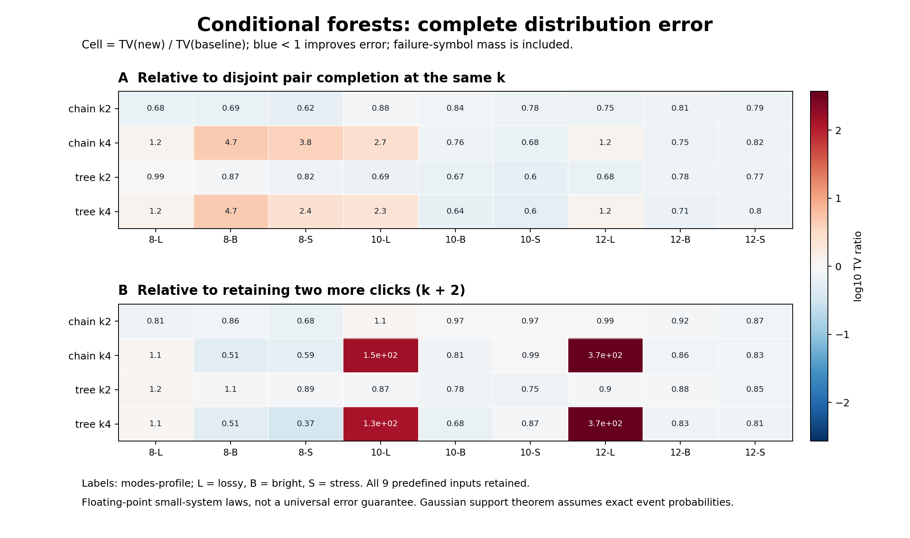

# 第七轮完整分布比较

Complete floating extended TV on these fixed small instances; Python full enumeration time is not sampling throughput or native cost. No novelty or universal accuracy claim.

所有TV均重读保存的P/Q数组计算，包含未解决分支的失败质量。数值相等采用绝对差1e-10，近零基线不计算比值。

| 新法 | 比较基线 | TV改善/恶化/数值相等 | TV比值中位数 | 最坏绝对恶化 | 最大失败质量 | Python准备+枚举时间中位比 |
|---|---|---:|---:|---:|---:|---:|
| chain_k2 | pair_k2 | 9/0/0 | 0.775061 | 0 | 0 | 1.211 |
| chain_k2 | retained_k4 | 8/1/0 | 0.918156 | 7.90717e-06 | 0 | 1.183 |
| chain_k4 | pair_k4 | 4/5/0 | 1.21421 | 0.000305695 | 0.00173276 | 1.017 |
| chain_k4 | retained_k6 | 6/3/0 | 0.864679 | 0.00172808 | 0.00173276 | 2.45 |
| tree_k2 | pair_k2 | 9/0/0 | 0.773033 | 0 | 0 | 1.206 |
| tree_k2 | retained_k4 | 7/2/0 | 0.880217 | 0.000235461 | 0 | 1.119 |
| tree_k4 | pair_k4 | 4/5/0 | 1.21421 | 0.000305695 | 0.00173276 | 1.095 |
| tree_k4 | retained_k6 | 6/3/0 | 0.826631 | 0.00172808 | 0.00173276 | 2.315 |

## 全部固定输入的完整TV

| 输入 | retained_k4 | retained_k6 | pair_k2 | pair_k4 | chain_k2 | chain_k4 | tree_k2 | tree_k4 |
|---|---:|---:|---:|---:|---:|---:|---:|---:|
| m8_lossy_s340701 | 2.9546396e-05 | 5.6381956e-08 | 3.5044353e-05 | 5.2218979e-08 | 2.3920979e-05 | 6.3536973e-08 | 3.4555228e-05 | 6.3536973e-08 |
| m8_bright_s340701 | 0.0024762847 | 4.4867844e-05 | 0.003113282 | 4.8595759e-06 | 0.0021336232 | 2.3071214e-05 | 0.0027117455 | 2.3071214e-05 |
| m8_stress_s340701 | 0.0065738983 | 0.00029842524 | 0.0072115179 | 4.5592105e-05 | 0.0044819405 | 0.00017475632 | 0.0058826648 | 0.0001107391 |
| m10_lossy_s340701 | 7.2338958e-05 | 6.5028978e-07 | 9.1356547e-05 | 3.6933757e-05 | 8.0246131e-05 | 9.8041282e-05 | 6.3213834e-05 | 8.3264142e-05 |
| m10_bright_s340701 | 0.0048583517 | 0.00029235756 | 0.0056332523 | 0.00031153727 | 0.0047212881 | 0.00023621658 | 0.0037846807 | 0.0001989076 |
| m10_stress_s340701 | 0.0097826231 | 0.0010336145 | 0.012265084 | 0.0015118605 | 0.0095061865 | 0.0010266191 | 0.007382206 | 0.00090218722 |
| m12_lossy_s340701 | 0.00023800486 | 4.6843951e-06 | 0.00031394752 | 0.0014270653 | 0.00023616485 | 0.0017327605 | 0.00021463612 | 0.0017327605 |
| m12_bright_s340701 | 0.011620013 | 0.0015580194 | 0.013139032 | 0.0018045218 | 0.010668979 | 0.001347186 | 0.010228136 | 0.0012879068 |
| m12_stress_s340701 | 0.018437635 | 0.0050816748 | 0.020224184 | 0.0051632859 | 0.015962106 | 0.0042407309 | 0.015633959 | 0.0041210897 |

Python时间包含准备、静态MI预计算（如适用）、完整指数规模Q枚举、选择器、建树和当前直接事件求值，单次描述性记录；未与C++、Frugal或九章时间对赛。失败没有补抽，成功子律没有重归一化。

